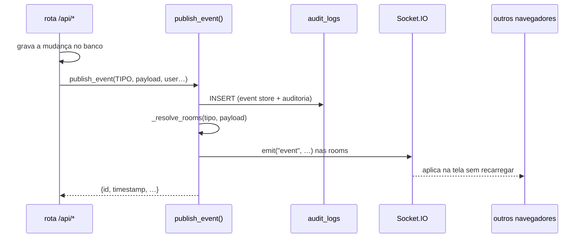
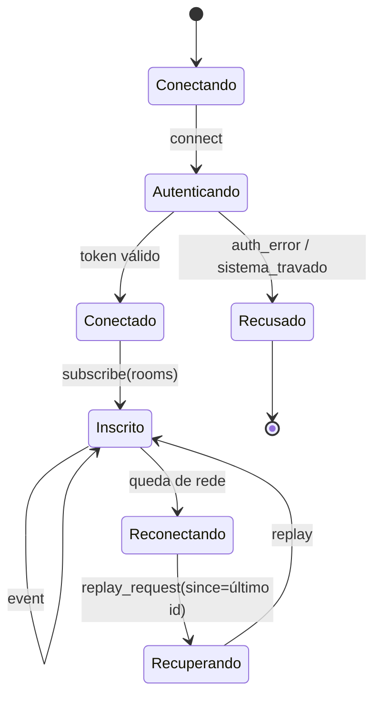

# Tempo real e trilha de eventos

Como uma mudança feita por uma pessoa aparece na tela das outras, e por que o
mesmo mecanismo serve de trilha de auditoria.

Código: [`event_bus.py`](../../event_bus.py),
[`static/socket-client.js`](../../static/socket-client.js),
[`static/app-realtime.js`](../../static/app-realtime.js).
Decisão: [ADR-0003](decisoes/ADR-0003-event-bus-e-audit-log.md).

---

## A regra

**Nenhuma rota chama `socketio.emit()` direto.** Toda mutação passa por
`publish_event()`, que faz três coisas numa chamada:

1. persiste o evento em `audit_logs` (que é o *event store*);
2. emite via Socket.IO para as rooms que interessam;
3. devolve o evento com id e timestamp.

Quebrar essa regra produz um efeito que só aparece depois: a tela atualiza mas
o evento não existe na trilha, então o replay de quem estava offline pula
aquela mudança e a auditoria não a registra.

---

## Rooms: quem recebe o quê

`_resolve_rooms()` decide o destino a partir do prefixo do tipo de evento e do
conteúdo do payload. Não há broadcast geral.

| Room | Quem entra | Recebe |
|---|---|---|
| `role:admin` | todo admin conectado | **tudo** |
| `role:gestor` | gestores | documentos, etapas, responsáveis, projetos, missões, fluxos, PDR |
| `role:tecnico` | técnicos | projetos/entregáveis, missões, fluxos, PDR |
| `setor:<X>` | quem abriu o setor | eventos de documento daquele setor |
| `equipamento:<Y>` | quem abriu o equipamento | eventos daquele equipamento |
| `doc:<N>` | quem está com a ficha aberta | eventos daquele documento |
| `projeto:<N>` | quem abriu o projeto | eventos daquele projeto |
| `apres:<N>` | quem abriu a apresentação PDR | eventos daquela apresentação |
| `user:<N>` | a própria pessoa | os apontamentos de tempo dela, notificações dirigidas |

Duas assimetrias que são de propósito, não esquecimento:

**Tempos não emite para gestor.** Um feed ao vivo de quem começou o quê seria um
canal de vigilância que ninguém pediu. Supervisão se faz pelas rotas de resumo,
sob demanda. (O admin recebe de qualquer forma, porque `role:admin` é semeado em
toda chamada.)

**Missões não tem sala por missão.** O backend emite para os papéis com acesso e
o front filtra pelo `missao_id` do payload. Simplificação assumida no MVP do
módulo.

**O aviso pessoal ("é sua vez") não passa pelo barramento.** Os fluxos de
revisão avisam quem passa a ter a etapa gravando na tabela `notificacoes`, e o
sino consulta `/api/notificacoes/contagem`. Quem estava fora precisa achar o aviso
esperando ao entrar, com o estado de lido e não lido, e isso o barramento não
guarda: o replay só cobre a janela de reconexão e não sabe o que já foi visto.
Gravado em `audit_logs`, cada aviso ainda viraria uma linha de auditoria por
pessoa e por passagem. Os eventos `FLUXO_*`, que só dizem que o item andou,
seguem pelo barramento normalmente.

---

## O ciclo do cliente

Eventos que o cliente envia:

| Evento | Efeito |
|---|---|
| `subscribe` | entra nas rooms pedidas (só prefixos `setor:`, `equipamento:`, `doc:`) |
| `unsubscribe` | sai das rooms |
| `replay_request` | pede o que perdeu desde um id, com as salas finas que tinha (`{since, rooms}`); até 500 eventos |
| `ping_app` | diagnóstico de conexão |
| `join_apresentacao` | entra na sala de uma apresentação PDR |

Eventos que o servidor envia: `connected`, `subscribed`, `event`, `replay`,
`pong_app`, `auth_error`, `sistema_travado`.

### O replay entrega só o que chegaria ao vivo

`audit_logs` guarda mais do que o barramento entrega a cada um: as linhas de
`log_action` (login, exclusão, acesso negado) e os eventos de sala restrita —
`TEMPO_*` vai só para o dono. O replay aplica o mesmo critério do envio ao vivo
(`event_bus.eventos_para_salas`): um evento volta para a conexão só se
`_resolve_rooms` incluir uma das salas dela.

- `role:<perfil>` e `user:<id>` saem do banco, relidos a cada pedido; o que o
  cliente diz não conta para essas duas.
- As salas finas (`setor:`, `equipamento:`, `doc:`) vêm no próprio pedido,
  porque na reconexão o cliente pede o replay **antes** do `subscribe` que as
  restaura. São as mesmas que o `subscribe` aceitaria, então não abrem nada novo.
  As salas em que a conexão já está (inclusive `apres:`) também contam.
- O admin recebe tudo, como ao vivo.

A resposta traz `ate`, o id da última linha examinada: o cliente avança o
cursor até ali mesmo quando nada foi entregue, senão varreria as mesmas linhas
filtradas a cada reconexão. Quando o limite de 500 corta a resposta, `ate` é a
última entregue e o resto vem no pedido seguinte. `GET /api/events/replay` é o
mesmo replay por HTTP, com `?rooms=` repetível.

Até a versão anterior o replay devolvia a tabela inteira para qualquer conexão
autenticada: qualquer técnico que reconectasse recebia os apontamentos de horas
dos colegas e quem fez login quando.

> **O handshake do Socket.IO não passa pelo `before_request` do Flask**, então o
> guardião do kill switch é checado explicitamente em `on_connect`. Sem essa
> checagem, o tempo real continuaria entregando eventos com o sistema travado —
> ver [ADR-0006](decisoes/ADR-0006-kill-switch-fora-do-banco.md).

---

### Quais telas têm socket

| Tela | Socket | Reage a |
|---|---|---|
| Documentos | `DocTrackSocket` em `app-realtime.js`, assinando `setor:PRE/Manuais/PDE` | `DOCUMENT_*` e responsáveis: aplica no cache e redesenha em lote; ficha aberta ganha aviso em vez de ser redesenhada |
| Equipamentos | `DocTrackSocket` em `equipamentos.js` | os eventos de equipamento da própria tela |
| Projetos | `io()` próprio em `entregaveis.js` | projetos, entregáveis, PMO e `FLUXO_*` (selo da linha e modal) |
| Missões | `io()` próprio em `missoes.js` | `MISSAO_*` |
| Fluxos (`/fluxos/`) | `DocTrackSocket` em `fluxos.js` | `FLUXO_*`: a lista "Em andamento" |
| Hub, Tempos, Custos, Cadernos | nenhum | — |

**O repasse `dt:evento`.** O painel do fluxo (`fluxos-painel.js`) e o sino
(`notificacoes-widget.js`) aparecem em várias telas e não conhecem o socket de
nenhuma. `socket-client.js` repassa cada evento recebido como um `CustomEvent`
`dt:evento` na `window`. Projetos e Missões, que usam `io()` direto, repassam os
`FLUXO_*` à mão.
- **Painel do fluxo:** recarrega quando o evento é do item que ele mostra. Se a
  pessoa estiver escrevendo nele, mostra "O fluxo mudou — Atualizar" em vez de
  apagar o texto.
- **Sino:** reconta na hora. O aviso em si continua vindo da API.
- **Tela sem socket:** o sino segue com a consulta de 30 s.

> Até 2026-10 a tela de Documentos não tinha tempo real: o `app-realtime.js` era
> um modelo de integração nunca ligado, que lia o token de uma chave antiga
> (`jwt`) e cuja `initRealtime()` ninguém chamava.
> `tests/test_tempo_real_front.py` trava os pontos que quebraram assim, em
> silêncio.

## Tipos de evento

A lista canônica é a classe `EventType` em [`event_bus.py`](../../event_bus.py) —
use sempre as constantes, nunca a string. Um tipo fora da lista é aceito mas
registra `WARNING` no log, o que é o sintoma de um `publish_event` escrito à mão.

Famílias, pelo prefixo:

| Prefixo | Domínio |
|---|---|
| `DOCUMENT_`, `ETAPA_`, `RESPONSAVEL_` | Documentos |
| `PROJETO_`, `ENTREGAVEL_`, `MENSAL_`, `BASELINE_` | Projetos e entregáveis |
| `MISSAO_` | Missões |
| `PRODUTO_`, `APRESENTACAO_`, `REIMPORT` | PDR |
| `CUSTO_` | Custos |
| `TEMPO_` | Tempos |
| `FLUXO_` | Fluxos de revisão (`INICIADO`, `MOVIDO`, `CONCLUIDO`, `CANCELADO`) |
| `NOTIFICATION`, `USER_` | Sistema |

**Tempos publica só as mutações de folha** — iniciar, pausar, retomar e parar o
cronômetro não passam pelo barramento. Se passassem, cada ciclo viraria duas
linhas em `audit_logs` e o event store encheria de ruído de interface.

---

## Por que a trilha e o event store são a mesma tabela

`audit_logs` responde às duas perguntas com o mesmo dado: "quem mudou o quê e
quando" (auditoria) e "o que aconteceu depois do id N" (replay). Duas tabelas
significariam duas escritas por mutação e a possibilidade permanente de
divergirem — e é justamente a divergência que destruiria o valor das duas.

O custo é que a tabela cresce com o uso e mistura granularidades. Existe
`DOCTRACK_AUDIT_RETENCAO_DIAS` para poda, desligado por padrão (`0`).
Ligar isso tem uma consequência que precisa ser decidida com consciência:
**podar a trilha encurta a janela de replay junto**, e num sistema sob validação
apagar trilha de auditoria é uma decisão regulatória, não de manutenção.

---

## Como acrescentar um evento novo

1. Adicione a constante em `EventType` (`event_bus.py`).
2. Se ele precisa de room própria, trate o prefixo em `_resolve_rooms()`.
3. Chame `publish_event()` na rota que faz a mutação, **depois** do commit.
4. Trate o tipo no front, em `static/app-realtime.js`.
5. Rode `python scripts/gerar_docs.py` se mexeu em rota ou modelo.
