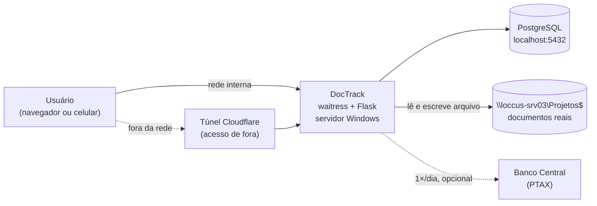
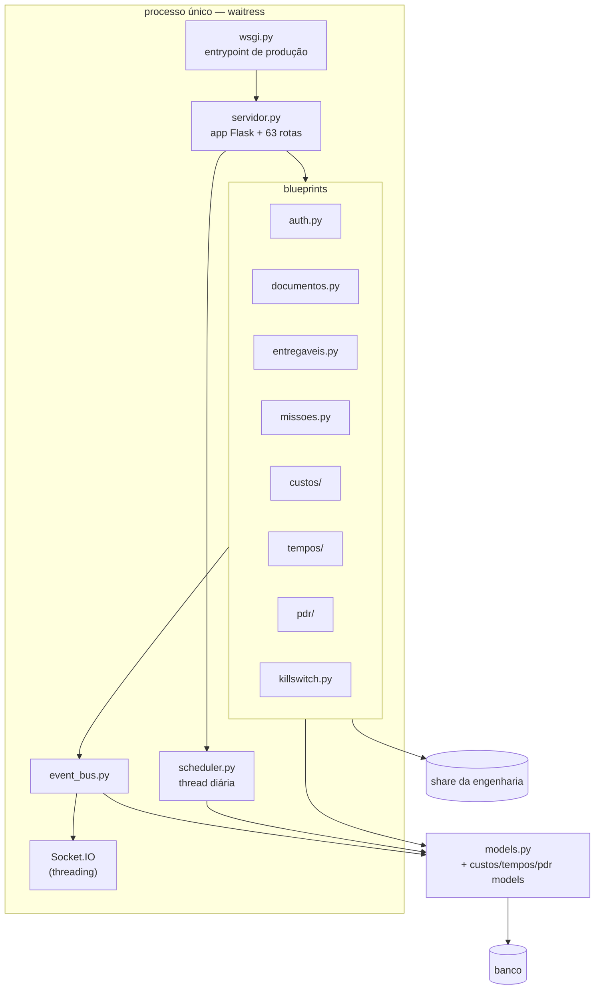
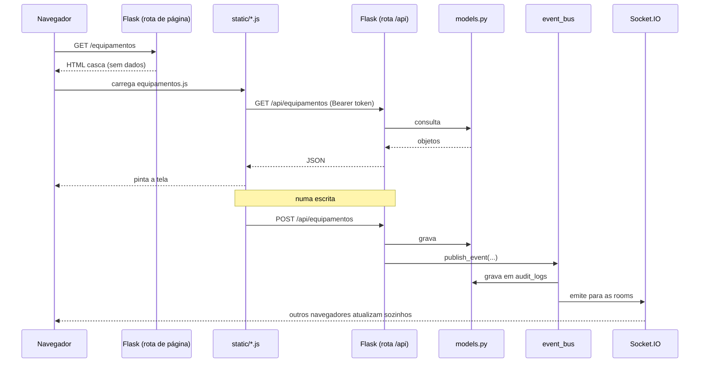

# DocTrack — visão geral da arquitetura

Este documento é a porta de entrada técnica. Ele responde *o que o sistema é
hoje*; o *porquê* de cada escolha estrutural está em
[`decisoes/`](decisoes/), e os números exatos (rotas, tabelas, colunas) estão
em [`../referencia/`](../referencia/), que é gerada do código.

---

## 1. O que é

Sistema web interno da Loccus para a gestão do P&D: documentos técnicos de
equipamentos, o cadastro dos próprios equipamentos, consumíveis, projetos e
seus entregáveis, um kanban de missões, formação de custo e apontamento de
horas. Usuários são funcionários da Loccus, dentro da rede, e o número deles é
da ordem de dezenas — não de milhares. Praticamente toda decisão de arquitetura
deste sistema decorre desse porte.

O sistema **fica dentro da rede** e isso não é conservadorismo: o banco guarda o
*caminho* dos documentos, não os arquivos. Uma cópia hospedada fora não abriria
documento nenhum. Ver
[ADR-0001](decisoes/ADR-0001-caminho-no-banco.md) — é a decisão da qual
dependem deploy, backup e acesso remoto.

---

## 2. Anatomia do processo

**Um processo, um banco, um servidor.** Não há fila, cache externo, worker ou
segunda instância. `waitress` serve o app com um pool de threads, e é essa
premissa que autoriza várias simplificações espalhadas pelo código — o estado
em memória de `ratelimit.py`, a thread do agendador, o cache do kill switch.
Se um dia houver duas instâncias, esses três pontos quebram juntos; estão
marcados nos ADRs [0005](decisoes/ADR-0005-ratelimit-em-memoria.md) e
[0008](decisoes/ADR-0008-agendador-embutido.md).

### Ordem de subida

`wsgi:app` — **nunca** `servidor:app`. Importar `servidor` não prepara nada de
propósito; quem sobe o servidor chama `servidor.init_app()`, que cria o schema,
roda os backfills, semeia e grava a foto do dia. Apontar o servidor WSGI direto
para `servidor:app` sobe um app com banco não preparado.
Ver [ADR-0002](decisoes/ADR-0002-schema-no-startup.md).

---

## 3. As camadas de uma requisição

O front **não é uma SPA com framework**. Cada página é um template Jinja que
devolve a casca, e um arquivo JS que a preenche chamando `/api/*` com o token no
cabeçalho.

Consequência que confunde quem lê a referência de rotas: as rotas de página
aparecem **sem exigência de papel**. Elas realmente respondem sem token — e
devolvem HTML vazio. Todo dado passa por `/api/*`, que é gatilhado.
Ver [ADR-0004](decisoes/ADR-0004-pagina-casca-api-gatilhada.md).

### Arquivos do front

| Arquivo | Papel |
|---|---|
| `static/auth.js` | login, token, refresh |
| `static/common.js` | utilidades compartilhadas por todas as telas |
| `static/socket-client.js` + `app-realtime.js` | conexão e aplicação dos eventos |
| `static/<modulo>.js` | uma tela por arquivo (`app.js` é o de Documentos) |
| `static/tempos-widget.js` | cronômetro global, presente em todos os módulos |
| `static/pwa.js` + `sw.js` + `manifest.webmanifest` | instalação no celular |
| `static/nav-mobile.js` + `mobile.css` | gaveta de navegação em telas estreitas |

---

## 4. Tempo real

Toda mutação relevante passa por `publish_event()`, que faz três coisas: grava
em `audit_logs`, emite via Socket.IO para as rooms certas, e devolve o id do
evento para replay. Nenhuma rota deve chamar `socketio.emit()` direto.

O detalhe que faz isso valer a pena é que `audit_logs` é ao mesmo tempo a
trilha de auditoria e o *event store*: o cliente que ficou offline pede
`replay_request` com o último id que viu e recebe o que perdeu — só o que teria
recebido ao vivo, pelas mesmas salas —, sem estado de sessão no servidor.

Detalhes em [EVENTOS.md](EVENTOS.md) e
[ADR-0003](decisoes/ADR-0003-event-bus-e-audit-log.md).

---

## 5. Dados

43 tabelas em 9 domínios — o dicionário completo, com os comentários de domínio
de cada coluna e os diagramas ER, está em
[`../referencia/dados.md`](../referencia/dados.md).

Três coisas que o dicionário não diz sozinho:

**As tabelas `*_snapshot` são séries temporais, não cache.** `equipamento_snapshot`,
`missao_snapshot` e `projeto_snapshot` guardam uma foto por dia dos indicadores.
Sem elas os índices só existiriam "hoje" e não haveria gráfico de evolução —
por isso existe o agendador ([ADR-0008](decisoes/ADR-0008-agendador-embutido.md)).

**As tabelas `*_historico` são a trilha de mudança de cada entidade**, separada
de `audit_logs` porque respondem perguntas diferentes: `audit_logs` é "o que
aconteceu no sistema", `documento_historico` é "o que aconteceu com *este*
documento".

**Custos usa `Numeric`, o resto usa `Float`.** Divergência deliberada: lá a
aritmética é encadeada (câmbio × alíquota × rateio × margem) e o erro de ponto
flutuante se acumula até produzir um número indefensável numa reunião. Ver o
docstring de [`custos/models.py`](../../custos/models.py).

---

## 6. Segurança

| Camada | Onde | O que faz |
|---|---|---|
| Autenticação | `auth.py` | JWT (access + refresh), bcrypt 12 rounds |
| Revogação | `models.RevokedToken` | logout invalida o JTI |
| Papéis | `auth.require_role` | `admin` · `gestor` · `tecnico` · `leitura` |
| Áreas | `auth.require_area`, `areas.py` | recorte por área de P&D, ortogonal ao papel |
| Força bruta | `ratelimit.py` | só tentativa falha conta, por (rota, identidade, IP) |
| Trava de emergência | `killswitch.py` | gatilho externo derruba tudo com `423` |
| Cabeçalhos | `servidor.add_security_headers` | CSP sem CDN, `X-Frame-Options: SAMEORIGIN` |
| Caminhos | `caminhos.py` | allowlist de raízes; sem ela, path traversal no share |
| Uploads | `arquivos_store.py` | nome em disco é o SHA-256 do conteúdo |

A matriz completa papel × rota e a lista das rotas abertas sem token estão em
[`../referencia/permissoes.md`](../referencia/permissoes.md). A superfície
pública tem seis rotas e há um teste que quebra se aparecer uma sétima
(`tests/test_docs_sincronia.py`).

---

## 7. Ambientes

| | Produção | Homologação |
|---|---|---|
| Onde | servidor Windows, `C:\apps\doctrack` | máquina do desenvolvedor |
| Banco | PostgreSQL via `DATABASE_URL` | SQLite `doctrack.db` (sem `DATABASE_URL`) |
| Servidor | waitress sob NSSM | `python servidor.py` |
| Arquivos | share da engenharia | o mesmo share, ou nada |

> O app aplica schema no startup. Homologação **nunca** pode ter `DATABASE_URL`
> apontando para produção — a alteração entraria para os usuários ao subir.
> Ver [ADR-0002](decisoes/ADR-0002-schema-no-startup.md) e
> [FLUXO_DESENVOLVIMENTO.md](../FLUXO_DESENVOLVIMENTO.md).

Publicação para fora da rede é por túnel Cloudflare, com o servidor onde está —
ver [ACESSO_REMOTO.md](../ACESSO_REMOTO.md).

---

## 8. Mapa do repositório

Onde procurar, quando a pergunta é:

| Pergunta | Arquivo |
|---|---|
| Como o app sobe? | [`wsgi.py`](../../wsgi.py), `servidor.init_app` |
| Onde está a rota X? | [`../referencia/api.md`](../referencia/api.md) |
| O que é a coluna Y? | [`../referencia/dados.md`](../referencia/dados.md) |
| Quem pode fazer Z? | [`../referencia/permissoes.md`](../referencia/permissoes.md) |
| Que variável liga W? | [`../referencia/config.md`](../referencia/config.md) e `.env.example` |
| Como o tempo real funciona? | [EVENTOS.md](EVENTOS.md), [`event_bus.py`](../../event_bus.py) |
| Por que isto é assim? | [`decisoes/`](decisoes/) |
| Como o módulo M funciona? | [`../funcional/`](../funcional/) |
| Deu problema em produção | [`../operacao/RUNBOOK.md`](../operacao/RUNBOOK.md) |

---

## 9. Limites conhecidos

Registrados aqui porque são estruturais, não bugs a corrigir numa tarde:

1. **Instância única.** Rate limit, agendador e cache do kill switch guardam
   estado em memória de processo. Uma segunda instância quebra os três.
2. **Os dumps do banco ficam no mesmo disco do banco.** Uma falha de disco leva
   os dois. Ver [`../operacao/RUNBOOK.md`](../operacao/RUNBOOK.md).
3. **Restaurar o banco não traz os documentos de volta** — eles vivem no share
   e dependem do backup daquele servidor ([ADR-0001](decisoes/ADR-0001-caminho-no-banco.md)).
4. **Dois mecanismos de migração convivem** (`_sync_schema()` idempotente no
   startup e os scripts numerados de `migrations/`), e manter os dois em dia é
   trabalho manual ([ADR-0002](decisoes/ADR-0002-schema-no-startup.md)).
5. **`servidor.py` e `models.py` são grandes** (3.2k e 2.5k linhas). Os módulos
   novos nascem em pacote próprio (`custos/`, `tempos/`); os antigos não foram
   quebrados.
