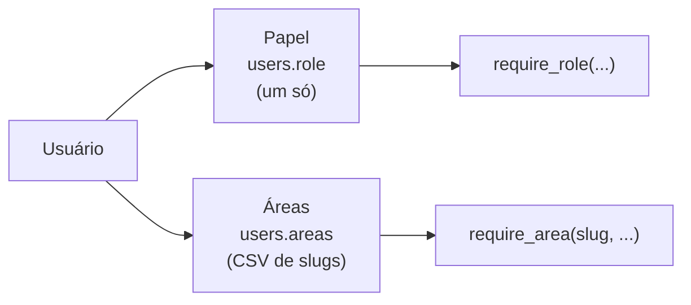
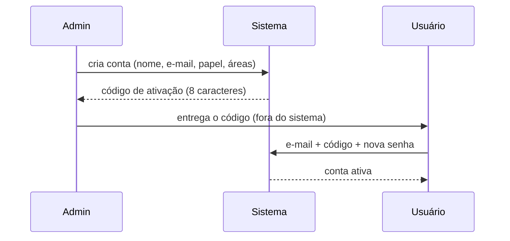

# Acesso, usuários e permissões

Código: [`auth.py`](../../auth.py) · [`areas.py`](../../areas.py) ·
[`ratelimit.py`](../../ratelimit.py) · modelos `User`, `RevokedToken`, `AuditLog`

Matriz completa e gerada do código:
[`../referencia/permissoes.md`](../referencia/permissoes.md).

## Dois eixos independentes

Confundi-los é a fonte de quase todo mal-entendido sobre permissão neste
sistema. **Papel** diz *o que* a pessoa pode fazer. **Área** diz *sobre o quê*.

### Papel — um por usuário

| Papel | Alcance |
|---|---|
| `admin` | tudo, incluindo gestão de usuários e exclusões definitivas |
| `gestor` | escrita em todos os módulos; sem gestão de usuários |
| `tecnico` | escrita no dia a dia; sem exclusão, sem custos |
| `leitura` | consulta apenas; fora de Missões e Tempos |

### Área — zero ou mais por usuário

Slugs vêm de [`areas.py`](../../areas.py), que é a **fonte única**: o hub, os
sub-hubs, os checkboxes no cadastro de usuário e os selos saem todos de lá.
Hoje são três: `pde` (P&D Equipamentos), `pdr` (P&D Reagentes) e `inov`
(Inovação). Projetos é um módulo só para as três — a área ali é filtro de
visão, não trava de acesso (ver [`projetos-entregaveis.md`](projetos-entregaveis.md)).

**Admin ignora a checagem de área** — sempre alcança todas.

Acrescentar uma área da empresa é acrescentar uma entrada em `AREAS`, com seus
módulos, e não mexer em rota nenhuma.

## Como as duas se combinam nas rotas

| Decorator | Exige |
|---|---|
| *(nenhum)* | nada — rota pública, ou casca de página ([ADR-0004](../arquitetura/decisoes/ADR-0004-pagina-casca-api-gatilhada.md)) |
| `@jwt_required()` | qualquer usuário logado |
| `@require_role("admin", "gestor")` | um dos papéis listados |
| `@require_area("pdr")` | a área no cadastro |
| `@require_area("pdr", "admin", "gestor")` | a área **e** um dos papéis |

`so_gestao` (Custos) e `so_membros` (Tempos) são apelidos locais de
`require_role` — o gerador de documentação os resolve lendo o fonte.

## Entrada: o modelo de convite

Não há auto-cadastro. O admin cria a conta e o sistema gera um **código de
ativação** de 8 caracteres, com validade. O usuário troca o código pela própria
senha em `/api/auth/primeiro-acesso`.

**O admin nunca define a senha de ninguém.** `POST /api/users` e
`PATCH /api/users/<id>` recusam o campo `senha` com 400 — a edição inteira é
recusada, sem aplicar os outros campos. Se o admin pudesse escolher a senha,
passaria a conhecê-la, e as ações daquela conta deixariam de ser atribuíveis só
ao dono dela (Análise de Riscos, R-05). A senha só nasce no primeiro acesso,
digitada pelo próprio usuário.

Enquanto a conta está pendente, `senha_hash` guarda um hash **inutilizável**:
mantém a coluna `NOT NULL` sem permitir login por senha. Definir a senha conclui
a pendência.

O mesmo caminho serve ao **reset**: `POST /api/users/<id>/reset-senha` (admin)
devolve a conta ao estado de primeiro acesso e gera código novo.

> **O código de ativação é o alvo mais atraente do sistema** — oito caracteres
> que valem uma conta inteira. É por isso que ele tem limite de tentativa
> próprio, mais apertado que o do login.

## Sessão

- **JWT** com access token e refresh token; o papel vai nas claims.
- **Logout revoga o JTI** (`revoked_tokens`), então o token não vale mais até
  expirar sozinho.
- **Destravar o kill switch invalida de uma vez todo token emitido antes** da
  trava, sem precisar listar JTI por JTI
  ([ADR-0006](../arquitetura/decisoes/ADR-0006-kill-switch-fora-do-banco.md)).
- **bcrypt em 12 rounds** em produção (4 nos testes, onde o custo do hash não
  protege nada).
- **Senha mínima**: `DOCTRACK_SENHA_MIN`, padrão 8.

## Limite de tentativas

Só **tentativa falha** conta — contar acerto puniria o uso normal. A contagem é
por `(rota, identidade, IP)`, para que um usuário não tranque o login de um
colega do mesmo escritório.

| Rota | Padrão |
|---|---|
| login | 5 tentativas / 5 min |
| primeiro acesso | 5 tentativas / 15 min |
| kill switch | 3 tentativas / 15 min |

Detalhes e a armadilha do proxy em
[ADR-0005](../arquitetura/decisoes/ADR-0005-ratelimit-em-memoria.md).

## Auditoria

Toda ação relevante vai para `audit_logs` — com usuário, IP, entidade, campo,
valor antigo e valor novo. A mesma tabela é o event store do tempo real
([ADR-0003](../arquitetura/decisoes/ADR-0003-event-bus-e-audit-log.md)).

Há um relatório de auditoria na interface
(`templates/audit_log_report.html`). As ações do kill switch aparecem sob o
usuário `kill-switch`.

### Tentativas de acesso recusadas

A validação de sistema computadorizado exige registrar as tentativas de acesso
de quem não está autorizado. O contador do limite de tentativas vê todas, mas
mora em memória e zera no reinício; por isso cada recusa também vira linha em
`audit_logs`:

| Ação | Quando | `valor_novo` (campo `motivo`) |
|---|---|---|
| `LOGIN_FALHA` | login recusado | `senha incorreta` · `e-mail sem conta ativa` |
| `ATIVACAO_FALHA` | primeiro acesso recusado | `código incorreto` · `código expirado` · `sem primeiro acesso pendente` |
| `LOGIN_BLOQUEADO` · `ATIVACAO_BLOQUEADA` | tentativa barrada pelo limite (429) | `limite por e-mail` · `limite por IP` |
| `KILL_SWITCH_LOCK_FALHA` · `KILL_SWITCH_UNLOCK_FALHA` | token do gatilho ou senha de desbloqueio errados | `token inválido` · `senha de desbloqueio incorreta` |
| `KILL_SWITCH_BLOQUEADO` | tentativa no kill switch barrada pelo limite | `limite do lock` · `limite do unlock` · `limite por IP` |

- **Usuário** é o e-mail digitado, exista a conta ou não; quando existe, a
  linha fica ligada a ela (`usuario_id`). O **IP** vem da mesma função que o
  limite de tentativas usa, então os dois sempre contam o mesmo endereço.
- **O segredo digitado nunca é gravado** — nem senha, nem código, nem token.
- **A resposta ao cliente não mudou.** O motivo existe só na auditoria; quem
  tenta continua sem saber se o e-mail tem conta.
- **Uma linha por bloqueio, não por requisição.** Enquanto o bloqueio dura,
  cada nova tentativa leva 429 sem o segredo ser conferido; gravar todas faria
  do limite o jeito mais barato de inundar a auditoria. Fica uma linha por
  contador (o da identidade ou o teto por IP) a cada janela do limite.
- **O volume tem teto.** Só entra o que o limite de tentativas conta, então um
  atacante não gera mais linhas do que o limite lhe deixa tentar. Por isso, no
  primeiro acesso, e-mail sem pendência e código vencido passaram a contar no
  limite — antes só o código errado contava, e uma varredura de e-mails nessa
  rota não custava nada nem deixava rastro.
- **Fica de fora, de propósito:** o 401 de token vencido (acontece a cada
  expiração e o front renova sozinho); e o login de conta com primeiro acesso
  pendente, em que nenhuma senha é conferida — a tentativa que importa nesse
  caso é a do código, que é gravada.
- **O IP aparece na tela de auditoria e no relatório exportado** (lista, CSV e
  PDF), e entra na busca das duas.
- **O e-mail digitado é texto de quem não tem conta**, gravado como veio. Tela e
  relatório escapam tudo o que exibem, e o export não deixa esse texto fechar o
  `<script>` em que o relatório carrega os dados.

### Acesso negado por perfil ou área (`ACESSO_NEGADO`)

Quem já está autenticado e tenta o que o perfil ou a área não alcança recebe
403 — e a tentativa vai para a trilha (Análise de Riscos, R-06):

| Campo | Conteúdo |
|---|---|
| `usuario_email` | quem tentou (do token) |
| `entidade` | método + rota, pela regra do Flask: `PATCH /api/users/<int:user_id>` |
| `campo` / `valor_novo` | `motivo` / por que foi recusado: `perfil leitura (exige admin, gestor)`, `sem a área pdr`, `papel leitor no caderno X (exige editor)`, `apontamento #12 de outro usuário` |
| `ip` | o mesmo IP do limite de tentativas |

Gravam: `require_role` e `require_area` (e por eles `so_membros`, `so_gestao`
e `require_pdr_access`), o cadastro de outro usuário em `GET /api/users/<id>`,
os gates de Cadernos (papel no caderno, área, criar e importar) e o gate de
dono de Tempos.

- **Uma linha por (usuário, rota) a cada 10 minutos**
  (`auth.JANELA_ACESSO_NEGADO`). O próprio front provoca esse 403 no uso
  normal — a seção que o perfil leitura não pode ver some da tela ao receber
  403 —, e não há limite de tentativas que segure esse volume. A rota é a
  regra, não o caminho com o id: a recusa por perfil vale para qualquer id, e
  uma varredura de ids não multiplica linhas. Perde-se a contagem dentro da
  janela; fica quem tentou o quê, de onde e quando. A fonte mais comum desse
  403 — o cronômetro global de Tempos, que o perfil leitura não tem — nem faz a
  chamada para esse perfil (`static/tempos-widget.js`).
- **A resposta ao cliente não mudou.** O motivo existe só na trilha.
- **Caderno sem acesso continua respondendo 404**, para não revelar que existe;
  a trilha registra a tentativa (`sem acesso ao caderno …`). Caderno que não
  existe não grava nada.
- **Fora:** os 403 de regra de dono em Projetos (técnico em entregável que não
  é dele) e em Missões (arquivar ou excluir missão alheia).

## Quem pode o quê, em usuários

| Ação | Papel |
|---|---|
| Ver a lista de usuários | admin e gestor |
| Ver o próprio cadastro | qualquer um |
| Ver o cadastro de outro | admin e gestor |
| Criar, editar, excluir, resetar senha | **admin** |

Excluir usuário é **soft delete** (`ativo=False`) por padrão.

## Pontos de atenção

- **`pode_pdr` é legado.** Foi substituído por `areas` e existe só para o
  backfill da migração. Não use em código novo.
- **Papel é global, não por área.** Um `gestor` é gestor em toda área a que
  tenha acesso — não existe "gestor só do PDR".
- **Cadernos têm, além disso, papel por caderno** (`leitor`, `editor`, `dono` —
  `cadernos/core.papel_efetivo`), e o perfil `leitura` nunca passa de leitor.
  **Exportar um caderno exige editor** (prévia, gerar e baixar o zip): exportar
  é saída de dados, e o perfil leitura só consulta (Análise de Riscos, R-50). O
  histórico do que já foi exportado continua visível a quem lê o caderno.
- **Uma rota `/api/*` sem decorator é dado aberto.** Não há gate de página para
  servir de rede de segurança; `tests/test_docs_sincronia.py` trava a lista de
  rotas públicas em seis.
