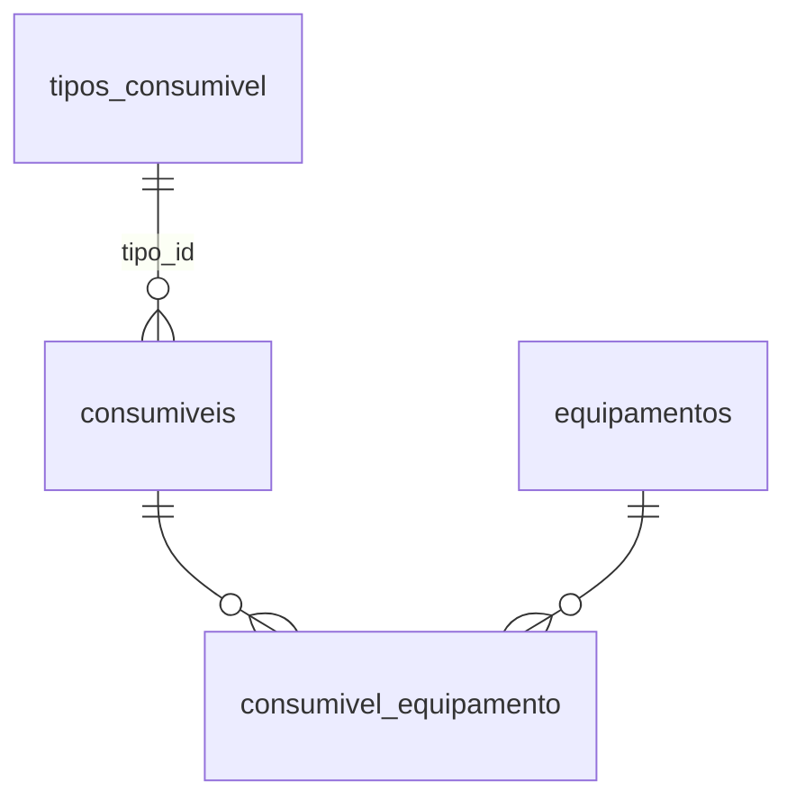

# Módulo Consumíveis

Código: rotas em [`servidor.py`](../../servidor.py) · modelos `TipoConsumivel`,
`Consumivel`, `ConsumivelEquipamento` · tela `static/consumiveis.js`

## O que resolve

Catálogo global de consumíveis (reagentes, insumos, peças de reposição de uso
corrente) com a resposta para a pergunta que ninguém conseguia dar rápido: *este
consumível serve em quais equipamentos, e este equipamento consome o quê?*

## O desenho: catálogo global + N:N

O consumível é **global**, não pertence a um equipamento. A compatibilidade é
uma tabela de ligação com atributos próprios — porque a relação carrega
informação que não é nem do consumível nem do equipamento:

| Campo do vínculo | Significa |
|---|---|
| `fornecimento` | como aquele equipamento recebe aquele consumível |
| `obrigatorio` | se é indispensável para o equipamento operar |
| `observacao` | exceção específica daquele par |

O par `(consumivel_id, equipamento_id)` é único. Desvincular é `ativo=False`,
não `DELETE` — o histórico de compatibilidade se perde num delete.

## Tipos configuráveis

`TipoConsumivel` não é uma lista fixa no código: é uma tabela, e cada tipo
carrega um **modelo de campos** (`campos`, JSON). Os valores preenchidos ficam
em `Consumivel.atributos`, também JSON.

Consequência: acrescentar "Volume (mL)" a um tipo é configuração pela interface,
não migração de schema. O preço é que esses campos **não são consultáveis por
SQL** como colunas — filtro e ordenação sobre eles são feitos na aplicação. Foi
a troca aceita para não ter uma tabela por tipo de consumível.

## Pendência de SKU

`pendente_sku` é derivado: consumível sem SKU preenchido entra como pendente.
Serve para separar o que veio de importação incompleta do que está cadastrado
de verdade.

A regra mora em um lugar só (`marcar_pendencia_sku()`) e precisa ser chamada
após qualquer escrita em `sku` — é o tipo de invariante que se quebra em
silêncio se alguém gravar o campo direto.

## Descritivo técnico em Word

O módulo importa e exporta o descritivo técnico em `.docx`. É o formato em que o
material já circula entre engenharia, regulatório e fornecedor — pedir que
alguém redigitasse na tela seria garantir que a tela ficasse desatualizada.

## Quem pode o quê

| Ação | Papel |
|---|---|
| Ver o catálogo e as compatibilidades | qualquer membro da área PDE |
| Criar e editar consumível, vincular a equipamento | técnico para cima |
| Criar e editar tipos de consumível | admin e gestor |
| Excluir | admin e gestor |

## Pontos de atenção

- **Campos dinâmicos são JSON em `Text`**, não colunas. Não espere consultá-los
  por SQL nem indexá-los.
- **O vínculo carrega dado próprio.** Recriar um vínculo desativado não é o
  mesmo que reativá-lo: `fornecimento`, `obrigatorio` e `observacao` se perdem.
- **Excluir um tipo com consumíveis vinculados** deixa os consumíveis sem
  modelo de campos, mas com os valores em `atributos` — eles não somem, deixam
  de ser exibidos com rótulo.
