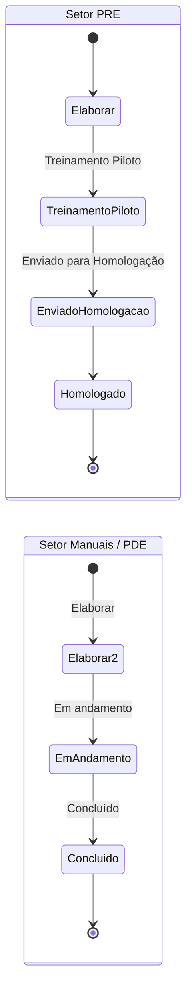

# Módulo Documentos

Código: [`documentos.py`](../../documentos.py) · modelos `Documento`,
`DocumentoHistorico`, `DocumentoArquivo` · tela `static/app.js`

## O que resolve

Acompanhar o estado dos documentos técnicos de cada equipamento: quais existem,
em que ponto do fluxo estão, quem responde por eles, quando vencem e onde o
arquivo mora de fato.

O documento em si **não vive aqui** — vive no share da engenharia. O que este
módulo guarda é o cadastro, o fluxo e o caminho
([ADR-0001](../arquitetura/decisoes/ADR-0001-caminho-no-banco.md)).

## Os 12 tipos canônicos

Todo equipamento nasce com **um documento de cada tipo**. Não se "cria um
documento": ele já existe desde o cadastro do equipamento, no status inicial.

**Setor PRE** (5 tipos) — pipeline longo:

| Tipo | Rótulo |
|---|---|
| `IT` | Instrução de Trabalho |
| `Checklist_Conferencia` | Checklist de Conferência |
| `Checklist_BurnIn` | Checklist de Burn-In |
| `Checklist_Limpeza_Embalagem` | Checklist de Limpeza e Embalagem |
| `Checklist_Produto` | Checklist de Produto |

**Setor Manuais** (7 tipos) — pipeline curto:

| Tipo | Rótulo |
|---|---|
| `Manual_Usuario` | Manual do Usuário PT |
| `Manual_ES` | Manual do Usuário ES |
| `Manual_Servico` | Manual de Serviço |
| `Spare_Parts` | Spare Parts *(opcional)* |
| `Dossie` | Dossiê *(opcional)* |
| `Guia_Instalacao` | Guia de Instalação |
| `QIQOQD` | QI/QO/QD *(opcional)* |

> Os três **opcionais** nascem marcados como "não se aplica" e só entram na
> contagem quando alguém os liga.

Existe ainda um terceiro setor, **PDE**, para documentos de *processo* da própria
área ("IT - Elaboração do Manual de Serviço"). Não pertencem a equipamento
nenhum, ficam fora da completude e usam o pipeline curto.

## Fluxo de status

O pipeline é **linear e determinado pelo setor**, não pelo tipo diretamente —
`SETOR_DO_TIPO` faz o mapa. Voltar status é permitido; o histórico registra os
dois sentidos.

### O documento manda no entregável do projeto

Quando um projeto aponta para o equipamento e o item do modelo diz que o
entregável É este documento, a troca de status aqui — pela tela, pela ficha ou
pelo fluxo de revisão — atualiza o entregável no projeto, e o N/A do escopo
o põe em N/A. A ficha mostra "É o entregável … do projeto … ↗". Ver
[projetos-entregaveis.md](projetos-entregaveis.md#equipamento-do-projeto-e-natureza-dos-entregáveis).

## "Não se aplica" (N/A)

Um documento pode ser desligado do escopo daquele equipamento. Ele **continua
existindo** — status, código e histórico preservados — mas sai do denominador
da completude, dos chips e do IDP. É reversível.

Marcar N/A exige um motivo de lista fechada, e a lista é fechada de propósito:
o N/A muda o denominador de um indicador, então precisa ser analisável.

| Código | Motivo |
|---|---|
| `nao_se_aplica_produto` | Não se aplica a este produto |
| `fornecido_fabricante` | Fornecido pelo fabricante |
| `coberto_outro_doc` | Coberto por outro documento |
| `equipamento_legado` | Equipamento legado / fora de linha |
| `sem_registro_anvisa` | Produto sem registro ANVISA |
| `outro` | livre — só aqui o campo de texto é obrigatório |

## Onde o arquivo está

Três níveis, do mais específico para o mais geral. Vence o primeiro que existir:

1. **`documentos.armazenamento`** — exceção livre do documento, para quando ele
   não cabe em nenhuma pasta (Manual ES em `\LATAM`, Manual PT em `\Manual Dash`).
   Vazio é o caso normal.
2. **`documentos.pasta_id`** → `equipamento_pastas.caminho` — a pasta (grupo) a
   que o documento pertence. Na estrutura real de rede, manuais ficam numa pasta,
   IT e checklists em outra, QI/QO/QD em outra.
3. **O caminho do próprio equipamento.**

Os caminhos são canonizados para UNC antes de gravar. Um caminho colado do
Explorer (`P:\...`) e a UNC do mesmo diretório são tratados como o mesmo lugar
— ver [`caminhos.py`](../../caminhos.py).

Além do share, o usuário pode **enviar** uma cópia para dentro da plataforma
(`documento_arquivos`). É cópia de conveniência, não mestre
([ADR-0009](../arquitetura/decisoes/ADR-0009-blob-por-conteudo.md)).
Remover um arquivo enviado é exclusão lógica: a linha fica inativa no histórico,
o arquivo deixa de ser servido, e o conteúdo **fica em disco** enquanto houver
linha que o referencie (Análise de Riscos, R-26).

## Datas: as três significam coisas diferentes

Confundi-las é o erro mais comum ao ler os dados:

| Coluna | Significado |
|---|---|
| `prazo` | data **alvo** de conclusão — sem ela nada pode estar "atrasado" |
| `data_inicio` | início efetivo do trabalho |
| `data_treinamento`, `data_homologacao` | datas **realizadas**: o que aconteceu |
| `entrou_status_em` | quando entrou no status atual — é o que dá o *aging* |
| `concluido_em` | marco de conclusão, para *cycle time* e *throughput* |

## Indicadores

O módulo publica métricas de fluxo (`/api/documentos/metricas`): WIP, aging,
cycle time e throughput; e alertas (`/api/documentos/alertas`) do que precisa de
atenção hoje. O `peso` de cada documento é o esforço relativo, usado na
ponderação.

## Tempo real

A tela atualiza sozinha quando outra pessoa muda um documento: status, campos,
responsáveis, criação e exclusão. Uma rajada de mudanças vira uma atualização só.
A ficha do equipamento aberta **não** é redesenhada por baixo de quem está
digitando; aparece "Esta ficha foi atualizada por outra pessoa — Atualizar a
ficha". O painel do fluxo de revisão dentro da ficha se atualiza sozinho. Ver
[EVENTOS.md](../arquitetura/EVENTOS.md#quais-telas-têm-socket).

## Quem pode o quê

| Ação | Papel |
|---|---|
| Ver | qualquer membro da área PDE |
| Editar campos, mudar status, marcar N/A | técnico para cima |
| Excluir (soft delete) | admin e gestor |

A matriz exata está em [`../referencia/permissoes.md`](../referencia/permissoes.md).

## Pontos de atenção

- **Exclusão é soft delete** (`deleted_at`), nunca `DELETE` — regra geral do
  projeto, ver [ADR-0002](../arquitetura/decisoes/ADR-0002-schema-no-startup.md).
- **`equipamento_id` é nullable** por herança da transição do modelo antigo, em
  que o vínculo era pelo nome em texto. O backfill preenche na subida.
- **`version` é controle de concorrência otimista.** Editar com versão velha
  devolve `409` em vez de sobrescrever a alteração de outra pessoa.
- **Toda mutação precisa passar por `publish_event()`** — senão a tela dos
  outros não atualiza e a trilha não registra
  ([ADR-0003](../arquitetura/decisoes/ADR-0003-event-bus-e-audit-log.md)).
