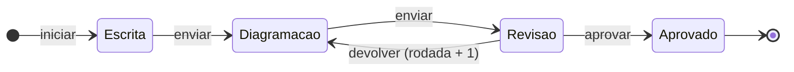

# Módulo Fluxos de revisão

Código: [`fluxos/`](../../fluxos/) — `core.py` (máquina de estados) · `models.py` ·
`routes.py` · [`notificacoes/`](../../notificacoes/) (o sino) · telas
`static/fluxos-painel.js` (painel), `static/fluxos.js` (página) e
`static/notificacoes-widget.js` (sino global). Montado em `/fluxos`.
Design: [`2026-10-26-fluxos-revisao-design.md`](../superpowers/specs/2026-10-26-fluxos-revisao-design.md).

## O que resolve

Um manual passa de mão em mão: a autora escreve o texto, o diagramador diagrama,
a autora revisa e devolve com apontamentos até aprovar. Antes, isso acontecia
fora do sistema e o DocTrack só via o começo e o fim. O fluxo registra com quem o
item está, quantas voltas deu e qual arquivo foi revisado em cada rodada, e avisa
a próxima pessoa.

Serve **documentos** (ficha do equipamento em Documentos) e **entregáveis**
(popover do entregável em Projetos) com o mesmo mecanismo.

## Modelo de fluxo

Cadastrado por admin/gestor na aba **Modelos** de `/fluxos/`.

- **Papéis** — quem faz (Autor(a), Diagramador(a)…). Cada papel pode ter uma
  pessoa padrão, que já vem escolhida ao iniciar.
- **Etapas**, na ordem, cada uma de um papel e de um tipo:

| Tipo | Saídas |
|---|---|
| Execução | *Enviar para a próxima* — ou *Concluir*, se for a última |
| Revisão | *Aprovar* (próxima etapa, ou encerra) · *Devolver* para uma etapa anterior |

A revisão nunca é a primeira etapa e só devolve para trás. Um banco sem modelos
nasce com o "Manual": Escrita (autor) → Diagramação (diagramador) → Revisão
(autor, devolve para Diagramação).

**Editar o modelo não mexe nos fluxos em andamento**: cada fluxo copia as etapas e
os papéis na hora em que começa. Modelo não se exclui, se arquiva.

## O ciclo

Cada ação vira uma **passagem** imutável, com quem fez, em nome de quem (quando a
gestão agiu no lugar do responsável), comentário, rodada e arquivos. A rodada
começa em 1 e só sobe na devolução.

## Regras

| Ação | Quem |
|---|---|
| Ver | admin/gestor; técnico nos fluxos de documento, nos que participa e nos de entregável de projeto que já enxerga |
| Iniciar | técnico para cima, num item que enxerga |
| Enviar, aprovar, devolver | o responsável pela etapa atual — ou admin/gestor **em nome dele** |
| Trocar a pessoa de um papel, cancelar | admin/gestor ou quem iniciou, com motivo |
| Modelos | admin/gestor |
| — | `leitura` fica fora (403), como em Missões |

- **Devolver exige comentário.** Os outros comentários são opcionais.
- **Anexos:** mesma allowlist e teto dos documentos (PDF, Office, imagens; 80 MB),
  até 10 por envio. O arquivo-fonte (InDesign etc.) continua no share
  ([ADR-0001](../arquitetura/decisoes/ADR-0001-caminho-no-banco.md)): o que se
  revisa é o PDF. Anexos são imutáveis — fazem parte do registro da rodada.
- **Um fluxo ativo por item**, garantido por índice parcial único no banco.
  Aprovado ou cancelado, o item pode receber outro (a revisão do ano seguinte).
- **Concorrência:** toda ação manda a `versao` do fluxo; versão velha recebe 409
  e a tela redesenha.

## Efeito no item

| Item | Iniciar | Aprovar |
|---|---|---|
| Documento dos setores Manuais e PDE | *Elaborar → Em andamento* | *Concluído* + os arquivos da última passagem de execução entram em `documento_arquivos` (mesmo blob, sem cópia em disco) |
| Documento do setor PRE | não toca | não toca |
| Entregável | *pendente → em progresso* | *concluído* |

O PRE fica de fora porque o pipeline dele tem marcos externos (treinamento,
homologação) que o fluxo não conhece. **Cancelar não mexe no status.** O
percentual do entregável continua sendo do responsável.

As trocas de status passam pelos mesmos caminhos da tela
(`documentos.aplicar_status_documento`, `entregaveis.aplicar_status_entregavel`):
trilha, marcos temporais e — no documento — a sincronização com o cartão de
missão vinculado, que muda de coluna sozinho.

Com fluxo em andamento, o item **não pode** ser marcado N/A nem excluído (409), e
"Aplicar o modelo aos projetos" o trata como "com andamento".

## Notificações (o sino)

Em cada passagem:

- quem passa a ter a etapa recebe **"É sua vez"** (ou "Voltou para você, rodada
  N" com os apontamentos no texto);
- os outros participantes e quem iniciou recebem o **andamento**;
- quem agiu não recebe nada da própria ação, e ninguém recebe duas por passagem.

O sino está em todas as telas, inclusive no hub. O painel tem **Com você agora**
(o estado vivo, que não some quando o aviso é lido) e **Avisos**. O título da aba
ganha "(n)" com avisos não lidos.

O aviso **não passa pelo barramento de tempo real**: o sino consulta
`/api/notificacoes/contagem` a cada 30 s, ao voltar o foco para a aba e logo
depois de uma ação. Ver [EVENTOS.md](../arquitetura/EVENTOS.md) para o motivo. As
notificações lidas há mais de 90 dias saem na tarefa diária; as não lidas ficam.

## Pontos de atenção

- **Etapa sem responsável:** se a pessoa de um papel for desativada ou excluída,
  o fluxo não para sozinho. A lista "Em andamento" e o painel sinalizam, e a
  gestão troca a pessoa.
- **Documento de processo (setor PDE)** não tem ficha de equipamento, então o
  fluxo dele não aparece em tela nenhuma ainda (só pela API).
- **E-mail e Teams estão fora.** A tabela `notificacoes` é o ponto de extensão
  para quando houver uma conta de envio.
