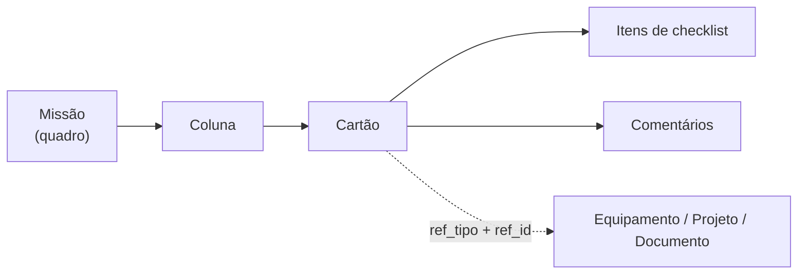

# Módulo Missões (kanban)

Código: [`missoes.py`](../../missoes.py) · modelos `Missao`, `MissaoColuna`,
`MissaoCartao`, `MissaoCartaoHistorico`, `MissaoCartaoItem`,
`MissaoCartaoComentario`, `MissaoSnapshot`, `MissaoModelo` ·
tela `static/missoes.js`

## O que resolve

Kanban nativo para o trabalho da área, no lugar do Planner. A razão de ser
nativo e não integrado: o cartão precisa **apontar para as entidades do
sistema** — um cartão ligado a um equipamento, a um projeto ou a um documento,
visível da ficha daquela entidade.

## Estrutura

Uma missão nova nasce com **três colunas padrão**, ou com as colunas de um
**modelo** (`missao_modelos`) — para processos que se repetem.

## Cartão

| Campo | Nota |
|---|---|
| `titulo` | máx. 200 caracteres |
| `descricao` | **fora da query do board** — só vem no cartão aberto |
| `prioridade` | ver `PRIORIDADES_CARTAO` |
| `responsaveis`, `etiquetas` | CSV, convenção herdada de `Entregavel` |
| `prazo`, `data_inicio` | ISO em texto |
| `peso` | esforço relativo, para avanço ponderado |
| `recorrencia` | cartão que volta sozinho |
| `versao` | lock otimista |
| `ref_tipo` + `ref_id` | vínculo opcional com equipamento, projeto ou documento |

**O board não carrega descrição.** É a separação leve/pesado: a listagem do
quadro traz o necessário para desenhar os cartões, e abrir um cartão faz uma
segunda chamada que traz descrição, checklist e comentários. Sem isso, um quadro
grande baixaria todo o texto de todos os cartões a cada abertura.

**O vínculo com outras entidades não tem chave estrangeira rígida.** É
`ref_tipo` + `ref_id`, validado na gravação. Foi a escolha para manter o módulo
solto — o preço é que a integridade depende do código, não do banco.

## Concorrência: `versao` e o 409

Editar ou mover um cartão envia a `versao` que o cliente tem. Se ela não bate
com a do banco, a resposta é **409** em vez de sobrescrever.

Kanban é o módulo onde duas pessoas mexem no mesmo objeto ao mesmo tempo com
mais frequência — arrastar cartões é rápido e simultâneo. Sem o lock, a última
gravação venceria em silêncio.

A reordenação roda em **transação**, com `ordem` inteira reindexada. É o
suficiente no volume atual; ordenação fracionária (LexoRank) só se faria
necessária em escala muito maior.

## Limite de WIP

Cada coluna pode ter um limite de trabalho em progresso. É o mecanismo que faz o
kanban ser kanban — sem limite, o quadro vira lista de tarefas.

## O que o módulo mede

`missao_cartao_historico` é a **série temporal do fluxo**. A trilha de auditoria
registra "alguém mexeu"; ela responde *quanto tempo um cartão ficou em cada
coluna* e *quantos foram concluídos na semana* — perguntas que o audit log não
responde.

`/api/missoes/<id>/metricas` devolve WIP, aging, cycle time, throughput e carga
por pessoa. `/api/missoes/alertas` devolve fatos acionáveis, no mesmo formato
dos alertas de projetos. `missao_snapshot` guarda a série diária.

`entrou_coluna_em` dá o aging sem varrer o histórico; o histórico continua sendo
a fonte da série completa.

## Integração com o resto do sistema

- **`/api/missoes/meus-cartoes`** — visão cross-missão da pessoa logada.
- **`/api/missoes/cartoes-vinculados`** — os cartões de uma entidade. Hoje a
  única tela que o usa é a ficha do equipamento em Documentos, e só para os
  cartões ligados aos documentos dele; cartão ligado direto a equipamento ou a
  projeto só aparece no próprio quadro.
- **`/api/missoes/cartao-rapido`** — cria cartão direto de uma entidade, sem sair
  da tela dela.
- **Tempos** pode cronometrar um cartão de missão como alvo.

## Quem pode o quê

Todo o módulo é **técnico para cima**. `leitura` recebe `403` — inclusive na
leitura, porque um quadro de missões expõe o planejamento da área.

Excluir uma missão **arquiva**. Excluir de verdade exige `?definitivo=1` **e**
papel admin. Excluir uma coluna migra os cartões, não os apaga.

## Pontos de atenção

- **SQLite não aplica `String(n)`**, então os limites de tamanho são validados
  no código (`MAX_TITULO`, `MAX_COMENTARIO`…). Em produção o Postgres aplicaria,
  mas a validação precisa valer nos dois.
- **Datas são validadas pelo calendário, não por regex**: um regex de formato
  deixa passar `2026-02-31`.
- **As missões não têm sala própria no tempo real.** O backend emite para os
  papéis com acesso e o front filtra pelo `missao_id`
  ([EVENTOS.md](../arquitetura/EVENTOS.md)).
