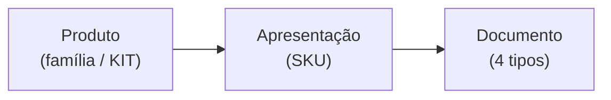

# Módulo PDR — P&D de Reagentes

Código: [`pdr/`](../../pdr/) — `models.py` · `importer.py` · `routes.py` ·
templates e estáticos próprios. Montado em `/pdr`.

## O que resolve

É o módulo da **outra área**. Enquanto os demais servem P&D de Equipamentos
(PDE), o PDR acompanha o desenvolvimento e a documentação dos reagentes: os
KITs, suas apresentações comerciais e os quatro documentos que cada apresentação
precisa ter.

Compartilha a plataforma — mesmo banco, mesma autenticação, mesma auditoria,
mesmo tempo real — mas é um domínio separado, com tabelas prefixadas `pdr_`.

## Estrutura

Linhas de produto: **Extracta KITs**, **Outros Produtos**, **Pré-Tratamento**.

## Os quatro documentos por apresentação

| Tipo | Rótulo |
|---|---|
| `especificacao` | Especificação do Produto |
| `descritivo` | Descritivo |
| `instrucao_trabalho` | Instrução de Trabalho |
| `manual` | Manual |

Diferente do PDE — que tem 12 tipos e pipeline linear — aqui são quatro, e o
fluxo de status é **muito mais largo**.

## Vocabulários controlados

Os três vêm do uso real e da legenda da planilha de origem, não de um desenho
teórico. É por isso que `STATUS_DOC` tem quinze valores, incluindo alguns que
parecem sobrepostos:

**Status Protheus** (situação no ERP):
`OK` · `BLOQUEADO` · `DESCONTINUADO` · `OBSOLETO` · `PARA CORREÇÃO`

**Status ANVISA** (situação regulatória):
`RUO` · `Registrado` · `Não Registrado` · `Kit Bloqueado`

**Status do documento** (15 valores): de `PENDENTE` e `EM ELABORAÇÃO` até
`FINALIZADO/LIBERADO`, passando por etapas específicas do processo do PDR
(`SEPARAR VERSÕES`, `REQUISIÇÃO ABERTA`, `ADEQUAR PADRONIZAÇÃO`, `MAPEADO`…).

**O que conta como concluído** no avanço é um conjunto explícito:
`FINALIZADO`, `FINALIZADO/LIBERADO`, `HOMOLOGADO`, `LIBERADO`.
`DESCONTINUADO` e `OBSOLETO` são tratados à parte.

> Não normalize esses status sem falar com a área. Eles não são sinônimos
> descuidados: distinguem estados reais do processo, e o conjunto `STATUS_OK` é
> o que impede que a largura da lista quebre o cálculo de avanço.

## Importação

O módulo nasceu de uma planilha — a Lista Mestra de Reagentes, versionada em
`pdr/data/`. `pdr/importer.py` a lê e popula as três tabelas; na primeira subida
o import roda sozinho se as tabelas estiverem vazias.

Reimportar é rota de **admin** (`POST /pdr/api/reimport`) e gera evento
`REIMPORT` na trilha.

`PDR_EXCEL_PATH` aponta para a planilha (padrão: o arquivo versionado).

## Apresentações ao vivo

O PDR tem uma sala de tempo real própria: `join_apresentacao` põe o cliente na
room `apres:<id>`, e os eventos daquela apresentação chegam só a quem está com
ela aberta.

## Quem pode o quê

Acesso é por **área**, não só por papel: exige `pdr` no cadastro do usuário
(`users.areas`). Admin passa sempre.

| Ação | Papel |
|---|---|
| Ver | membro da área PDR |
| Editar produto, apresentação, status de documento | técnico para cima, na área |
| Reimportar a Lista Mestra | admin |

Ver [`acesso-usuarios.md`](acesso-usuarios.md) para como área e papel se
combinam.

## Pontos de atenção

- **Assets ficam dentro do pacote** (`pdr/static/`), diferente dos outros
  módulos. Por isso o PDR precisou de um `ASSET_V` próprio para cache-busting:
  a função de versionamento de estáticos do mestre só varre o primeiro nível de
  `static/`.
- **O PDR tem `<head>` e corpo próprios**, o que já causou um bug de navegação
  no celular — a gaveta lateral existia nos outros módulos e não nele.
- **Reimportar sobrescreve.** Alterações feitas na interface sobre dados que
  vieram da planilha podem ser perdidas na reimportação.
