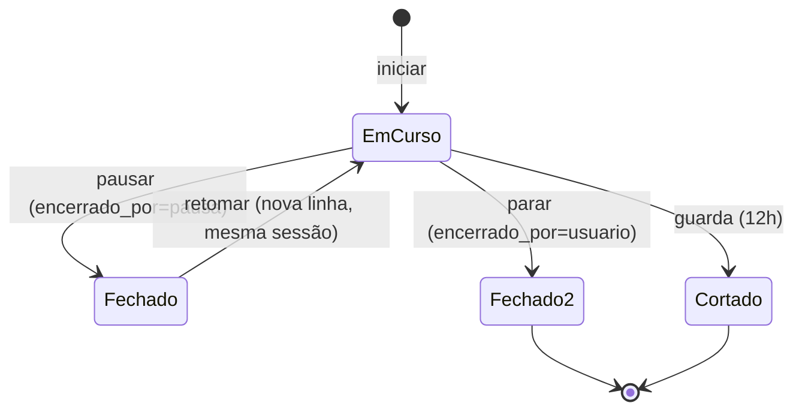

# Módulo Tempos

Código: [`tempos/`](../../tempos/) — `models.py` · `core.py` · `routes.py` ·
widget global em `static/tempos-widget.js` · tela `static/tempos.js`
Montado em `/tempos`.

## O que resolve

Apontamento de horas por pessoa, amarrado ao que já existe na plataforma. É o
que responde "para onde foi o tempo do time" com granularidade abaixo do dia —
e é o insumo de custo/hora que o módulo de Custos consome como premissa.

O cronômetro é **global**: está presente em todos os módulos, não só na tela de
Tempos.

## O alvo do apontamento

| Tipo | Aponta para |
|---|---|
| `projeto` | um projeto |
| `entregavel` | um entregável |
| `missao_cartao` | um cartão de missão |
| `equipamento` | um equipamento |
| `livre` | nada — tarefa que não existe na plataforma, com título obrigatório |

**A tarefa livre não é preguiça de modelagem.** Sem ela o módulo mediria só o
trabalho já cadastrado, e sumiria justamente a reunião, o suporte e o imprevisto
— que é onde as horas costumam vazar.

## O modelo: pausar fecha o intervalo

A decisão que define tudo no módulo.

**Uma linha é sempre um intervalo fechado.** Pausar não põe o apontamento em
suspenso: fecha a linha. Retomar abre outra, herdando o alvo.

A alternativa — uma linha com `pausado_em` e segundos acumulados — cria um
terceiro estado que envenena a invariante do cronômetro único: pausado conta
como "em curso"? Se sim, a pessoa fica travada durante o almoço; se não,
acumulam-se linhas pausadas esquecidas sem regra de qual "retomar" alcança.

Com o modelo atual, `duracao_s == fim - inicio` vale **sempre**, todo relatório
é um `SUM`, e corrigir "esqueci de voltar do almoço" vira editar um horário que
se confere contra um relógio.

O preço é que um dia com 4 pausas são 5 linhas. **`sessao_id` paga isso**: é o
id do primeiro trecho da corrente, e `GROUP BY sessao_id` devolve a sessão
inteira.

Consequência: **pausar e parar são a mesma escrita**, diferindo só em
`encerrado_por` — e é essa coluna que torna a linha elegível a retomada.

## Um cronômetro por pessoa, garantido no banco

Índice **parcial e único** em `(user_id) WHERE fim IS NULL`. Não é validação de
aplicação: é o banco que impede dois cronômetros simultâneos.

> A declaração precisa de `sqlite_where=` **e** `postgresql_where=`. Cada
> dialeto emite o seu e ignora o outro. Num terceiro dialeto ambos seriam
> ignorados e sobraria um `UNIQUE(user_id)` puro — um apontamento por pessoa,
> para sempre. É por isso que essa linha nunca pode ser "simplificada".

## Limites e guardas

| Limite | Padrão | Por quê |
|---|---|---|
| `LIMITE_CRONOMETRO_H` | 12 h | além disso o cronômetro é considerado abandonado e cortado. 8 h truncaria um dia longo legítimo; 12 h só pega esquecimento — e corta sexta→segunda para um número defensável |
| `JANELA_RETOMADA_H` | 12 h | por quanto tempo uma pausa continua oferecível como "retomar" |
| `LIMITE_APONTAMENTO_H` | 16 h | teto de um lançamento manual — uma linha de 400 horas é erro de digitação |
| `RETROATIVO_DIAS` | 90 dias | quão para trás se pode lançar — barra o "1970" de um campo mal interpretado |

**A guarda fecha em `inicio + LIMITE`, não em "agora".** Assim o resultado não
depende de quando a guarda rodou: hoje, amanhã, ou as duas vezes produz
exatamente a mesma linha. A linha fica com `encerrado_por='guarda'` e a folha a
pinta em âmbar — o sistema **corta e sinaliza** em vez de adivinhar uma duração
e esconder o palpite. Quem corrige é o dono.

## Quem vê o quê

| | |
|---|---|
| Dono | vê e corrige o que é dele |
| admin, gestor | veem e corrigem o de todo mundo |
| tecnico | **não alcança o alheio nem para ler** |
| leitura | fora do módulo |

Um apontamento diz o que a pessoa estava fazendo e quando — isso não é dado de
time. O gate devolve **403 e não 404**: id sequencial de apontamento não é
segredo, e a mensagem honesta economiza um chamado. O corpo do 403 não devolve
nada da linha.

**O tempo real também respeita isso**: eventos `TEMPO_*` vão só para a sala do
próprio usuário. Um feed ao vivo de quem começou o quê seria um canal de
vigilância que ninguém escopou — supervisão se faz pelas rotas de resumo, sob
demanda ([EVENTOS.md](../arquitetura/EVENTOS.md)).

## O que vai para a trilha

Só as mutações de **folha** (criar, editar, excluir apontamento). Iniciar,
pausar, retomar e parar **não** passam pelo barramento de eventos: cada ciclo de
cronômetro viraria duas linhas em `audit_logs` e o event store encheria de ruído
de interface.

## Pontos de atenção

- **`DateTime` real, não string ISO.** Diferente de `Projeto` e `MissaoCartao`,
  onde a data é rótulo. Aqui a aritmética abaixo do dia **é** o produto.
- **`duracao_s` é `Integer`, derivado e persistido.** Calcular no SQL exigiria
  `julianday()` no SQLite e `EXTRACT(EPOCH FROM …)` no Postgres — dois dialetos.
  A invariante é mantida em um lugar só: `core.fechar()`.
- **Horários são naive locais**, como o resto do repositório.
- **O widget não guarda estado entre páginas.** Ao retomar, o cliente manda só o
  id e o servidor copia título, alvo e projeto — é o que permite o cronômetro
  atravessar módulos e máquinas.
