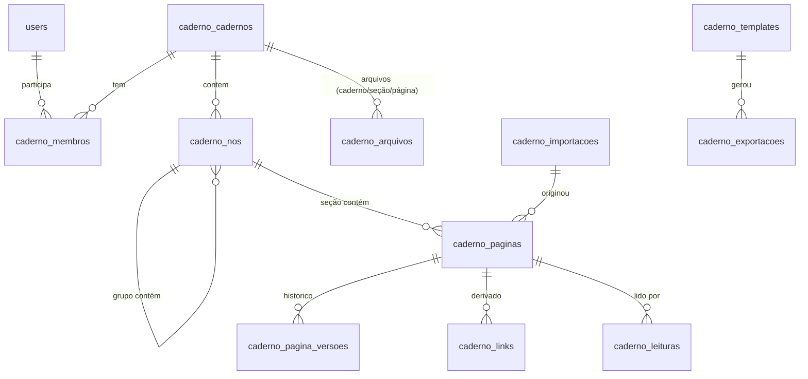
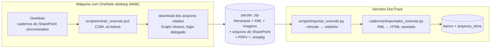

# PLANO — Cadernos do PDR (substituir o OneNote e o SharePoint)

> **Objetivo.** Quando o módulo estiver em uso, **os cadernos de laboratório do PDR
> vivem só no DocTrack**: sem OneNote e sem SharePoint. São quatro frentes:
>
> 1. **Editar.** Um espaço de edição completo, no nível de um Word: tabelas com cor de
>    célula, colar do Excel, imagens, listas, realce, localizar e substituir.
>    Organizado como o OneNote: cadernos → grupos de seções → seções → páginas e
>    subpáginas.
> 2. **Guardar arquivos.** Arquivos de **qualquer extensão** (dados brutos, laudos,
>    planilhas, **programas**) presos à página, à seção ou ao caderno, com versões.
> 3. **Migrar.** Os cadernos do OneNote **completos**, e isso inclui **os arquivos que
>    hoje estão no SharePoint e são citados por link nas páginas**.
> 4. **Exportar para a liderança.** Um pacote `.zip` com o relatório Word no template
>    do PDR, as imagens, os arquivos dos testes e os programas escolhidos.
>
> Pesquisa e inventário feitos em 2026-10-05. A Parte 1 descreve o funcionamento do
> OneNote e como tirar os dados dele, com as fontes. A Parte 2 é o plano.

---

# Parte 1 — Como o OneNote funciona

## 1.1 Hierarquia

| Nível | O que é | Regras que importam |
|---|---|---|
| **Caderno** (*notebook*) | Uma pasta com os arquivos de seção (`.one`) e um arquivo de índice (`.onetoc2`). O índice guarda a **ordem das seções e a cor** do caderno. | No Graph: `displayName`, `isDefault`, `isShared`, `userRole` (`Owner` · `Contributor` · `Reader`). |
| **Grupo de seções** | Contêiner de seções **e de outros grupos**. | Aninhamento livre. Não contém páginas diretamente. |
| **Seção** | Um arquivo `.one`. Guarda nome, cor, a lista de páginas e a ordem delas. | **Página só existe dentro de seção.** Cada seção pode ter um modelo de página padrão. |
| **Página** | Título (com data e hora) e conteúdo. | No Graph, `level` e `order` são somente leitura. |
| **Subpágina** | **Não é um filho numa árvore.** É uma página da **mesma lista plana** da seção, com recuo maior. | `PageLevel` vai de 1 a 3 (até 2 níveis de subpágina). A primeira página da série tem nível 1. Recolher a mãe esconde a série, e mover a mãe recolhida leva a série junto. |

**O que isso significa para a implementação:** a árvore real é
`Caderno → (Grupo)* → Seção → lista ordenada de páginas com nível 1–3`. Uma página
não precisa de `parent_id`: a subpágina é deduzida da ordem e do nível.

## 1.2 O conteúdo da página

- **Formato nativo ([MS-ONE]):** página → *outlines* (caixas posicionadas livremente
  na página) → *outline elements* (parágrafo, item de lista, tabela, imagem, arquivo).
  Cada *outline element* guarda **autor, último autor e datas**. Daí vêm as iniciais e
  o destaque de "não lido".
- **Pela API do Graph:** a página é um subconjunto de HTML (`p`, `h1`–`h6`, listas,
  `table`, `img`, `object`), com estilos inline limitados e sem `rowspan`/`colspan`. A
  edição é feita por elemento: `target`, `action` (`append`/`insert`/`prepend`/
  `replace`) e `position`.
- **Marcas (*note tags*):** `data-tag="forma[:status]"`. São cerca de 30 marcas
  prontas, e as de caixa de seleção aceitam `:completed`, com data de criação e de
  conclusão.

## 1.3 Armazenamento, sincronização e conflito

- **Revision store ([MS-ONESTORE]).** Cada página é um *object space* revisado sem
  depender das outras. A revisão é um snapshot imutável, gravado inteiro ou como delta
  sobre a revisão anterior. Um log de transações protege as escritas.
- **Sincronização (FSSHTTP).** Só o que mudou trafega, em *cells*.
- **Concorrência.** Objetos diferentes da página são mesclados automaticamente. O
  **mesmo objeto** editado por duas pessoas vira uma **página de conflito** (somente
  leitura), que o usuário resolve à mão.
- **Versões** por página e **lixeira de 60 dias** por caderno.

## 1.4 Colaboração e leitura

- **Permissão só no caderno** (dono, colaborador ou leitor). Não existe permissão por
  seção, e essa é uma queixa recorrente.
- **Senha por seção** (AES-128, sem recuperação). A seção sai da busca e do resumo de
  marcas.
- **Não lidos.** Caderno, seção e página **em negrito**, conteúdo novo destacado, e
  "marcar como lido".
- **Autores:** iniciais por parágrafo, Edições recentes e Localizar por autor.

## 1.5 Navegação e organização

- **Links** para caderno, seção, página e parágrafo. O wiki-link `[[Página]]` cria a
  página se ela não existir.
- **Busca** por escopo (página, seção, grupo, caderno, todos), com OCR de imagens e as
  marcas.
- **Modelos de página**, com um padrão por seção.

## 1.6 O que não vale copiar

| Recurso do OneNote | Por que não copiar |
|---|---|
| **Tela livre** (caixas posicionadas) | Funciona mal na web e no celular. Um documento corrido resolve quase todos os usos. |
| **Senha por seção** | Sem recuperação, e a seção sai da busca. Permissão resolve melhor. |
| **Permissão só no caderno** | O DocTrack já tem papel + área. |
| **Wiki-link por nome** | É ambíguo. Aqui o link é por `uuid`. |
| **Coedição simultânea na mesma página** | É o que obriga a ter páginas de conflito. Para equipes de 4 a 6 pessoas por caderno, **uma pessoa editando a página por vez**, com os outros vendo ao vivo, resolve com muito menos risco (ver 2.0). |

## 1.7 Como tirar os dados do OneNote

| Caminho | Preserva | Não preserva | Depende de |
|---|---|---|---|
| **API COM do OneNote desktop** ✅ | Hierarquia, `pageLevel`, cores, autor e data por parágrafo, marcas, **tabelas com cor de célula**, listas, imagens com OCR, anexos e links | Histórico de versões e tinta como vetor (sai como imagem no PDF) | OneNote **desktop do Microsoft 365** no Windows, com os cadernos sincronizados. **Não depende do TI.** |
| Microsoft Graph (OneNote) | Hierarquia, texto, imagens, anexos | Autor por parágrafo e OCR. Tem limite de requisições | App Registration com permissão delegada. App-only foi desativado em 31/03/2025. |
| `Publish` → Word/PDF | Aparência | Estrutura | — |
| Ler o `.one` direto | Depende do parser | — | Parser não oficial |

**Escolha: COM.** Funciona na máquina do Melk (`OneNote.Application.15`) com os
cadernos do SharePoint abertos no desktop. O inventário do L-037 foi feito assim
(ver 2.12).

**Os arquivos citados por link** (no L-037 são 238 links para o SharePoint) **não
estão dentro do caderno**. Para trazê-los é preciso o **Graph de arquivos**, que é
outra API, não a do OneNote:

- `GET /shares/{u!base64url(link)}/driveItem/content` baixa o arquivo de um link de
  compartilhamento.
- Exige login delegado de alguém com acesso, com a permissão mínima
  **`Files.ReadWrite`**.

Ver 2.6.

---

# Parte 2 — Plano para o DocTrack

## 2.0 Contexto e decisões (ler antes de codar)

### Onde o módulo mora

- **Pacote genérico `cadernos/` com coluna `area`, aberto pelo PDR.** A barra lateral
  do PDR (`pdr/templates/pdr/dashboard.html`) ganha o item **"Cadernos"**, que leva a
  `/cadernos?area=pdr`, no mesmo padrão do item "Projetos".
- Para o usuário, o Cadernos está **dentro do PDR**. No código, outra área pode usar
  depois sem retrabalho.
- O `@` cita entidades do DocTrack: **Produto**, **Apresentação (SKU)**,
  **PdrDocumento**, **Projeto**, **Entregável** e **Equipamento**.

### Consequência de abandonar o SharePoint

**O DocTrack passa a ser o único lugar onde os cadernos de laboratório existem.** O
SharePoint tem histórico de versões, lixeira e o backup da Microsoft. O servidor do
DocTrack tem um disco, e o próprio
[VISAO_GERAL §9](../arquitetura/VISAO_GERAL.md) registra que **"os dumps do banco
ficam no mesmo disco do banco"**.

**Pré-requisito do corte (Fase 6), não opcional:** backup **fora da máquina** do banco
**e** da pasta `arquivos/`, os dois juntos ([ADR-0009]), com **um teste de restauração
feito de verdade**. Sem isso, uma falha de disco apaga anos de caderno de laboratório
de um kit em desenvolvimento.

### O que já existe e será reaproveitado

- **`arquivos_store.py`** ([ADR-0009]): blob pelo SHA-256, deduplicação, gravação
  atômica e teto por chamada. O padrão de **binário servido sempre como download, com
  mime genérico** (`documentos.py:1543`) é exatamente o que os programas anexados
  precisam.
  - O `_sha_orfao` (`documentos.py:1183`) passa a consultar também `caderno_arquivos`,
    `caderno_templates` e `caderno_exportacoes`. O ADR-0009 é atualizado junto.
- **`event_bus.publish_event`**: só para mudanças estruturais e para a trava de
  edição. Autosave não emite, pelo mesmo motivo de `tempos/routes.py:_emit`.
- **Agendador diário** (purga da lixeira), **`Sortable`** (arrastar páginas),
  **`docx-preview`** (prévia do relatório), **`utils.norm`** (busca).
- **Formato de módulo** ([ADR-0010]): `models.py`, `core.py` (puro), `routes.py`,
  `templates/`, tabelas `caderno_*`.
- **CSP** (`servidor.py:227`): o editor precisa ser vendorizado.
- **`X-Content-Type-Options: nosniff`** já é global (`servidor.py:220`).

### Decisões tomadas (e por quê)

| Decisão | Escolha | Motivo |
|---|---|---|
| Estrutura | `Caderno` → `CadernoNo` (grupo ou seção) → `CadernoPagina` em **lista plana** com `ordem` e `nivel` 1–3 | É o modelo do OneNote, e o `pageLevel` importa sem conversão. |
| **Editor** | **CKEditor 5** (v48, open source GPL-2.0+), build UMD **self-hosted** em `static/vendor/ckeditor5/` com `licenseKey: 'GPL'` | "Todo o espaço de edição de texto" pede um editor de documento, não de blocos. **Todos os recursos necessários estão na parte aberta** (conferido no npm): tabela com **propriedades de célula (cor, borda, alinhamento)**, redimensionar coluna, **colar do Word/Excel** (Paste from Office), fonte (cor, fundo, tamanho), realce, alinhamento, recuo, listas e lista de tarefas, imagem (upload, redimensionar, legenda), menção (`@` e `[[`), **localizar e substituir**, caracteres especiais, código, autosave e contagem de palavras. Sem bundler, porque o pacote traz `dist/browser/ckeditor5.umd.js`. Ver ADR-0011. |
| Conteúdo | **HTML saneado** pelo esquema do CKEditor no cliente **e** por uma allowlist no servidor (com `lxml`, que já entra para a exportação) | O esquema do CKEditor produz um HTML pequeno e previsível, e isso é o que torna a exportação para Word confiável. O servidor nunca confia no que chega. |
| **Concorrência** | **Trava de edição por página**: quem clica em "Editar" fica com a página, renovada a cada 30 s e expirando em 2 min sem sinal. Quem chega depois vê a página **ao vivo, só leitura**, com "em edição por Fulano". Mais a checagem de `versao` como rede de segurança | Equipes de 4 a 6 pessoas raramente editam o mesmo registro ao mesmo tempo. A mesclagem por parágrafo (o modelo do OneNote) seria o trecho mais caro e arriscado do módulo, para um caso raro. Ver ADR-0012. |
| **Arquivos** | Espaço de arquivos em **três níveis** (página, seção, caderno), **qualquer extensão**, com **versões**, pasta lógica e a opção "entra na exportação" | Pedido explícito: programas e arquivos de outras extensões que compõem o zip. Fica numa rota própria e é sempre servido como download (ver 2.5). |
| **Migração** | **COM → pacote → importador no servidor** + **download pelo Graph dos arquivos citados por link no SharePoint**, que viram arquivos da página. O link no texto passa a apontar para o arquivo no DocTrack | "Caderno completo, não o link." Ver 2.6. |
| **Exportação** | **Pacote `.zip`**: relatório `.docx` (gerado com `docxtpl` sobre o template do PDR) + imagens + arquivos dos registros + arquivos do projeto escolhidos + LEIA-ME | As dependências instalam por wheel no Python 3.14 do Windows (conferido), sem nada nativo. O PDF sai pelo Word, por causa do [ADR-0007]. |
| Ficha de teste | **Formulário acima do editor** nas páginas do tipo "Registro de teste", gravado em `ficha_json` | Fica fora do HTML: é dado estruturado, alimenta a tabela-resumo do relatório e não depende de um widget customizado do editor. |
| Versões | Snapshot ao **sair do modo edição** (fim da sessão) e antes de excluir, restaurar ou reimportar. Diff de texto entre versões | Com a trava, a "sessão de edição" é bem definida, e uma versão por sessão é o natural. |
| Lixeira | Exclusão lógica, 60 dias, purga no agendador | Igual ao OneNote. |
| Permissão | Membro do caderno (`dono`·`editor`·`leitor`) + `visibilidade` (`privado`·`area`). Admin vê tudo e o papel `leitura` nunca edita | Owner/Contributor/Reader com o recorte de área. |
| Busca | `texto_busca = norm(título + texto + ficha + OCR + nomes dos arquivos)` e `LIKE`, com escopo | Igual no SQLite e no Postgres. |
| Imagens no HTML | Guardadas como `">`. Na leitura, o servidor gera um `src` com **URL assinada de curta duração**, e na gravação a URL é removida | Um `` não manda o cabeçalho JWT, e um token na URL vazaria em log e no histórico. |

## 2.1 Modelo de dados (`cadernos/models.py`)



| Tabela | Colunas principais | Observações |
|---|---|---|
| `caderno_cadernos` | `id`, `uuid`, `nome`, `cor`, `area`, `visibilidade`, `modelo` (ex.: `projeto_pdr`), `dono_id`, `criado_em`, `atualizado_em`, `arquivado`, `excluido_em`, `origem_ref` | `origem_ref` é o ID do OneNote, usado pela reimportação. |
| `caderno_membros` | `caderno_id`, `user_id`, `papel` | |
| `caderno_nos` | `id`, `uuid`, `caderno_id`, `parent_id`, `tipo` (`grupo`·`secao`), `nome`, `cor`, `ordem`, `modelo_pagina_id`, `excluido_em`, `origem_ref` | |
| `caderno_paginas` | `id`, `uuid`, `secao_id`, `caderno_id`, `tipo` (`nota`·`registro_teste`), `titulo`, `data_pagina`, `nivel`, `recolhida`, `ordem`, **`conteudo_html`**, **`ficha_json`**, `texto_busca`, `versao`, `criado_por`/`em`, `atualizado_por`/`em`, **`editando_por`**, **`editando_ate`**, `excluido_em`, `origem_ref`, `origem_modificado_em`, `origem_autores`, `importacao_id` | `editando_por`/`editando_ate` são a trava. `origem_autores` guarda os autores do OneNote (por parágrafo, resumidos por página). |
| `caderno_pagina_versoes` | `id`, `pagina_id`, `versao`, `titulo`, `conteudo_html`, `ficha_json`, `autor_id`, `criado_em`, `motivo` (`sessao`·`antes_excluir`·`antes_restaurar`·`reimportacao`·`importacao`) | A versão 1 de toda página importada tem `motivo=importacao` e é a cópia fiel do que veio do OneNote. |
| **`caderno_arquivos`** | `id`, `uuid`, `caderno_id`, **`escopo`** (`caderno`·`secao`·`pagina`), **`escopo_id`**, **`pasta`** (ex.: "Programas", "Dados brutos"), `nome_original`, `ext`, `mime`, `sha256`, `tamanho`, **`versao`**, `ativo`, `descricao`, **`incluir_exportacao`**, `largura_px`/`altura_px` (imagens), `ocr_texto`, **`origem`** (`upload`·`onenote`·`onenote_pdf`·`sharepoint`), **`origem_url`**, `enviado_por`, `enviado_em` | Imagens do editor, anexos e programas na mesma tabela. **Substituir cria `versao+1`** e a anterior fica inativa, como em `DocumentoArquivo`. `origem_url` guarda o link original do SharePoint, para rastrear de onde o arquivo veio. |
| `caderno_links` *(derivada)* | `pagina_id`, `destino_tipo` (`pagina`·`arquivo`·`pdr_produto`·`pdr_apresentacao`·`pdr_documento`·`projeto`·`entregavel`·`equipamento`·`externo`), `destino_ref` | Reconstruída a cada gravação. Alimenta os backlinks e o "Notas sobre este equipamento". |
| `caderno_leituras` | `user_id`, `pagina_id`, `lido_em` | Não lidos. |
| `caderno_modelos` | `id`, `nome`, `tipo` (`pagina`·`caderno`), `conteudo_json`, `area`, `ativo` | Modelo de **página** ("Registro de teste") e de **caderno** ("Projeto PDR", com as seções). |
| `caderno_importacoes` | `id`, `area`, `pacote_sha256`, `executado_por`, `executado_em`, `simulacao`, `contagens_json`, `avisos_json`, `mapa_autores_json` | |
| `caderno_templates` | `id`, `nome`, `area`, `sha256`, `versao`, `ativo`, `enviado_por`, `enviado_em`, `opcoes_json` | O template Word de exportação. |
| `caderno_exportacoes` | `id`, `template_id`, `template_versao`, `escopo`, `escopo_ref`, `paginas_versoes_json`, `sha256_docx`, `manifesto_json`, `gerado_por`, `gerado_em` | O zip é remontado a partir do manifesto e não é guardado. |

**`ficha_json`** (páginas do tipo `registro_teste`), com os campos do "Modelo de
Registro de Teste Homologado" que o PDR já usa, mais o resultado:

```json
{"projeto": "L-037", "numero": "T-049", "resp_teste_id": 12, "resp_execucao_id": 15,
 "inicio": "2026-09-12", "termino": "2026-09-14", "resultado": "aprovado"}
```

## 2.2 Regras de negócio (`cadernos/core.py`, sem Flask)

### Níveis e séries

- Invariantes: a primeira página da seção tem nível 1, não se pula nível e o nível
  fica entre 1 e 3.
- Funções: `serie(pagina)`, `mover(pagina, destino, apos, com_serie=True)` e
  `promover`/`rebaixar` (ajustam as páginas seguintes para manter a invariante).
- O importador usa as mesmas funções. Uma sequência inválida é normalizada e vira
  aviso.

### Trava de edição

```
iniciar_edicao(pagina, user):
    se editando_por ∉ {None, user} e editando_ate > agora → 423 "em edição por X"
    editando_por = user; editando_ate = agora + 2 min; emite caderno.pagina.trava
renovar(pagina, user)      → a cada 30 s, só o dono da trava; estende editando_ate
salvar(pagina, user, versao_base, html, ficha)
    exige a trava; versao_base == versao (senão 409); saneia; versao += 1
encerrar_edicao(pagina, user)
    snapshot(motivo="sessao") se houve mudança; libera; emite caderno.pagina.salva
```

- A trava **expira sozinha**: aba fechada ou máquina que dormiu não deixam a página
  presa.
- O **dono do caderno** pode "tomar a edição". O conteúdo pendente do outro é salvo
  como versão antes da troca, então nada se perde.
- Quem está lendo recebe `caderno.pagina.salva` e recarrega a página sozinho.

### Versões, leitura e permissão

- **Restaurar** grava o estado atual como versão antes de aplicar a escolhida.
- **Não lido**: `atualizado_em > lido_em` com `atualizado_por ≠ eu`. **Páginas
  importadas nascem lidas.**
- `papel_efetivo(user, caderno)` decide a permissão para toda rota.

### Saneamento do HTML (servidor)

Tags permitidas:

- **Bloco:** `p`, `h2`–`h4`, `ul`, `ol`, `li`, `figure`, `figcaption`, `table`,
  `thead`, `tbody`, `tr`, `th`, `td`, `img`, `blockquote`, `pre`, `code`, `hr`, `br`.
- **Inline:** `a`, `strong`, `i`, `u`, `s`, `sub`, `sup`, `mark`, `span`.

Atributos permitidos:

- **`style`**, só com estas propriedades: `color`, `background-color`, `font-size`,
  `text-align`, `margin-left`, `width`, `border*`, `vertical-align`.
- `class`, só as do CKEditor (`marker-*`, `table`, `image*`, `todo-list*`).
- `data-arquivo`, `data-ref`, `href` (só `http`, `https`, `mailto` e caminho interno),
  `colspan` e `rowspan`.

**Todo o resto é removido**, incluindo `<script>`, `on*=`, `javascript:` e `<iframe>`.
A mesma função saneia o que vem do importador.

## 2.3 API (`/cadernos/api`, todas atrás de JWT)

| Método e rota | Papel mínimo | O que faz |
|---|---|---|
| `GET /cadernos?area=pdr` · `POST /cadernos` (com `modelo`) · `PATCH/DELETE /cadernos/<uuid>` · `PUT .../membros` | membro da área · técnico+ · dono | CRUD. O modelo "Projeto PDR" já cria as seções. |
| `GET /cadernos/<uuid>/arvore` | leitor | Grupos, seções e páginas, com a trava e o não lido. |
| `POST /nos` · `PATCH/DELETE /nos/<uuid>` · `POST /nos/<uuid>/mover` | editor | Grupos e seções. |
| `POST /secoes/<uuid>/paginas` (com `tipo`/`modelo`) | editor | Cria a página. |
| `GET /paginas/<uuid>` | leitor | HTML com URLs assinadas, ficha, versão e trava. Marca como lida. |
| `POST /paginas/<uuid>/edicao` · `PUT .../edicao` (renovar) · `DELETE .../edicao` · `POST .../edicao/tomar` | editor · dono | A trava. |
| `PUT /paginas/<uuid>` | editor com a trava | Grava (autosave). |
| `POST /paginas/<uuid>/mover` · `/nivel` · `/copiar` · `DELETE` · `/restaurar` | editor | Organização e lixeira. |
| `GET /paginas/<uuid>/versoes` · `GET .../versoes/<v>` · `POST .../versoes/<v>/restaurar` | leitor · editor | Histórico com diff. |
| **`GET /arquivos?escopo=&id=`** · **`POST /arquivos`** (multipart, `escopo`, `escopo_id`, `pasta`) · **`POST /arquivos/<uuid>/versao`** · **`PATCH /arquivos/<uuid>`** (pasta, descrição, `incluir_exportacao`) · **`DELETE /arquivos/<uuid>`** | leitor · editor | Espaço de arquivos. |
| **`GET /arquivos/<uuid>/conteudo`** (JWT ou URL assinada) | leitor | **PDF e imagem abrem inline. Qualquer outra extensão desce como download, com mime genérico.** |
| `GET /busca` · `GET /recentes` · `GET /refs` · `GET /por-entidade` | membro da área | Busca, edições recentes, autocomplete e notas por entidade. |
| `GET/POST /templates` · `PATCH /templates/<id>` | leitor · gestor | Templates de exportação. |
| `POST /exportar` · `GET /exportacoes/<id>/relatorio.docx` · `GET /exportacoes/<id>/pacote.zip` · `GET /exportacoes?ref=` | editor (o histórico: leitor) | Exportação (ver 2.7). Era leitor; passou a editor pela Análise de Riscos (R-50). |
| `GET /importacoes` · `GET /importacoes/<id>` | gestor | Relatórios do importador. |

## 2.4 Front (`templates/cadernos.html`, `static/cadernos.js`, `static/cadernos.css`)

```
┌─────────────┬──────────────────┬─────────────────────────────────────────────────┐
│ ← PDR       │ PÁGINAS          │ T-049 · Lise — tempo        [Editar] ● Salvo   │
│ CADERNOS    │ T-049 Lise tempo │ ┌ Ficha ──────────────────────────────────────┐ │
│ ▾ L-037 CMV │ T-048 Extração   │ │ Nº T-049 · Resp. A. Souza · Exec. G. Nunes  │ │
│   ■ Desenv. │ **T-047 Placa 3**│ │ 12/09 → 14/09/2026 · Resultado: Aprovado    │ │
│   ■ Valid…  │ Reunião 03/10    │ └─────────────────────────────────────────────┘ │
│   ■ Estab.  │                  │ [B I U S x² x₂ │ A▾ ▇▾ │ ≡ │ • 1. ☑ │ ▦ 🖼 🔗 │ Ω 🔍] │
│   ■ Transf. │                  │ 2.2 Reagentes utilizados                        │
│ + Caderno   │ + Página ▾       │ ┌────────┬──────┬──────────┬──────────┐         │
│             │                  │ │Reagente│ Lote │ Validade │ SKU      │ …       │
│             │                  │ 📎 Arquivos da página (3)  · corrida_0912.eds   │
│             │                  │                                [Exportar ▾]    │
└─────────────┴──────────────────┴─────────────────────────────────────────────────┘
```

- **Árvore** com cores, negrito para não lido, arraste. Mostra um 🔒 na página em
  edição por outra pessoa.
- **Lista de páginas** com recuo por nível e chevron. "+ Página ▾" oferece "Nota" e
  "Registro de teste".
- **Página em leitura por padrão.** "Editar" pega a trava, e o editor aparece com a
  **barra completa**:
  - títulos, negrito, itálico, sublinhado, tachado, sobrescrito, subscrito;
  - cor de texto, cor de fundo, **realce em 6 cores** (as do OneNote: amarelo,
    verde-limão, magenta, vermelho, ciano, cinza), tamanho da fonte;
  - alinhamento e recuo;
  - listas com marcadores e numeradas (com estilo de numeração), lista de tarefas;
  - **tabela** com cabeçalho, **cor e borda de célula**, mesclar células,
    redimensionar colunas e **colar do Excel com as cores**;
  - **imagem**: colar, arrastar ou enviar, redimensionar, com legenda;
  - link, `@` entidade e `[[` página;
  - caracteres especiais (µ, °, ±, ≤, letras gregas), código, linha;
  - **localizar e substituir**, desfazer e refazer, contagem de palavras, tela cheia.
- **Paletas do editor**: a de célula traz as 47 cores encontradas no L-037 (as da
  paleta do Office), e a de realce traz as 6 cores do OneNote. Assim o conteúdo
  importado continua editável com as mesmas cores.
- **Ficha** (só em "Registro de teste"): formulário acima do editor. O número do
  teste sugere o próximo livre do caderno.
- **Arquivos**, em três lugares:
  - **"Arquivos da página"**, no rodapé da página;
  - **"Arquivos da seção"** e **"Arquivos do projeto"**, num painel da árvore.

  Em todos: arrastar para enviar, pastas, nova versão, histórico de versões, o
  interruptor **"entra na exportação"** e a prévia de PDF, imagem e `.docx` no modal
  que já existe.
- **Exportar ▾**: escopo, template, quais arquivos entram e prévia do relatório.

## 2.5 Espaço de arquivos (qualquer extensão)

| Aspecto | Regra | Por quê |
|---|---|---|
| Extensões | **Qualquer uma**, só na rota `/cadernos/api/arquivos`. Precisa de um sentinela `QUALQUER` em `arquivos_store.guardar(permitidas=...)` | É pedido explícito (programas, scripts, arquivos de equipamento). As outras rotas do DocTrack seguem com as allowlists delas, e a exceção fica restrita a este módulo. |
| Como é servido | PDF e imagem abrem inline. **Todo o resto desce como download**, com `application/octet-stream` (o `nosniff` já é global) | É o padrão já adotado para firmware (`documentos.py:1543`). O navegador nunca interpreta o conteúdo, então um `.html` ou `.svg` enviado não executa nada. |
| Tamanho | Teto do repositório de binários: `DOCTRACK_UPLOAD_BIN_MAX_MB` (500 MB) | Instaladores passam dos 80 MB do teto de documentos. |
| Versões | Substituir cria `versao+1` e a anterior fica inativa e baixável no histórico | A versão do programa usada num teste precisa continuar recuperável. |
| Organização | Escopo (página, seção, caderno) + `pasta` livre | A pasta vira a pasta dentro do zip. |
| Exportação | `incluir_exportacao` (padrão: ligado na página, desligado no caderno). A tela de exportar permite revisar caso a caso | Um instalador de 300 MB não deveria entrar em todo zip por acidente. |

Não entra **antivírus** no upload. Se a política de TI exigir, ele é plugado em
`guardar()`. Vale também avisar a liderança que **e-mail costuma barrar `.exe` dentro
de zip**: o pacote deve ser compartilhado pelo link de download do DocTrack.

## 2.6 Migração do OneNote (caderno completo)



### Etapa 0 — baixar uma cópia local do caderno (procedimento padrão)

1. No SharePoint, baixar a **pasta do caderno** ("Baixar"). Vêm os `.one` de cada seção
   e o `.onetoc2`.
2. Abrir essa cópia local no OneNote desktop (abrir o `.onetoc2`).
3. Extrair **dessa cópia**.

**Por quê:** o caderno aberto direto do SharePoint baixa as imagens aos poucos, e no
L-037 a primeira leitura viu 2 imagens de 595. A cópia local tem tudo desde o
primeiro segundo.

Ganhos adicionais:

- A extração não toca no original.
- Os `.one` baixados **são o arquivo morto**, com o histórico de versões.

**Cuidado:** a cópia é uma foto do momento do download. Na migração final, o download
é refeito **depois** de colocar o original em somente leitura.

### Etapa 1 — extrair (na máquina do Melk)

| O que | Como | Vai para |
|---|---|---|
| Árvore | `GetHierarchy("", hsPages=4, xs2013=2)` | `hierarquia.xml` |
| Páginas | `GetPageContent(id, piBinaryDataFileType=5, xs2013)` | `paginas/<id>.xml` (com as imagens) |
| Anexos embutidos | cópia do `pathCache` | `arquivos/onenote/<id>.<ext>` |
| **Arquivos citados por link** | para cada `href` em `*.sharepoint.com`: `GET /shares/u!<base64url>/driveItem` (nome, tamanho, data) e `.../content` (o arquivo) | `arquivos/sharepoint/<n>_<nome>` + `links_sharepoint.json` (link → arquivo, ou erro) |
| Links entre páginas | `GetHyperlinkToObject(id, "")` | `links.json` |
| Tinta | `Publish(id, …, pfPDF=3)` nas 3 páginas | `originais/<id>.pdf` |
| Arquivo morto | `Publish(caderno, …, pfOneNotePackage=1)` | `arquivo/<caderno>.onepkg` |
| Inventário | contagens, tamanhos, links que falharam | `manifesto.json` |

**Login no Graph**: fluxo *device code*, em que a pessoa digita um código em
microsoft.com/devicelogin com a própria conta. É feito com o cliente público da
Microsoft "Microsoft Graph Command Line Tools", pedindo **`Files.ReadWrite`**, a
permissão mínima que a API aceita. O script só lê, e o token fica só em memória.

**Testado em 2026-10-05: bloqueado.** O tenant da Loccus **exige aprovação do
administrador** para esse consentimento. O texto pronto do pedido ao TI está no Anexo A.

### Caminho sem o TI: OneDrive + nome do arquivo

- **184 das 238 ocorrências de link mostram o nome do arquivo com extensão** no
  texto visível (128 `.pdf`, 53 `.xlsx`, 2 `.docx`, 1 `.eds`). As outras 54 têm texto
  descritivo.
- O cliente do OneDrive já está instalado nesta máquina (v26.168), sem conta
  conectada.

O caminho fica assim:

1. **Sincronizar a biblioteca** "Documentos Compartilhados" do site
   `pesquisaedesenvolvimento` (ou só as pastas do projeto) pelo botão **"Sincronizar"**
   do SharePoint. O OneDrive é um app da própria Microsoft e não passa pelo
   consentimento de apps de terceiros. Só depende de o TI não ter bloqueado a
   sincronização por política.
2. O extrator **casa cada link pelo nome do arquivo** na pasta sincronizada:
   - **nome único** → associa direto;
   - **mesmo nome em várias pastas** → prefere a pasta do projeto (L-037) e, se ainda
     houver dúvida, manda para o relatório;
   - **texto descritivo ou arquivo renomeado** → vai para o relatório como "não
     resolvido".
3. Os não resolvidos (no L-037 devem ser poucas dezenas de arquivos distintos, porque
   os 238 links apontam para 104 endereços) são **associados à mão** numa tela do
   relatório de importação: a pessoa escolhe o arquivo da pasta sincronizada.

A sincronização tem um efeito colateral útil: traz também os **arquivos do projeto
que não são citados no caderno**. Se a decisão for não usar mais nada do SharePoint,
eles podem entrar como "Arquivos do projeto" no mesmo passo (pergunta 2 em 2.11).

### Caminho mais simples: exportação em bloco

No SharePoint, selecionar as pastas onde ficam os arquivos dos testes e clicar em
**"Baixar"** gera um `.zip`. O extrator casa os links pelo nome contra esse zip
descompactado, exatamente como faria com a pasta sincronizada, sem OneDrive e sem
Graph.

- **Volume no L-037:** os 104 links apontam para **89 arquivos distintos**, e todos
  têm o nome do arquivo em ao menos uma citação.
- **A lista para orientar o download** (nome, tipo, citações, páginas) é gerada pelo
  extrator.
- **Composição dos 89:** 51 `.tlpd` + 2 `.epf` + 1 `.eds` (arquivos de corrida de
  equipamento de qPCR), 26 `.xlsx`, 7 `.pdf` (um artigo citado 73 vezes) e 2 `.docx`.

**As três rotas convivem.** Se o TI aprovar o Graph, ele resolve 100% dos links pelo
próprio link, sem depender do nome. Até lá, a exportação em bloco (ou a sincronização)
destrava a migração.
**Isso não trava o desenvolvimento**: as Fases 1 e 2 (editor e arquivos) não dependem
de nenhuma das duas.

### Etapa 2 — importar (no servidor)

Comando: `python scripts/importar_onenote.py pacote.zip --area pdr [--simular] [--mapa-autores autores.csv]`

- **Idempotente** pelo `origem_ref`. Uma página editada no DocTrack não é
  sobrescrita: vira conflito no relatório.
- **Arquivos do SharePoint** viram `caderno_arquivos` da página (`origem=sharepoint`,
  `origem_url`), e o link no texto é **reescrito** para `data-arquivo="<uuid>"`. O que
  não pôde ser baixado continua como link e aparece no relatório para ser resolvido à
  mão.
- A versão 1 de cada página (`motivo=importacao`) é a cópia fiel do que veio.

### Conversão: OneNote (XML 2013) → HTML do DocTrack

| OneNote | DocTrack |
|---|---|
| `Notebook` / `SectionGroup` / `Section` (cor; itens da lixeira ignorados) | caderno / nó `grupo` / nó `secao` |
| `Page` (`name`, `dateTime`, `pageLevel`, `isCollapsed`, datas em UTC) | página (`titulo`, `data_pagina`, `nivel`, `recolhida`), com as datas em hora local sem fuso |
| `Outline` (várias) | concatenadas por posição (y, depois x). Caixas lado a lado viram aviso |
| `OE` + `T` | `<p>` com `strong`/`i`/`u`/`s`/`sup`/`sub`. **`mso-highlight:<cor>` → `<mark class="marker-<cor>">`**. `color` → `<span style="color">`. Fonte e tamanho são descartados |
| Linhas em maiúsculas do modelo ("MATERIAIS E MÉTODOS", "2.2 Reagentes…") | `<h2>`/`<h3>` quando reconhecidas |
| `OEChildren` (recuo) | `style="margin-left"` (recuo de bloco do CKEditor) |
| `List` | `<ul>`/`<ol>` aninhadas |
| `Table` (`hasHeaderRow`) / `Cell` (`shadingColor`) | `<figure class="table"><table>` com `<thead>` e **`<td style="background-color:#…">`**. Vários `OE` na célula viram vários `<p>` |
| Cabeçalho do "Registro de Teste" (Projeto, Número do teste, Responsáveis, Datas) | **`ficha_json`** + `tipo=registro_teste`. A tabela original sai do corpo, porque a ficha a substitui |
| `Image` (`Data`, `alt`, `OCRData`) | arquivo + `<figure class="image"><figcaption>`. O OCR vai para a busca |
| `InsertedFile` / `MediaFile` | arquivo da página + link no texto |
| **Link para `*.sharepoint.com`** | **arquivo da página** (baixado na extração) + link reescrito |
| Link `onenote:` entre páginas | `<a data-ref="pagina:<uuid>">` |
| `InkDrawing` / `InkWord` | PDF original anexado + aviso no topo da página |
| `Tag` (no L-037, só 8 "Telefone") | descartadas, com contagem no relatório |
| `author` / `lastModifiedBy` por `OE` | `origem_autores` da página. O sufixo " [Loccus]" é removido antes de casar com `users.nome`, e os nomes sem par ficam como texto |

### Corte

1. **Fase 0:** inventário (feito, ver 2.12) e **teste de login no Graph**.
2. **Piloto L-037** em homologação: `--simular`, importar e conferir lado a lado
   (tabelas, cores, ficha e arquivos baixados).
3. **Inventário dos outros cadernos** em "04. Cadernos de laboratório".
4. **Importação geral + convivência**, com reimportação incremental.
5. **Pré-requisitos do corte:** backup fora da máquina **com restauração testada** e
   espaço em disco medido (texto + arquivos baixados + crescimento).
6. **Corte:** os cadernos ficam somente leitura no SharePoint (dono ou TI), roda a
   última reimportação, e o `.onepkg` é anexado ao caderno como arquivo morto. A
   partir daí, **tudo novo acontece no DocTrack**.

## 2.7 Exportação para a liderança

### O pacote

```
L-037_Desenvolvimento_2026-10-05.zip
├── Relatorio.docx                        ← template do PDR preenchido
├── imagens/
│   └── Figura_01_<legenda>.png           ← originais, mesma numeração do relatório
├── registros/
│   └── T-049_Lise-tempo/                 ← arquivos da página (dados brutos, laudos,
│       ├── corrida_0912.eds                planilhas, inclusive os que vieram do
│       └── laudo.pdf                       SharePoint na migração)
├── projeto/
│   └── Programas/analise_placa_v3.exe    ← arquivos do caderno/seção marcados como
│                                           "entra na exportação", pela pasta
└── LEIA-ME.txt                           ← índice: arquivo, origem, autor, data, SHA-256
```

- **Escopo:** página, seção, caderno ou seleção de páginas.
- **Os arquivos são revistos antes de gerar**, com checklist e tamanho total.
- O nome do zip vem do template, por exemplo `<projeto>_<seção>_<data>`.

### Template (a desenvolver com o PDR a partir do modelo que já existe)

| Seção do relatório | Conteúdo | Origem |
|---|---|---|
| **Capa** | logo, "L-037 Kit de detecção CMV", fase (seção), período, emissor, data, versão | caderno, seção e exportação |
| **Testes efetuados** | nº · título · início–término · responsáveis · **resultado** · conclusão (1 linha) | `ficha_json` + parágrafo sob "CONCLUSÃO" |
| **Registros de teste** | cada página na estrutura do modelo (1. Descrição… 2. Materiais e métodos… 3. Resultados…), **com as tabelas e as cores** | HTML das páginas |
| **Arquivos** | o que está em `registros/` e `projeto/`, com tamanho | arquivos marcados |
| **Assinaturas** | executor e responsável | modelo atual |

**Como é gerado.**

- O PDR edita o template **no Word** (logo, cabeçalho, rodapé, estilos), com campos
  do `docxtpl` para capa, tabela-resumo e o laço de páginas.
- O corpo de cada página é montado por código, convertendo o HTML saneado em Word com
  os **estilos do template**:
  - `h2`/`h3` → `Título 2`/`Título 3`;
  - `ul`/`ol` → listas;
  - `table` → tabela com **o sombreamento de cada célula** e o estilo `Tabela PDR`;
  - `img` → figura escalada para a largura útil da página, mais "Figura N — legenda";
  - `mark` → realce do Word na mesma cor.

  Como o esquema do CKEditor limita o HTML a esse conjunto pequeno de elementos, a
  conversão é finita e testável.
- **Rastreabilidade:** `caderno_exportacoes` guarda o template, a versão de cada
  página e o manifesto do zip.
- **Dependências novas:** `docxtpl` (LGPL-2.1, usada como biblioteca), `python-docx`
  (MIT), `lxml` (BSD) e `docxcompose` (MIT), mais **Pillow** (HPND). Pillow deixou de
  ser opcional depois do inventário corrigido: são 41,5 MB de imagens só no L-037.

**Imagens largas (77% das do L-037).** As imagens são capturas de tela de software e
precisam continuar **legíveis**. A regra fica como opção do template:

- até ~1,3× a largura útil: reduz para caber em A4 em pé;
- mais largas que isso: entram numa **seção em paisagem** (o `python-docx` alterna a
  orientação por seção), ou ocupam a página inteira;
- no Word, a imagem é reamostrada para no máximo ~200 dpi na largura impressa. **O
  original vai inteiro em `imagens/` no zip**, e quem precisar dos detalhes abre por
  lá.

## 2.8 Fases

| Fase | Entrega | Pronto quando |
|---|---|---|
| **0 — Viabilidade** | ✅ Inventário do L-037. ✅ Teste do Graph (**bloqueado**: precisa do TI, ver Anexo A). Teste da rota do OneDrive (sincronizar a biblioteca e casar por nome). ADR-0011 (CKEditor 5 + HTML saneado), ADR-0012 (trava por página), ADR-0013 (`.docx` no servidor), ADR-0014 (DocTrack como sistema de registro dos cadernos: backup e retenção). | O Graph baixa um arquivo de verdade (ou o pedido ao TI está feito) e os ADRs estão aprovados. |
| **1 — Estrutura e editor** | Cadernos, seções, páginas com nível e data, **CKEditor 5 completo** com as paletas, trava de edição, autosave, ficha de teste, modelo "Projeto PDR" e "Registro de teste", busca, lixeira, permissão, item na barra lateral do PDR. | Um registro igual aos de 2026 pode ser escrito no DocTrack, e **a maior página do L-037** (1.452 parágrafos, 15 tabelas) abre e edita sem travar. |
| **2 — Arquivos** | Espaço de arquivos em três níveis, qualquer extensão, versões, pastas, prévia, "entra na exportação". | Um programa de 300 MB entra, ganha versão nova e baixa a versão antiga. |
| **3 — Migração (piloto)** | Extrator completo (com o download dos arquivos do SharePoint), importador com `--simular`, saneamento, ficha extraída, cores, links reescritos, relatório. **Piloto: L-037.** | As 96 páginas e os arquivos citados conferidos lado a lado, sem perda relevante. |
| **4 — Exportação** | Template v1 com o PDR, gerador do `.docx`, pacote `.zip`, seleção, prévia, histórico. | A liderança recebe o pacote de uma seção real do L-037 sem retoque manual. |
| **5 — Colaboração** | Versões com diff e restauração, não lidos, edições recentes, "tomar edição", leitura ao vivo. | Duas pessoas no mesmo caderno trabalham sem pisar uma na outra. |
| **6 — Corte** | Importação de todos os cadernos, **backup fora da máquina com restauração testada**, convivência, corte e `.onepkg` arquivado. | O PDR trabalha só no DocTrack e o backup foi restaurado com sucesso. |

### Status em 2026-10-05: Fase 1 (MVP) implementada

**Entregue:**

- **Pacote `cadernos/`** (`models`, `core`, `routes`, template), com 42 rotas e 6
  tabelas.
- **CKEditor 5.48.5.2** vendorizado (GPL, `licenseKey: 'GPL'`, tradução pt-br,
  checksum do npm conferido), com:
  - paleta de células e realces do L-037;
  - envio de imagem;
  - autosave.
- **Trava de edição** com versão por sessão, restauração e "tomar edição" pelo dono.
- **Ficha do registro de teste.**
- **Modelos:**
  - caderno "Projeto PDR" (as 7 seções);
  - página "Registro de teste" (o modelo homologado).
- **Espaço de arquivos** em três níveis, qualquer extensão (`arquivos_store.QUALQUER`),
  com versões e o marcador "Exporta".
- **Lixeira de 60 dias**, com purga diária no agendador.
- **Busca sem acento.**
- **Link "Cadernos"** na barra lateral do PDR.
- **Testes:** 51 em `tests/test_cadernos.py`, e a suíte inteira passa (695).

**Ficou para depois:**

- **Tempo real:** quem lê descobre a trava e as gravações por consulta a cada 20 s.
  Ainda não há eventos no `event_bus`.
- **Mover página entre cadernos.**
- **Escopo de busca** por seção ou grupo: hoje é todos os cadernos ou um caderno.
- **Não lidos.**
- **ADRs 0011–0014.**
- **Documento funcional** em `docs/funcional/`.

**Verificação visual:** feita num servidor isolado (SQLite descartável, porta 5350),
porque **a máquina de desenvolvimento é o servidor de produção** e o `.env` aponta
para o PostgreSQL real. Script em `run_cadernos.py`, no scratchpad da sessão.

### Status em 2026-10-05: migração piloto do L-037 feita (servidor de teste)

**Ferramentas:**

- **Extrator:** `scripts/onenote/extrair_onenote.ps1`. Só leitura, UTF-8 com BOM.
- **Conversor:** `cadernos/importador_onenote.py`, puro, com 11 testes em
  `tests/test_importador_onenote.py`.
- **Importador:** `scripts/importar_onenote.py`.
  - `--simular` mostra o relatório sem gravar.
  - Recusa PostgreSQL sem `--producao`.
  - `--banco` exige `--arquivos`, e o script confere a pasta efetiva antes de gravar.
  - Reimportação idempotente.

**Execução:**

- **Pacote:** `C:\Apps\doctrack-arquivo\onenote\L-037\pacote`, extraído da cópia
  local da Área de Trabalho.
- **Resultado:** 96 páginas, 90 registros de teste com ficha (49 com data, 89 com
  responsável), **595 de 595 imagens**, 598 tabelas com cor de célula, **240 de 240
  links**, 3 páginas de tinta com o PDF original e os 9 `.one`/`.onetoc2` como
  arquivo morto.
- **Avisos:** 1, de uma página com duas caixas empilhadas.

**Correções que o piloto obrigou a fazer:**

| Problema | Perda que causava |
|---|---|
| Vários `OEChildren` no mesmo pai | 73 imagens e 23 tabelas |
| Linha "Arquivos relacionados" no cabeçalho do registro | 46 links |
| Tinta direto sob `<Page>` | as 3 páginas com desenho não eram sinalizadas |
| Ordem de import que apontava os blobs para a pasta de produção | nenhuma: foi barrada antes de gravar |

**Falta para a migração real:**

- os 89 arquivos citados por link, ainda só no SharePoint;
- casar as 4 autoras com usuários de produção;
- importar em produção depois do deploy do módulo.

### Status em 2026-10-05: anexo na nota, exportação em zip e importação pela tela

**Anexo dentro da nota.**

- Botão 📎 "Anexar arquivo" na barra do editor e arrastar qualquer arquivo para o
  texto. O arquivo vai para os arquivos da página e o texto ganha o link no lugar do
  cursor; imagem arrastada continua virando imagem.
- No painel, "Inserir no texto" põe no texto um arquivo que já existe, e a marca
  "no texto" mostra quais estão citados.
- Guardado como `<a data-arquivo>`, sem URL nem token, como as imagens. O link
  baixa a versão **vigente** do arquivo (`?atual=1`).
- Arquivo inserido numa página do OneNote (`InsertedFile`/`MediaFile`) chega na
  importação como esse mesmo anexo, no mesmo lugar.

**Exportação (Fase 4, primeira versão).**

- Entradas: botão **Exportar zip** na página, ⋯ da seção e ⋯ do caderno.
- Fluxo em dois passos: escolher as páginas, depois revisar os arquivos com
  tamanho total. Vêm marcados o "Exporta" de cada arquivo e tudo o que está citado
  no texto.
- O zip leva `Relatorio.docx`, `imagens/` (originais com a numeração das figuras),
  `registros/NN - página/`, `projeto/` e um `LEIA-ME.txt` com o SHA-256 de cada
  arquivo.
- O relatório tem capa, tabela de testes efetuados (nº, datas, responsáveis,
  resultado e a conclusão tirada da seção "CONCLUSÃO"), cada página com a ficha,
  lista de arquivos e assinaturas. Mantém cor de célula, mesclas, realce, listas e
  o link para o arquivo **dentro** do zip.
- Gerador: `cadernos/relatorio_docx.py` (python-docx). `cadernos/modelos/relatorio.docx`,
  se existir, dá os estilos, o cabeçalho e o logo: é por aí que o PDR ajusta a
  aparência sem código. Ficou fora o docxtpl: os campos Jinja no Word eram frágeis
  para quem não programa.
- Roda como tarefa em segundo plano (`cadernos/tarefas.py`), com barra de
  progresso. O zip fica um dia em pasta temporária; o rastro permanente é
  `caderno_exportacoes` (páginas com a versão, manifesto com SHA-256) mais o audit
  log.
- Medido no L-037: a seção inteira (90 páginas, 594 imagens) gera um `.docx` de 644
  páginas em ~19 s. Eram 60 s antes de contornar três trechos quadráticos do
  python-docx.
- Quem exporta: o editor do caderno (`PAPEL_EXPORTAR` em `routes.py`) — prévia,
  geração e download do zip. Era quem lê o caderno, resposta provisória à
  pergunta 4 da seção 2.11; a Análise de Riscos da validação (R-50) fechou em
  editor, porque a ERU reserva saída de dados a quem trabalha no registro e o
  perfil leitura só consulta. O histórico das exportações continua aberto a quem
  lê.

**Importação pela tela.** Botão **Importar do OneNote** na barra lateral, em três
passos:

1. Baixar o caderno do SharePoint.
2. Rodar o **assistente**: um `.cmd` só, servido pelo DocTrack e montado na hora a
   partir de `scripts/onenote/assistente_onenote.ps1` + `extrair_onenote.ps1`.
   - Lista os cadernos abertos e abre a cópia baixada (zip ou pasta).
   - Extrai e compacta o pacote.
   - Não usa `Invoke-Expression`, o padrão que antivírus bloqueia.
3. Enviar o zip, conferir o resumo (ou o aviso de reimportação) e confirmar.

- A gravação é `cadernos/importacao.py`, a mesma do `scripts/importar_onenote.py`.
  Roda como tarefa, com progresso e relatório final: páginas, imagens, anexos,
  autores casados e avisos.
- O extrator agora copia os anexos das páginas (cache do OneNote) e os `.one`
  originais para o pacote, e escolhe o caderno pelo ID.
- Testado com o pacote real do L-037 (96 MB) pelo servidor de teste: 94 páginas
  atualizadas, 2 puladas por terem sido editadas, 595 imagens.

**Testes:** `tests/test_cadernos_exportacao.py` (14) e
`tests/test_cadernos_importacao.py` (11), mais 1 no conversor. Suíte completa: 732.

## 2.9 Testes (`tests/test_cadernos*.py`)

- **Níveis e séries** seguem as invariantes.
- **Trava.**
  - Um segundo editor recebe `423`.
  - Uma trava expirada é liberada.
  - Gravar sem a trava ou com `versao` velha dá `409`.
  - "Tomar edição" salva antes o conteúdo do outro.
- **Saneamento.**
  - `<script>`, `on*=`, `javascript:` e `<iframe>` são removidos.
  - `style` fica só com as propriedades permitidas.
  - `data-arquivo` sobrevive.
  - URL assinada nunca é gravada.
- **Arquivos.**
  - Qualquer extensão é aceita na rota de cadernos e **recusada nas outras**.
  - Um `.html` ou `.exe` desce como download com mime genérico.
  - Nova versão inativa a anterior.
  - O blob compartilhado não é apagado enquanto outra tabela usa.
- **Importador** (XML anonimizado do L-037 em `tests/fixtures/onenote/`):
  - tabela com `shadingColor` → `background-color`;
  - realce → `mark`;
  - cabeçalho → ficha;
  - link SharePoint → arquivo com o link reescrito, ou mantido + aviso;
  - tinta → PDF;
  - " [Loccus]" removido no casamento de autor;
  - reimportação não sobrescreve página editada;
  - `--simular` não grava nada.
- **Exportação.**
  - O `.docx` reabre no `python-docx`.
  - A cor de célula chega ao Word.
  - Imagem maior que a largura útil é reduzida, e menor não é ampliada.
  - As figuras do zip batem com as do relatório.
  - O SHA-256 do LEIA-ME confere.
  - Arquivo desmarcado não entra.
- **Permissão.** Leitor não edita, quem não é da área não vê, e busca e exportação não
  vazam páginas nem arquivos sem acesso.

## 2.10 Fora de escopo (decidido)

- Coedição simultânea na mesma página e mesclagem por parágrafo. A trava resolve.
- Tela livre, tinta editável, áudio e vídeo. A tinta importada chega como PDF.
- Senha e permissão por seção, edição offline.
- Recursos pagos do CKEditor: controle de alterações, comentários, colaboração em
  tempo real, pincel de formatação, numeração multinível (1.1.1), paginação.
- PDF gerado no servidor ([ADR-0007]).
- Travamento e assinatura eletrônica de página: a exportação vai para a liderança. O
  template mantém as linhas de assinatura para assinar no Word.
- Antivírus no upload. Pode ser plugado depois em `guardar()`.

## 2.11 Perguntas em aberto

**Respondidas em 2026-10-05:**

- Os cadernos estão no SharePoint e o Melk tem acesso → o extrator roda na máquina
  dele.
- Ainda não há template Word → ele parte do "Modelo de Registro de Teste Homologado"
  do próprio L-037.
- A exportação vai para a liderança, num zip com o relatório, as imagens, os testes e
  os programas.
- **Depois do corte, só o DocTrack** → o caderno vem completo, com os arquivos do
  SharePoint baixados, e o backup vira pré-requisito.
- Editor completo e espaço de arquivos de qualquer extensão.

**Em aberto:**

1. **Graph:** o tenant **não permite** o consentimento pelo usuário (teste de
   2026-10-05). Ou o pedido do Anexo A é enviado ao TI, ou a migração usa a rota do
   OneDrive (2.6). **A sincronização do OneDrive está liberada para a conta do Melk?**
   Ainda não foi testado.
2. **Há arquivos do projeto no SharePoint que não são citados no caderno** (pastas de
   dados brutos, por exemplo)? Se "não usar mais nada do SharePoint" incluir isso, a
   migração ganha um passo para importar uma pasta inteira como "Arquivos do projeto".
3. **Quantos cadernos existem** em "04. Cadernos de laboratório"?
4. **Quem exporta?** Qualquer membro do caderno, ou só o gestor?
5. **As cores têm significado fixo** (ex.: vermelho = desvio, cor de célula = grupo
   de amostra)? Se tiverem, vale uma legenda no editor e no relatório.
6. **As 4 autoras do L-037 já têm usuário no DocTrack?** Só dá para conferir em
   produção.
7. **Licença GPL do CKEditor 5:** para uso interno não há obrigação prática. Se o
   DocTrack um dia for distribuído para fora da Loccus, isso precisa ser revisto.

## 2.12 Inventário do piloto — L-037 (2026-10-05)

Lido pela COM, em modo somente leitura, na máquina do Melk. Foram impressas só
contagens, e nenhum conteúdo foi gravado.

**Caderno:** "Projeto L-037 Kit de detecção CMV", em
`sites/pesquisaedesenvolvimento / Documentos Compartilhados / 04. Cadernos de laboratório`.

| Seção | Páginas | Período |
|---|---|---|
| Desenvolvimento | 89 | 06/11/2024 → 07/01/2026 |
| Validação Equipamentos · Validação Externa · Validação Fornecedor · Validação Materiais e Reagentes · Estabilidade · Transferência de Projeto | 1 cada | esqueleto das fases (19–20/08/2026) |
| Modelo de Relatório de Teste | 1 | "Modelo de Registro de Teste Homologado" |
| *Lixeira do OneNote* | *3* | *não importar* |

| Medida | Valor | O que isso muda |
|---|---|---|
| Texto | 513 mil caracteres, 31 mil parágrafos (mediana de 326 por página, máximo de 1.452) | O editor precisa aguentar páginas longas. É critério da Fase 1. |
| **Tabelas** | **648** (mediana de 8 por página, máximo de 15), todas com cabeçalho e bordas, até 13 colunas e 23 linhas, nenhuma aninhada | **É o conteúdo principal.** As de 13 colunas são mapas de placa. |
| **Células sombreadas** | **1.969 de 16.949 (12%)**, 47 cores da paleta do Office | A cor de célula é obrigatória no editor e no Word. |
| Formatação | negrito 4.107 · **realce 1.091** (amarelo 841, verde-limão 44, magenta 27, vermelho 27, ciano 17, cinza 9) · sublinhado 1.044 · itálico 533 · cor de texto 106 · sobrescrito 9 | Define a barra do editor e o saneamento. |
| Estilos | só "Título da página" e "Normal" | Os títulos vêm dos textos em maiúsculas do modelo. |
| **Imagens** | **595 em 90 páginas (41,5 MB)**: mediana de 6 por página, máximo de 16. **Todas dentro do texto**, nenhuma solta. 590 com OCR (mediana de 234 caracteres: são **capturas de tela de software** com tabelas e curvas). Largura exibida com mediana de 620 pt (máximo de 1.616), e **460 (77%) mais largas que a área útil de um A4 em pé (~450 pt)** | **As imagens são o segundo conteúdo principal.** O editor carrega as imagens sob demanda. A exportação precisa de uma regra para imagens largas (ver 2.7). O OCR torna as telas pesquisáveis. |
| Anexos embutidos | 0 | Os arquivos dos testes estão no SharePoint (ver "Arquivos citados"). |
| ⚠️ **Correção do inventário** | A primeira leitura (no caderno do SharePoint) contou **2 imagens**. A segunda, numa **cópia local** dos `.one` baixados, contou **595** | O OneNote desktop **baixa as imagens aos poucos**: o caderno recém-aberto ainda não tinha as imagens. Daí a regra em 2.6: **extrair de uma cópia local**. |
| **Links** | **238 para arquivos no SharePoint de P&D**: 128 PDFs, 53 planilhas, 2 Word, 55 de outro tipo | **São as evidências dos testes, e serão baixadas para dentro do DocTrack.** |
| Marcas · tinta · subpáginas | 8 (só "Telefone") · 3 páginas · nenhuma | Pouco impacto. |
| Autores | 4 pessoas, com e sem o sufixo " [Loccus]" | Normalizar antes de casar. |
| Modelo seguido | **49 de 49 páginas de 2026** usam o cabeçalho do registro. Todas as 89 têm Materiais e Métodos e Resultados | A ficha sai automaticamente em 49 páginas. |
| Volume do caderno | 68,5 MB nos `.one` (Desenvolvimento: 68,3 MB). No conteúdo atual são ~42 MB de imagens + ~0,5 MB de texto. O restante é o histórico de versões guardado no arquivo (o `.one` tem 614 PNGs distintos e cada texto repetido várias vezes) | Os `.one` baixados **são o arquivo morto**: guardam o histórico que a COM não expõe. |
| **Arquivos citados** | 104 links → **89 arquivos distintos**: 51 `.tlpd`, 26 `.xlsx`, 7 `.pdf`, 2 `.docx`, 2 `.epf`, 1 `.eds` | **54 são arquivos de corrida de equipamento de qPCR.** É isso que justifica o espaço de arquivos de qualquer extensão. O tamanho total se mede no download. |
| **Cópia × original** | Em 2026-10-05 o caderno aberto passou a ser **"Projeto Kit L-037", no OneDrive pessoal do Melk** (`Documentos/Projeto Kit L-037`), e não mais o original do site de P&D | A **migração final** tem de ler o **original** do site, ou garantir que ninguém edite o original depois da cópia. Caso contrário, o que foi escrito no original depois da cópia se perde. |

## Anexo A — Pedido ao TI (acesso de leitura pelo Graph)

> **Assunto:** Aprovação de acesso somente leitura ao SharePoint pelo Microsoft Graph,
> para migração dos cadernos de laboratório do PDR
>
> Estamos migrando os cadernos de laboratório do P&D (site
> `pesquisaedesenvolvimento`, pasta "04. Cadernos de laboratório") para o DocTrack,
> que é o sistema interno do P&D. Os cadernos citam arquivos do próprio SharePoint
> (laudos, planilhas, arquivos de equipamento), e precisamos baixá-los junto.
>
> Preciso de **uma** das opções abaixo, para a minha conta (melk.oliveira):
>
> 1. **Aprovar o consentimento** do app da Microsoft "Microsoft Graph Command Line
>    Tools" (ID `14d82eec-204b-4c2f-b7e8-296a70dab67e`), só com a permissão
>    **delegada** `Files.Read.All` (leitura); **ou**
> 2. **Criar um App Registration** "DocTrack – Migração OneNote": locatário único,
>    cliente público com fluxo de código de dispositivo, **só** a permissão delegada
>    `Files.Read.All`, sem segredo e sem permissões de aplicativo.
>
> O acesso é **delegado**: enxerga só o que a minha conta já enxerga, e só faz leitura.
> É temporário e pode ser revogado ao fim da migração.

---

## Fontes

- Microsoft Graph (OneNote) — [visão geral](https://learn.microsoft.com/en-us/graph/api/resources/onenote-api-overview?view=graph-rest-1.0) ·
  [notebook](https://learn.microsoft.com/en-us/graph/api/resources/notebook?view=graph-rest-1.0) ·
  [sectionGroup](https://learn.microsoft.com/en-us/graph/api/resources/sectiongroup?view=graph-rest-1.0) ·
  [onenotePage](https://learn.microsoft.com/en-us/graph/api/resources/onenotepage?view=graph-rest-beta) ·
  [HTML de entrada e saída](https://learn.microsoft.com/en-us/graph/onenote-input-output-html) ·
  [atualizar página](https://learn.microsoft.com/en-us/graph/onenote-update-page) ·
  [marcas](https://learn.microsoft.com/en-us/graph/onenote-note-tags)
- Microsoft Graph (arquivos) — [Access shared items (`/shares`)](https://learn.microsoft.com/en-us/graph/api/shares-get?view=graph-rest-1.0)
- Fim do app-only no Graph para OneNote — [Icewolf Blog](https://blog.icewolf.ch/archive/2025/03/25/check-for-retiring-onenote-app-permission-in-entra/) ·
  [MC1011142](https://app.cloudscout.one/evergreen-item/mc1011142/)
- API COM do OneNote — [Application interface](https://learn.microsoft.com/en-us/office/client-developer/onenote/application-interface-onenote) ·
  [Enumerations](https://learn.microsoft.com/en-us/office/client-developer/onenote/enumerations-onenote-developer-reference) ·
  [XSD 2013](https://learn.microsoft.com/en-us/archive/blogs/descapa/onenote-2013-com-api-xml-schema-onenote-2013-xsd)
  ([cópia](https://github.com/stevencohn/OneMore/tree/main/Reference)) ·
  [one-note-to-markdown](https://github.com/segunak/one-note-to-markdown) ·
  [exportação em lote](https://janikvonrotz.ch/2020/07/01/01-bulk-export-onenote-notebooks-to-markdown-and-other-formats/)
- Especificações — [[MS-ONE]](https://learn.microsoft.com/en-us/openspecs/office_file_formats/ms-one/73d22548-a613-4350-8c23-07d15576be50) ·
  [[MS-ONESTORE]](https://learn.microsoft.com/en-us/openspecs/office_file_formats/ms-onestore/ae670cd2-4b38-4b24-82d1-87cfb2cc3725)
- Suporte Microsoft — [subpágina](https://support.microsoft.com/en-us/office/create-a-subpage-in-onenote-2dd0fbd9-5e2f-4162-b53b-66d0c41b0873) ·
  [destaque de não lidos](https://support.microsoft.com/en-us/office/why-is-some-text-highlighted-in-a-shared-notebook-in-onenote-for-windows-0480d39e-9849-4a04-9380-ab92c6252783) ·
  [mostrar autores](https://support.microsoft.com/en-us/onenote/show-authors-in-a-shared-notebook-in-onenote-for-windows) ·
  [busca](https://support.microsoft.com/en-us/onenote/onenote-help-and-learning/search-notes-in-onenote)
- Comunidade — [conflitos de página](https://learn.microsoft.com/en-us/answers/questions/4943583/how-to-get-rid-of-conflicts-on-a-one-note-page) ·
  [permissão por seção](https://learn.microsoft.com/en-us/answers/questions/5077724/microsoft-onenote-share-permission-levels?forum=msoffice-msoffice_onenote-mso_win10-mso_o365b) ·
  [criptografia das seções](https://learn.microsoft.com/en-us/archive/blogs/descapa/encryption-for-password-protected-sections) ·
  [lixeira](https://www.customguide.com/course/onenote/onenote-recycle-bin)
- Editor — [CKEditor 5: license key e GPL](https://ckeditor.com/docs/ckeditor5/latest/getting-started/licensing/license-key-and-activation.html) ·
  [licença](https://ckeditor.com/docs/ckeditor5/latest/getting-started/licensing/license-and-legal.html) ·
  pacotes conferidos no npm: [`ckeditor5`](https://www.npmjs.com/package/ckeditor5) (aberto) e
  [`ckeditor5-premium-features`](https://www.npmjs.com/package/ckeditor5-premium-features) (pago)
- Exportação — [docxtpl](https://pypi.org/project/docxtpl/) · [python-docx](https://pypi.org/project/python-docx/) ·
  [lxml](https://pypi.org/project/lxml/)

[ADR-0007]: ../arquitetura/decisoes/ADR-0007-pdf-no-navegador.md
[ADR-0009]: ../arquitetura/decisoes/ADR-0009-blob-por-conteudo.md
[ADR-0010]: ../arquitetura/decisoes/ADR-0010-monolito-modular.md
