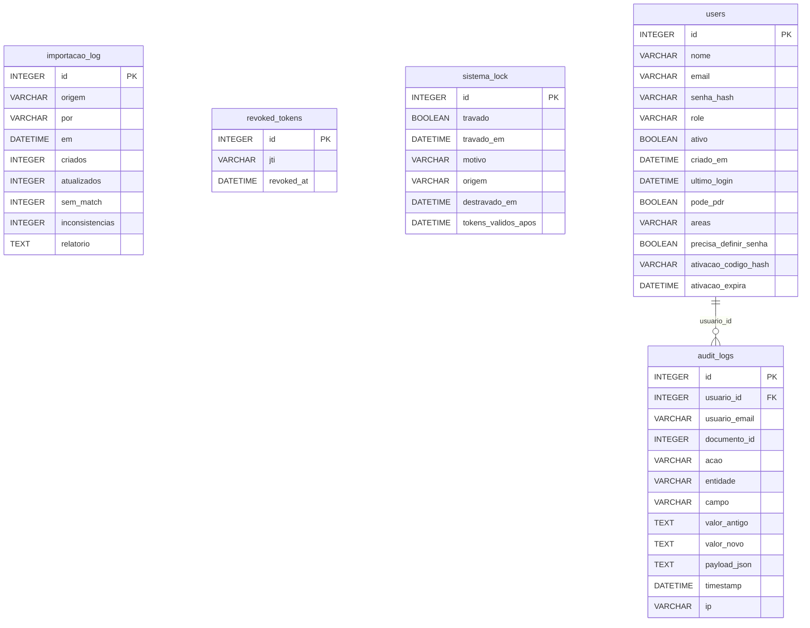
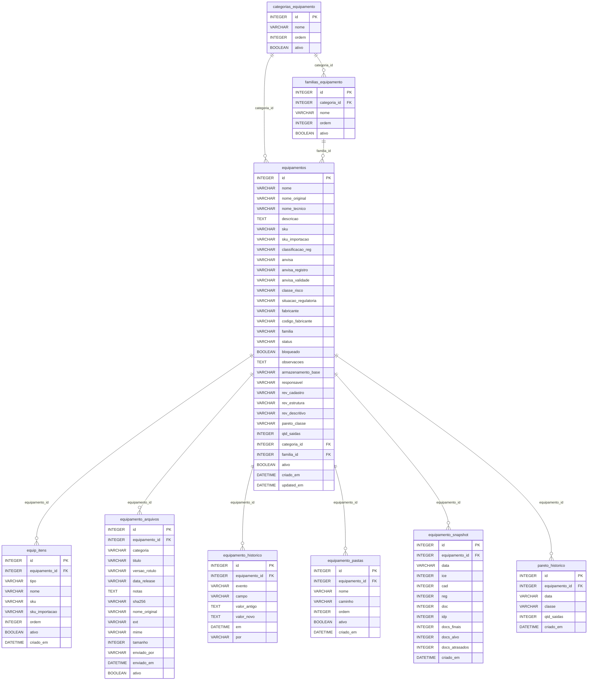
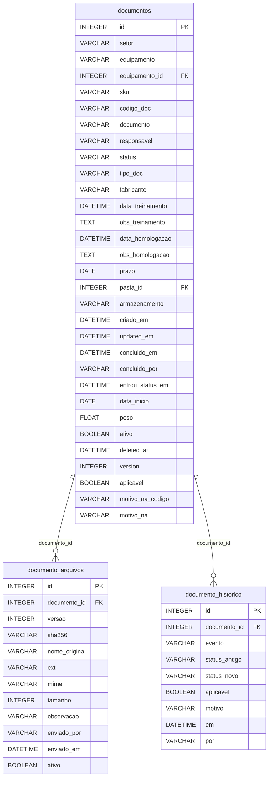
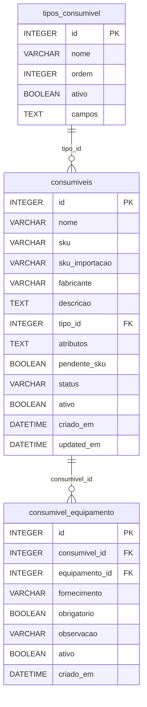
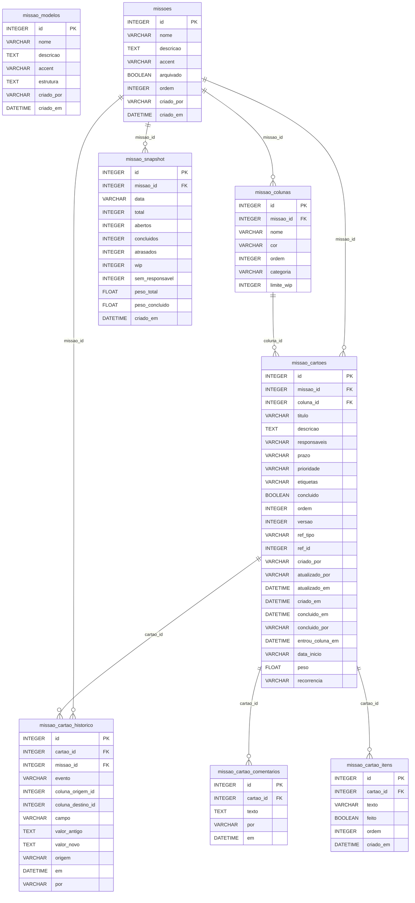
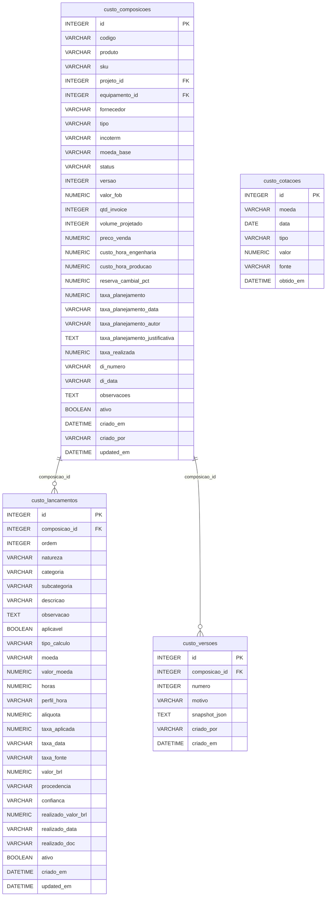
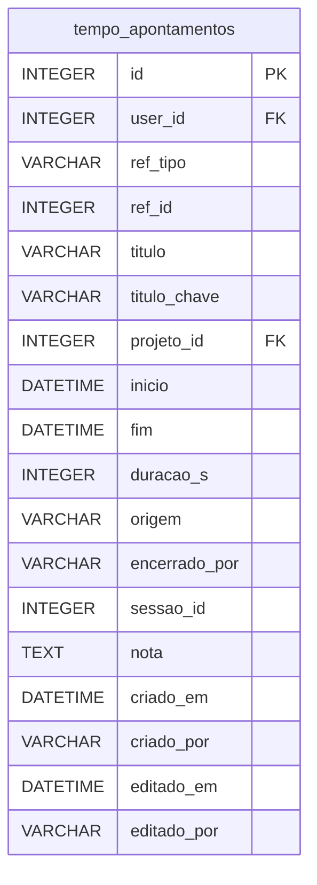
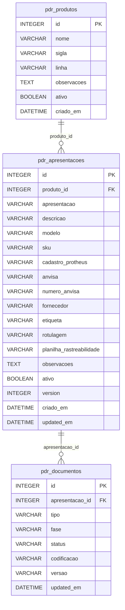
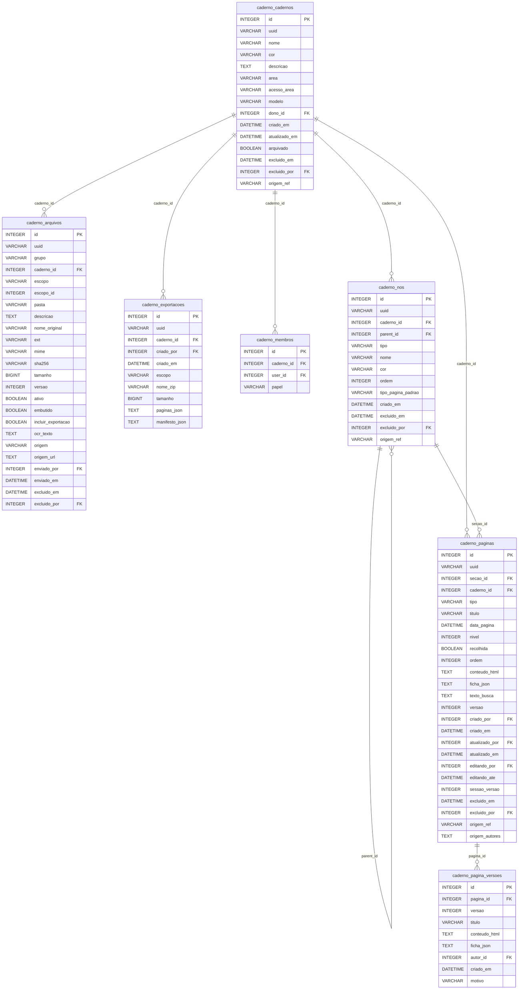

<!-- GERADO POR scripts/gerar_docs.py — NÃO EDITE À MÃO.
     Para mudar este arquivo, mude o código e rode:
         python scripts/gerar_docs.py
     tests/test_docs_sincronia.py falha se ele estiver defasado. -->

# Dicionário de dados

**54** tabelas, **627** colunas, agrupadas em **10** domínios.

Os textos da coluna *Nota* são os comentários do próprio `models.py` — é onde o conhecimento de domínio deste sistema está escrito.

> **O banco não guarda arquivo.** Colunas como `documentos.armazenamento` e `equipamento_arquivos.caminho` guardam o *caminho* para `\\loccus-srv03\Projetos$\Engenharia`. É a decisão que governa deploy, backup e acesso remoto — ver [ADR-0001](../arquitetura/decisoes/ADR-0001-caminho-no-banco.md).

## Índice

- **Acesso, auditoria e estado do sistema** (5): `audit_logs`, `importacao_log`, `revoked_tokens`, `sistema_lock`, `users`
- **Equipamentos e taxonomia** (9): `categorias_equipamento`, `equip_itens`, `equipamento_arquivos`, `equipamento_historico`, `equipamento_pastas`, `equipamento_snapshot`, `equipamentos`, `familias_equipamento`, `pareto_historico`
- **Documentos** (3): `documento_arquivos`, `documento_historico`, `documentos`
- **Consumíveis** (3): `consumiveis`, `consumivel_equipamento`, `tipos_consumivel`
- **Projetos e entregáveis** (11): `categorias_entregavel`, `entregaveis`, `entregavel_historico`, `modelos_entregavel`, `mudancas_modelo`, `mudancas_modelo_itens`, `projeto_baseline`, `projeto_mensal`, `projeto_snapshot`, `projetos`, `tipos_projeto`
- **Missões (kanban)** (8): `missao_cartao_comentarios`, `missao_cartao_historico`, `missao_cartao_itens`, `missao_cartoes`, `missao_colunas`, `missao_modelos`, `missao_snapshot`, `missoes`
- **Custos** (4): `custo_composicoes`, `custo_cotacoes`, `custo_lancamentos`, `custo_versoes`
- **Tempos** (1): `tempo_apontamentos`
- **PDR (P&D de reagentes)** (3): `pdr_apresentacoes`, `pdr_documentos`, `pdr_produtos`
- **Cadernos de laboratório** (7): `caderno_arquivos`, `caderno_cadernos`, `caderno_exportacoes`, `caderno_membros`, `caderno_nos`, `caderno_pagina_versoes`, `caderno_paginas`

---

## Acesso, auditoria e estado do sistema

### `audit_logs`

Modelo `AuditLog`. 12 colunas.

| Coluna | Tipo | Nulo | Chave | Padrão | Nota |
|---|---|---|---|---|---|
| `id` | INTEGER | não | PK | — |  |
| `usuario_id` | INTEGER | sim | FK → `users.id` | — |  |
| `usuario_email` | VARCHAR(120) | sim | — | — |  |
| `documento_id` | INTEGER | sim | — | — |  |
| `acao` | VARCHAR(60) | sim | — | — |  |
| `entidade` | VARCHAR(200) | sim | — | — |  |
| `campo` | VARCHAR(80) | sim | — | — |  |
| `valor_antigo` | TEXT | sim | — | — |  |
| `valor_novo` | TEXT | sim | — | — |  |
| `payload_json` | TEXT | sim | — | — |  |
| `timestamp` | DATETIME | sim | índice | `(dinâmico)` | index: /api/audit e /api/export/audit ordenam por timestamp DESC e filtram por período. Sem ele, a tela de auditoria fazia full scan + sort na tabela que mais cresce no banco. |
| `ip` | VARCHAR(50) | sim | — | — |  |

### `importacao_log`

Modelo `ImportacaoLog`. 9 colunas.

| Coluna | Tipo | Nulo | Chave | Padrão | Nota |
|---|---|---|---|---|---|
| `id` | INTEGER | não | PK | — |  |
| `origem` | VARCHAR(30) | não | índice | — | 'mestra' \| 'pareto' |
| `por` | VARCHAR(120) | sim | — | `''` |  |
| `em` | DATETIME | sim | índice | `(dinâmico)` |  |
| `criados` | INTEGER | sim | — | `0` |  |
| `atualizados` | INTEGER | sim | — | `0` |  |
| `sem_match` | INTEGER | sim | — | `0` |  |
| `inconsistencias` | INTEGER | sim | — | `0` |  |
| `relatorio` | TEXT | sim | — | `''` | JSON do relatório completo |

### `revoked_tokens`

Modelo `RevokedToken`. 3 colunas.

| Coluna | Tipo | Nulo | Chave | Padrão | Nota |
|---|---|---|---|---|---|
| `id` | INTEGER | não | PK | — |  |
| `jti` | VARCHAR(64) | não | único índice | — |  |
| `revoked_at` | DATETIME | não | — | `(dinâmico)` |  |

### `sistema_lock`

Modelo `SistemaLock`. 7 colunas.

| Coluna | Tipo | Nulo | Chave | Padrão | Nota |
|---|---|---|---|---|---|
| `id` | INTEGER | não | PK | — | sempre 1 |
| `travado` | BOOLEAN | não | — | `False` |  |
| `travado_em` | DATETIME | sim | — | — |  |
| `motivo` | VARCHAR(300) | sim | — | `''` |  |
| `origem` | VARCHAR(60) | sim | — | `''` | IP que disparou |
| `destravado_em` | DATETIME | sim | — | — |  |
| `tokens_validos_apos` | DATETIME | sim | — | — | Corte de sessão: todo JWT emitido ANTES deste instante é recusado. É o que transforma a trava em revogação de sessões — sem isto, quem já estava com um token válido voltaria a usá-lo intacto no destravamento. |

### `users`

Modelo `User`. 13 colunas.

| Coluna | Tipo | Nulo | Chave | Padrão | Nota |
|---|---|---|---|---|---|
| `id` | INTEGER | não | PK | — |  |
| `nome` | VARCHAR(120) | não | — | — |  |
| `email` | VARCHAR(120) | não | único índice | — |  |
| `senha_hash` | VARCHAR(256) | não | — | — |  |
| `role` | VARCHAR(20) | não | — | `'tecnico'` |  |
| `ativo` | BOOLEAN | sim | — | `True` |  |
| `criado_em` | DATETIME | sim | — | `(dinâmico)` |  |
| `ultimo_login` | DATETIME | sim | — | — |  |
| `pode_pdr` | BOOLEAN | não | — | `False` | Acesso ao módulo PDR (P&D de reagentes). Legado: substituído pela coluna `areas`; mantido só para compatibilidade da migração (backfill de áreas). |
| `areas` | VARCHAR(200) | não | — | `''` | Áreas de P&D que o usuário acessa (CSV de slugs, ex.: "pde,pdr"). Admin sempre acessa todas — ver area_slugs(). Fonte dos slugs: areas.py. |
| `precisa_definir_senha` | BOOLEAN | não | — | `False` | Primeiro acesso / reset de senha (modelo de convite) Conta pendente: precisa_definir_senha=True, senha_hash inutilizável e um código de ativação (hash) que o usuário troca pela própria senha. |
| `ativacao_codigo_hash` | VARCHAR(256) | sim | — | — |  |
| `ativacao_expira` | DATETIME | sim | — | — |  |

---

## Equipamentos e taxonomia

### `categorias_equipamento`

Modelo `CategoriaEquipamento`. 4 colunas.

| Coluna | Tipo | Nulo | Chave | Padrão | Nota |
|---|---|---|---|---|---|
| `id` | INTEGER | não | PK | — |  |
| `nome` | VARCHAR(120) | não | índice | — |  |
| `ordem` | INTEGER | sim | — | `0` |  |
| `ativo` | BOOLEAN | não | índice | `True` |  |

### `equip_itens`

Modelo `EquipamentoItem`. 9 colunas.

| Coluna | Tipo | Nulo | Chave | Padrão | Nota |
|---|---|---|---|---|---|
| `id` | INTEGER | não | PK | — |  |
| `equipamento_id` | INTEGER | não | FK → `equipamentos.id` índice | — |  |
| `tipo` | VARCHAR(20) | não | índice | — | "consumivel" \| "acessorio" |
| `nome` | VARCHAR(200) | não | — | `''` |  |
| `sku` | VARCHAR(50) | sim | — | `''` | SKU de Venda |
| `sku_importacao` | VARCHAR(50) | sim | — | `''` | SKU de Importação |
| `ordem` | INTEGER | sim | — | `0` |  |
| `ativo` | BOOLEAN | não | índice | `True` |  |
| `criado_em` | DATETIME | sim | — | `(dinâmico)` |  |

### `equipamento_arquivos`

Modelo `EquipamentoArquivo`. 15 colunas.

| Coluna | Tipo | Nulo | Chave | Padrão | Nota |
|---|---|---|---|---|---|
| `id` | INTEGER | não | PK | — |  |
| `equipamento_id` | INTEGER | não | FK → `equipamentos.id` índice | — |  |
| `categoria` | VARCHAR(20) | não | índice | `'agregado'` |  |
| `titulo` | VARCHAR(200) | sim | — | `''` | Nome de exibição. Vazio → cai no nome do arquivo enviado. |
| `versao_rotulo` | VARCHAR(60) | sim | — | `''` | Rótulo de versão do FABRICANTE ("v2.4.1", "FW 3.02"). Texto livre de propósito: cada fabricante numera do seu jeito e não há o que validar. |
| `data_release` | VARCHAR(10) | sim | — | `''` | Data de liberação da versão (YYYY-MM-DD, texto — padrão do projeto para datas vindas de planilha/fabricante). É por ela que "a mais nova" é decidida. |
| `notas` | TEXT | sim | — | `''` |  |
| `sha256` | VARCHAR(64) | não | índice | — |  |
| `nome_original` | VARCHAR(300) | não | — | `''` |  |
| `ext` | VARCHAR(10) | sim | — | `''` |  |
| `mime` | VARCHAR(120) | sim | — | `''` |  |
| `tamanho` | INTEGER | sim | — | `0` |  |
| `enviado_por` | VARCHAR(120) | sim | — | `''` |  |
| `enviado_em` | DATETIME | sim | índice | `(dinâmico)` |  |
| `ativo` | BOOLEAN | não | índice | `True` |  |

### `equipamento_historico`

Modelo `EquipamentoHistorico`. 8 colunas.

| Coluna | Tipo | Nulo | Chave | Padrão | Nota |
|---|---|---|---|---|---|
| `id` | INTEGER | não | PK | — |  |
| `equipamento_id` | INTEGER | não | FK → `equipamentos.id` índice | — |  |
| `evento` | VARCHAR(20) | sim | índice | `'update'` | create\|update\|delete\|import |
| `campo` | VARCHAR(60) | sim | índice | `''` |  |
| `valor_antigo` | TEXT | sim | — | `''` |  |
| `valor_novo` | TEXT | sim | — | `''` |  |
| `em` | DATETIME | sim | índice | `(dinâmico)` |  |
| `por` | VARCHAR(120) | sim | — | `''` |  |

### `equipamento_pastas`

Modelo `EquipamentoPasta`. 7 colunas.

| Coluna | Tipo | Nulo | Chave | Padrão | Nota |
|---|---|---|---|---|---|
| `id` | INTEGER | não | PK | — |  |
| `equipamento_id` | INTEGER | não | FK → `equipamentos.id` índice | — |  |
| `nome` | VARCHAR(80) | não | — | `''` |  |
| `caminho` | VARCHAR(500) | sim | — | `''` | Caminho completo e canônico (ver caminhos.normalizar). Não é sufixo do armazenamento_base: há equipamento cuja pasta de manuais está fora dele. |
| `ordem` | INTEGER | sim | — | `0` |  |
| `ativo` | BOOLEAN | não | — | `True` |  |
| `criado_em` | DATETIME | sim | — | `(dinâmico)` |  |

### `equipamento_snapshot`

Modelo `EquipamentoSnapshot`. 12 colunas.

| Coluna | Tipo | Nulo | Chave | Padrão | Nota |
|---|---|---|---|---|---|
| `id` | INTEGER | não | PK | — |  |
| `equipamento_id` | INTEGER | não | FK → `equipamentos.id` índice | — |  |
| `data` | VARCHAR(10) | não | índice | — | 'YYYY-MM-DD' |
| `ice` | INTEGER | sim | — | `0` |  |
| `cad` | INTEGER | sim | — | `0` |  |
| `reg` | INTEGER | sim | — | `0` |  |
| `doc` | INTEGER | sim | — | `0` |  |
| `idp` | INTEGER | sim | — | — |  |
| `docs_finais` | INTEGER | sim | — | `0` |  |
| `docs_alvo` | INTEGER | sim | — | `0` |  |
| `docs_atrasados` | INTEGER | sim | — | `0` |  |
| `criado_em` | DATETIME | sim | — | `(dinâmico)` |  |

### `equipamentos`

Modelo `Equipamento`. 31 colunas.

| Coluna | Tipo | Nulo | Chave | Padrão | Nota |
|---|---|---|---|---|---|
| `id` | INTEGER | não | PK | — |  |
| `nome` | VARCHAR(200) | não | índice | — | Nome comercial / chave de junção |
| `nome_original` | VARCHAR(300) | sim | — | `''` |  |
| `nome_tecnico` | VARCHAR(400) | sim | — | `''` | nome longo/descritivo (planilha mestra) |
| `descricao` | TEXT | sim | — | `''` | descritivo livre (≠ nome_tecnico ≠ observacoes) |
| `sku` | VARCHAR(50) | sim | índice | `''` | SKU de Venda (chave de junção) |
| `sku_importacao` | VARCHAR(50) | sim | — | `''` | SKU de Importação |
| `classificacao_reg` | VARCHAR(20) | sim | — | `''` | "RUO" \| "IVD" \| "" (nem todo equip. tem registro ANVISA) |
| `anvisa` | VARCHAR(60) | sim | — | `''` | nº de registro ANVISA |
| `anvisa_registro` | VARCHAR(40) | sim | — | `''` | data (texto, padrão do projeto) |
| `anvisa_validade` | VARCHAR(40) | sim | — | `''` | data (texto) |
| `classe_risco` | VARCHAR(10) | sim | — | `''` | I \| II \| III \| IV (RDC 751) |
| `situacao_regulatoria` | VARCHAR(30) | sim | — | `''` | Vigente \| Em renovação \| Cancelado \| Não aplicável |
| `fabricante` | VARCHAR(200) | sim | — | `''` | Código interno, modelo, tecnologia e aplicação saíram da ficha: repetiam o que já vem em SKU/código do fabricante e no descritivo. As colunas seguem no banco, sem uso, para não exigir migração destrutiva. |
| `codigo_fabricante` | VARCHAR(80) | sim | — | `''` | código interno do fabricante (part number) |
| `familia` | VARCHAR(120) | sim | — | `''` | LEGADO (texto); migrar p/ familia_id |
| `status` | VARCHAR(40) | sim | — | `'Ativo'` | Ativo/Obsoleto/Descontinuado |
| `bloqueado` | BOOLEAN | não | índice | `False` |  |
| `observacoes` | TEXT | sim | — | `''` |  |
| `armazenamento_base` | VARCHAR(500) | sim | — | `''` |  |
| `responsavel` | VARCHAR(120) | sim | — | `''` | Dono do cadastro. A worklist do dashboard listava o que está incompleto sem dizer para quem cobrar; o responsável do documento é por documento, não cobre os campos de cadastro/regulatório do próprio equipamento. |
| `rev_cadastro` | VARCHAR(20) | sim | — | `'Pendente'` | Revisões manuais do IDP (Índice de Desenvolvimento de Produto). Os itens Manual do usuário / IT / Checklists são derivados do status dos documentos (não persistidos aqui); estes três são marcados à mão. Valores: ESTADOS_REVISAO. |
| `rev_estrutura` | VARCHAR(20) | sim | — | `'Pendente'` |  |
| `rev_descritivo` | VARCHAR(20) | sim | — | `'Pendente'` |  |
| `pareto_classe` | VARCHAR(1) | sim | — | `''` | "A" \| "B" \| "C" \| "" |
| `qtd_saidas` | INTEGER | sim | — | `0` |  |
| `categoria_id` | INTEGER | sim | FK → `categorias_equipamento.id` índice | — | Taxonomia gerenciada (família aninhada na categoria) |
| `familia_id` | INTEGER | sim | FK → `familias_equipamento.id` índice | — |  |
| `ativo` | BOOLEAN | não | índice | `True` |  |
| `criado_em` | DATETIME | sim | — | `(dinâmico)` |  |
| `updated_em` | DATETIME | sim | — | `(dinâmico)` |  |

### `familias_equipamento`

Modelo `FamiliaEquipamento`. 5 colunas.

| Coluna | Tipo | Nulo | Chave | Padrão | Nota |
|---|---|---|---|---|---|
| `id` | INTEGER | não | PK | — |  |
| `categoria_id` | INTEGER | não | FK → `categorias_equipamento.id` índice | — |  |
| `nome` | VARCHAR(120) | não | índice | — |  |
| `ordem` | INTEGER | sim | — | `0` |  |
| `ativo` | BOOLEAN | não | índice | `True` |  |

### `pareto_historico`

Modelo `ParetoHistorico`. 6 colunas.

| Coluna | Tipo | Nulo | Chave | Padrão | Nota |
|---|---|---|---|---|---|
| `id` | INTEGER | não | PK | — |  |
| `equipamento_id` | INTEGER | não | FK → `equipamentos.id` índice | — |  |
| `data` | VARCHAR(10) | não | índice | — | 'YYYY-MM-DD' |
| `classe` | VARCHAR(1) | sim | — | `''` |  |
| `qtd_saidas` | INTEGER | sim | — | `0` |  |
| `criado_em` | DATETIME | sim | — | `(dinâmico)` |  |

---

## Documentos

**Ligações para fora deste domínio:**

| Daqui | Coluna | Aponta para |
|---|---|---|
| `documentos` | `equipamento_id` | `equipamentos` |
| `documentos` | `pasta_id` | `equipamento_pastas` |

### `documento_arquivos`

Modelo `DocumentoArquivo`. 12 colunas.

| Coluna | Tipo | Nulo | Chave | Padrão | Nota |
|---|---|---|---|---|---|
| `id` | INTEGER | não | PK | — |  |
| `documento_id` | INTEGER | não | FK → `documentos.id` índice | — |  |
| `versao` | INTEGER | não | — | `1` |  |
| `sha256` | VARCHAR(64) | não | índice | — |  |
| `nome_original` | VARCHAR(300) | não | — | `''` |  |
| `ext` | VARCHAR(10) | sim | — | `''` |  |
| `mime` | VARCHAR(120) | sim | — | `''` |  |
| `tamanho` | INTEGER | sim | — | `0` |  |
| `observacao` | VARCHAR(300) | sim | — | `''` |  |
| `enviado_por` | VARCHAR(120) | sim | — | `''` |  |
| `enviado_em` | DATETIME | sim | índice | `(dinâmico)` |  |
| `ativo` | BOOLEAN | não | índice | `True` |  |

### `documento_historico`

Modelo `DocumentoHistorico`. 9 colunas.

| Coluna | Tipo | Nulo | Chave | Padrão | Nota |
|---|---|---|---|---|---|
| `id` | INTEGER | não | PK | — |  |
| `documento_id` | INTEGER | não | FK → `documentos.id` índice | — |  |
| `evento` | VARCHAR(20) | sim | índice | `'status'` |  |
| `status_antigo` | VARCHAR(60) | sim | — | `''` |  |
| `status_novo` | VARCHAR(60) | sim | — | `''` |  |
| `aplicavel` | BOOLEAN | sim | — | — |  |
| `motivo` | VARCHAR(300) | sim | — | `''` |  |
| `em` | DATETIME | sim | índice | `(dinâmico)` |  |
| `por` | VARCHAR(120) | sim | — | `''` |  |

### `documentos`

Modelo `Documento`. 31 colunas.

| Coluna | Tipo | Nulo | Chave | Padrão | Nota |
|---|---|---|---|---|---|
| `id` | INTEGER | não | PK | — |  |
| `setor` | VARCHAR(30) | não | índice | — |  |
| `equipamento` | VARCHAR(200) | não | — | `''` |  |
| `equipamento_id` | INTEGER | sim | FK → `equipamentos.id` índice | — | Vínculo com a entidade Equipamento (identidade compartilhada). Nullable durante a transição; backfill no startup preenche para os docs existentes. |
| `sku` | VARCHAR(50) | sim | — | `''` |  |
| `codigo_doc` | VARCHAR(50) | sim | — | `''` |  |
| `documento` | VARCHAR(300) | não | — | `''` |  |
| `responsavel` | VARCHAR(200) | sim | — | `''` |  |
| `status` | VARCHAR(60) | sim | — | `'Elaborar'` |  |
| `tipo_doc` | VARCHAR(60) | sim | — | `''` |  |
| `fabricante` | VARCHAR(200) | sim | — | `''` |  |
| `data_treinamento` | DATETIME | sim | — | — | data_treinamento / data_homologacao são datas REALIZADAS (o que aconteceu). `prazo` é a data ALVO de conclusão — sem ela nada pode estar "atrasado". |
| `obs_treinamento` | TEXT | sim | — | `''` |  |
| `data_homologacao` | DATETIME | sim | — | — |  |
| `obs_homologacao` | TEXT | sim | — | `''` |  |
| `prazo` | DATE | sim | índice | — |  |
| `pasta_id` | INTEGER | sim | FK → `equipamento_pastas.id` índice | — | Pasta (grupo) a que este documento pertence — ver EquipamentoPasta. É o nível que faltava: na estrutura real de rede os manuais ficam numa pasta, IT e checklists em outra, QI/QO/QD em outra. Antes só havia "a pasta do equipamento", e dizer isso exigia um override em cada documento. |
| `armazenamento` | VARCHAR(500) | sim | — | `''` | Exceção livre deste documento, quando ele não cabe em nenhuma pasta do equipamento (ex.: Manual ES em \LATAM e Manual PT em \Manual Dash). Vazio é o caso normal. Vence a pasta e o caminho do equipamento. |
| `criado_em` | DATETIME | sim | — | `(dinâmico)` |  |
| `updated_em` | DATETIME | sim | — | `(dinâmico)` |  |
| `concluido_em` | DATETIME | sim | índice | — | Documento era o modelo menos instrumentado do sistema, apesar de ser o maior conjunto de dados: `updated_em` é sobrescrito a cada save, então não havia como responder "quanto tempo levou para homologar", "há quantos dias está parado neste status" ou "quantos foram concluídos em março" sem varrer a trilha inteira. Missões e Entregáveis já tinham estas colunas. |
| `concluido_por` | VARCHAR(120) | sim | — | `''` |  |
| `entrou_status_em` | DATETIME | sim | — | — | Quando o documento entrou no status atual — aging sem varrer o histórico (a trilha continua sendo a fonte da série completa). |
| `data_inicio` | DATE | sim | — | — | Início efetivo do trabalho. Com `prazo` fecha a duração planejada. |
| `peso` | FLOAT | sim | — | `1.0` | esforço relativo |
| `ativo` | BOOLEAN | não | índice | `True` |  |
| `deleted_at` | DATETIME | sim | — | — |  |
| `version` | INTEGER | não | — | `0` |  |
| `aplicavel` | BOOLEAN | não | índice | `True` | Escopo de documentos do equipamento: aplicavel=False → "não se aplica" (N/A). O documento continua existindo (status, código, histórico preservados), mas sai do denominador da completude (card, chips, KPIs, IDP). Reversível. |
| `motivo_na_codigo` | VARCHAR(40) | sim | — | `''` | motivo_na_codigo: chave de MOTIVOS_NA (analisável, obrigatória ao marcar N/A). motivo_na: descrição livre — obrigatória apenas quando o código é 'outro'. |
| `motivo_na` | VARCHAR(300) | sim | — | `''` |  |

---

## Consumíveis

**Ligações para fora deste domínio:**

| Daqui | Coluna | Aponta para |
|---|---|---|
| `consumivel_equipamento` | `equipamento_id` | `equipamentos` |

### `consumiveis`

Modelo `Consumivel`. 13 colunas.

| Coluna | Tipo | Nulo | Chave | Padrão | Nota |
|---|---|---|---|---|---|
| `id` | INTEGER | não | PK | — |  |
| `nome` | VARCHAR(200) | não | índice | — |  |
| `sku` | VARCHAR(50) | sim | índice | `''` | SKU de Venda (chave de dedup) |
| `sku_importacao` | VARCHAR(50) | sim | — | `''` |  |
| `fabricante` | VARCHAR(200) | sim | — | `''` |  |
| `descricao` | TEXT | sim | — | `''` |  |
| `tipo_id` | INTEGER | sim | FK → `tipos_consumivel.id` índice | — |  |
| `atributos` | TEXT | sim | — | `'{}'` | JSON: valores (campos do modelo + extras) |
| `pendente_sku` | BOOLEAN | não | índice | `False` |  |
| `status` | VARCHAR(40) | sim | — | `'Ativo'` |  |
| `ativo` | BOOLEAN | não | índice | `True` |  |
| `criado_em` | DATETIME | sim | — | `(dinâmico)` |  |
| `updated_em` | DATETIME | sim | — | `(dinâmico)` |  |

### `consumivel_equipamento`

Modelo `ConsumivelEquipamento`. 8 colunas.

| Coluna | Tipo | Nulo | Chave | Padrão | Nota |
|---|---|---|---|---|---|
| `id` | INTEGER | não | PK | — |  |
| `consumivel_id` | INTEGER | não | FK → `consumiveis.id` índice | — |  |
| `equipamento_id` | INTEGER | não | FK → `equipamentos.id` índice | — |  |
| `fornecimento` | VARCHAR(30) | sim | — | `'nao_informado'` |  |
| `obrigatorio` | BOOLEAN | sim | — | `False` |  |
| `observacao` | VARCHAR(300) | sim | — | `''` |  |
| `ativo` | BOOLEAN | não | índice | `True` |  |
| `criado_em` | DATETIME | sim | — | `(dinâmico)` |  |

### `tipos_consumivel`

Modelo `TipoConsumivel`. 5 colunas.

| Coluna | Tipo | Nulo | Chave | Padrão | Nota |
|---|---|---|---|---|---|
| `id` | INTEGER | não | PK | — |  |
| `nome` | VARCHAR(120) | não | índice | — |  |
| `ordem` | INTEGER | sim | — | `0` |  |
| `ativo` | BOOLEAN | não | índice | `True` |  |
| `campos` | TEXT | sim | — | `'[]'` | JSON: modelo de campos do tipo |

---

## Projetos e entregáveis

```mermaid
erDiagram
    categorias_entregavel {
        INTEGER id PK
        VARCHAR nome
        INTEGER ordem
        DATETIME criado_em
    }
    entregaveis {
        INTEGER id PK
        INTEGER projeto_id FK
        VARCHAR tipo
        VARCHAR categoria
        VARCHAR status
        INTEGER percentual
        FLOAT peso
        VARCHAR responsaveis
        VARCHAR data_inicio_prev
        VARCHAR data_fim_prev
        VARCHAR data_inicio
        VARCHAR data_conclusao
        INTEGER ordem
        VARCHAR modelo_chave
        TEXT modelo_origem
        VARCHAR atualizado_por
        DATETIME atualizado_em
    }
    entregavel_historico {
        INTEGER id PK
        INTEGER entregavel_id FK
        VARCHAR status_antigo
        VARCHAR status_novo
        INTEGER percentual
        DATETIME em
        VARCHAR por
    }
    modelos_entregavel {
        INTEGER id PK
        VARCHAR chave
        VARCHAR tipo_projeto
        VARCHAR categoria
        VARCHAR tipo
        FLOAT peso
        VARCHAR responsavel_padrao
        INTEGER ordem
    }
    mudancas_modelo {
        INTEGER id PK
        VARCHAR tipo_projeto
        VARCHAR motivo
        VARCHAR feito_por
        DATETIME feito_em
        INTEGER n_projetos
        INTEGER n_alteracoes
    }
    mudancas_modelo_itens {
        INTEGER id PK
        INTEGER mudanca_id FK
        INTEGER projeto_id
        VARCHAR projeto_nome
        INTEGER entregavel_id
        VARCHAR entregavel
        VARCHAR acao
        VARCHAR campo
        VARCHAR antes
        VARCHAR depois
    }
    projeto_baseline {
        INTEGER id PK
        INTEGER projeto_id FK
        INTEGER versao
        VARCHAR data_inicio_prev
        VARCHAR data_fim_prev
        FLOAT orcamento
        VARCHAR motivo
        VARCHAR criado_por
        DATETIME criado_em
    }
    projeto_mensal {
        INTEGER id PK
        INTEGER projeto_id FK
        VARCHAR competencia
        INTEGER pct_previsto
        INTEGER pct_realizado
        FLOAT custo_mes
        FLOAT custo_acumulado
        VARCHAR atualizado_por
        DATETIME atualizado_em
    }
    projeto_snapshot {
        INTEGER id PK
        INTEGER projeto_id FK
        VARCHAR data
        INTEGER avanco
        INTEGER pct_previsto
        FLOAT spi
        FLOAT cpi
        FLOAT ac
        FLOAT bac
        DATETIME criado_em
    }
    projetos {
        INTEGER id PK
        VARCHAR nome
        VARCHAR descricao
        VARCHAR tipo
        VARCHAR sku
        VARCHAR moscow
        INTEGER prioridade
        BOOLEAN consumivel
        VARCHAR lancamento
        INTEGER ano
        VARCHAR status
        BOOLEAN ativo
        DATETIME criado_em
        VARCHAR data_inicio_prev
        VARCHAR data_inicio_real
        VARCHAR data_fim_prev
        VARCHAR data_fim_real
        FLOAT orcamento
    }
    tipos_projeto {
        INTEGER id PK
        VARCHAR nome
        VARCHAR area
        INTEGER ordem
        DATETIME criado_em
    }
    entregaveis ||--o{ entregavel_historico : "entregavel_id"
    mudancas_modelo ||--o{ mudancas_modelo_itens : "mudanca_id"
    projetos ||--o{ entregaveis : "projeto_id"
    projetos ||--o{ projeto_baseline : "projeto_id"
    projetos ||--o{ projeto_mensal : "projeto_id"
    projetos ||--o{ projeto_snapshot : "projeto_id"
```

### `categorias_entregavel`

Modelo `CategoriaEntregavel`. 4 colunas.

| Coluna | Tipo | Nulo | Chave | Padrão | Nota |
|---|---|---|---|---|---|
| `id` | INTEGER | não | PK | — |  |
| `nome` | VARCHAR(40) | não | único | — |  |
| `ordem` | INTEGER | sim | — | `0` |  |
| `criado_em` | DATETIME | sim | — | `(dinâmico)` |  |

### `entregaveis`

Modelo `Entregavel`. 17 colunas.

| Coluna | Tipo | Nulo | Chave | Padrão | Nota |
|---|---|---|---|---|---|
| `id` | INTEGER | não | PK | — |  |
| `projeto_id` | INTEGER | não | FK → `projetos.id` índice | — |  |
| `tipo` | VARCHAR(120) | não | — | — |  |
| `categoria` | VARCHAR(40) | sim | — | `'Produto'` |  |
| `status` | VARCHAR(20) | sim | índice | `'pendente'` |  |
| `percentual` | INTEGER | sim | — | — |  |
| `peso` | FLOAT | sim | — | `1.0` | esforço relativo (EVM) |
| `responsaveis` | VARCHAR(200) | sim | — | `''` | legado / rótulo livre |
| `data_inicio_prev` | VARCHAR(40) | sim | — | `''` | ISO — planejado |
| `data_fim_prev` | VARCHAR(40) | sim | — | `''` | ISO — planejado |
| `data_inicio` | VARCHAR(40) | sim | — | `''` | ISO — quando a tarefa começou |
| `data_conclusao` | VARCHAR(40) | sim | — | `''` | ISO — quando foi concluída |
| `ordem` | INTEGER | sim | — | `0` | posição na lista do projeto |
| `modelo_chave` | VARCHAR(32) | sim | índice | `''` | Vínculo com o item de modelo de onde veio (ModeloEntregavel.chave) e os valores que o modelo tinha na última criação/aplicação — é a "origem" da comparação de três lados de modelo_sync. Vazio = avulso, a propagação não toca. NULL em `modelo_origem` = linha anterior ao vínculo, ainda não avaliada (o backfill da subida resolve e nunca deixa NULL). |
| `modelo_origem` | TEXT | sim | — | `''` |  |
| `atualizado_por` | VARCHAR(120) | sim | — | `''` |  |
| `atualizado_em` | DATETIME | sim | — | `(dinâmico)` |  |

### `entregavel_historico`

Modelo `EntregavelHistorico`. 7 colunas.

| Coluna | Tipo | Nulo | Chave | Padrão | Nota |
|---|---|---|---|---|---|
| `id` | INTEGER | não | PK | — |  |
| `entregavel_id` | INTEGER | não | FK → `entregaveis.id` índice | — |  |
| `status_antigo` | VARCHAR(20) | sim | — | `''` |  |
| `status_novo` | VARCHAR(20) | sim | — | `''` |  |
| `percentual` | INTEGER | sim | — | — |  |
| `em` | DATETIME | sim | índice | `(dinâmico)` |  |
| `por` | VARCHAR(120) | sim | — | `''` |  |

### `modelos_entregavel`

Modelo `ModeloEntregavel`. 8 colunas.

| Coluna | Tipo | Nulo | Chave | Padrão | Nota |
|---|---|---|---|---|---|
| `id` | INTEGER | não | PK | — |  |
| `chave` | VARCHAR(32) | sim | índice | `(dinâmico)` |  |
| `tipo_projeto` | VARCHAR(20) | não | índice | — | nome de um TipoProjeto |
| `categoria` | VARCHAR(40) | sim | — | `'Produto'` |  |
| `tipo` | VARCHAR(120) | não | — | — | nome do entregável |
| `peso` | FLOAT | sim | — | `1.0` | esforço relativo padrão |
| `responsavel_padrao` | VARCHAR(200) | sim | — | `''` |  |
| `ordem` | INTEGER | sim | — | `0` |  |

### `mudancas_modelo`

Modelo `MudancaModelo`. 7 colunas.

| Coluna | Tipo | Nulo | Chave | Padrão | Nota |
|---|---|---|---|---|---|
| `id` | INTEGER | não | PK | — |  |
| `tipo_projeto` | VARCHAR(20) | não | índice | — | nome do modelo na época |
| `motivo` | VARCHAR(500) | não | — | — |  |
| `feito_por` | VARCHAR(120) | sim | — | `''` |  |
| `feito_em` | DATETIME | sim | índice | `(dinâmico)` |  |
| `n_projetos` | INTEGER | sim | — | `0` |  |
| `n_alteracoes` | INTEGER | sim | — | `0` | sem contar os "mantidos" |

### `mudancas_modelo_itens`

Modelo `MudancaModeloItem`. 10 colunas.

| Coluna | Tipo | Nulo | Chave | Padrão | Nota |
|---|---|---|---|---|---|
| `id` | INTEGER | não | PK | — |  |
| `mudanca_id` | INTEGER | não | FK → `mudancas_modelo.id` índice | — |  |
| `projeto_id` | INTEGER | sim | índice | — |  |
| `projeto_nome` | VARCHAR(200) | sim | — | `''` |  |
| `entregavel_id` | INTEGER | sim | — | — |  |
| `entregavel` | VARCHAR(120) | sim | — | `''` | nome do entregável na época |
| `acao` | VARCHAR(20) | não | — | — | ver modelo_sync.ACOES |
| `campo` | VARCHAR(20) | sim | — | `''` |  |
| `antes` | VARCHAR(300) | sim | — | `''` |  |
| `depois` | VARCHAR(300) | sim | — | `''` |  |

### `projeto_baseline`

Modelo `ProjetoBaseline`. 9 colunas.

| Coluna | Tipo | Nulo | Chave | Padrão | Nota |
|---|---|---|---|---|---|
| `id` | INTEGER | não | PK | — |  |
| `projeto_id` | INTEGER | não | FK → `projetos.id` índice | — |  |
| `versao` | INTEGER | não | — | `1` |  |
| `data_inicio_prev` | VARCHAR(40) | sim | — | `''` |  |
| `data_fim_prev` | VARCHAR(40) | sim | — | `''` |  |
| `orcamento` | FLOAT | sim | — | `0.0` |  |
| `motivo` | VARCHAR(300) | sim | — | `''` |  |
| `criado_por` | VARCHAR(120) | sim | — | `''` |  |
| `criado_em` | DATETIME | sim | — | `(dinâmico)` |  |

### `projeto_mensal`

Modelo `ProjetoMensal`. 9 colunas.

| Coluna | Tipo | Nulo | Chave | Padrão | Nota |
|---|---|---|---|---|---|
| `id` | INTEGER | não | PK | — |  |
| `projeto_id` | INTEGER | não | FK → `projetos.id` índice | — |  |
| `competencia` | VARCHAR(7) | não | — | — | 'YYYY-MM' |
| `pct_previsto` | INTEGER | sim | — | `0` | % planejado acumulado |
| `pct_realizado` | INTEGER | sim | — | `0` | % executado acumulado |
| `custo_mes` | FLOAT | sim | — | `0.0` | R$ gasto NO mês (incremental) |
| `custo_acumulado` | FLOAT | sim | — | `0.0` | R$ gasto acumulado (AC) — derivado |
| `atualizado_por` | VARCHAR(120) | sim | — | `''` |  |
| `atualizado_em` | DATETIME | sim | — | `(dinâmico)` |  |

### `projeto_snapshot`

Modelo `ProjetoSnapshot`. 10 colunas.

| Coluna | Tipo | Nulo | Chave | Padrão | Nota |
|---|---|---|---|---|---|
| `id` | INTEGER | não | PK | — |  |
| `projeto_id` | INTEGER | não | FK → `projetos.id` índice | — |  |
| `data` | VARCHAR(10) | não | índice | — | 'YYYY-MM-DD' |
| `avanco` | INTEGER | sim | — | `0` |  |
| `pct_previsto` | INTEGER | sim | — | — |  |
| `spi` | FLOAT | sim | — | — |  |
| `cpi` | FLOAT | sim | — | — |  |
| `ac` | FLOAT | sim | — | — |  |
| `bac` | FLOAT | sim | — | — |  |
| `criado_em` | DATETIME | sim | — | `(dinâmico)` |  |

### `projetos`

Modelo `Projeto`. 18 colunas.

| Coluna | Tipo | Nulo | Chave | Padrão | Nota |
|---|---|---|---|---|---|
| `id` | INTEGER | não | PK | — |  |
| `nome` | VARCHAR(200) | não | — | — |  |
| `descricao` | VARCHAR(400) | sim | — | `''` |  |
| `tipo` | VARCHAR(20) | sim | — | `''` | nome de um TipoProjeto \| "" (projetos antigos) |
| `sku` | VARCHAR(50) | sim | — | `''` |  |
| `moscow` | VARCHAR(10) | sim | — | `''` |  |
| `prioridade` | INTEGER | sim | — | `0` |  |
| `consumivel` | BOOLEAN | sim | — | `False` |  |
| `lancamento` | VARCHAR(40) | sim | — | `''` | data ou ano em texto livre |
| `ano` | INTEGER | sim | índice | `(dinâmico)` |  |
| `status` | VARCHAR(20) | não | índice | `'execucao'` |  |
| `ativo` | BOOLEAN | não | índice | `True` |  |
| `criado_em` | DATETIME | sim | — | `(dinâmico)` |  |
| `data_inicio_prev` | VARCHAR(40) | sim | — | `''` | ── PMO: cronograma (datas ISO em texto) + orçamento (BAC) ── |
| `data_inicio_real` | VARCHAR(40) | sim | — | `''` |  |
| `data_fim_prev` | VARCHAR(40) | sim | — | `''` |  |
| `data_fim_real` | VARCHAR(40) | sim | — | `''` |  |
| `orcamento` | FLOAT | sim | — | `0.0` | BAC – Budget At Completion |

### `tipos_projeto`

Modelo `TipoProjeto`. 5 colunas.

| Coluna | Tipo | Nulo | Chave | Padrão | Nota |
|---|---|---|---|---|---|
| `id` | INTEGER | não | PK | — |  |
| `nome` | VARCHAR(20) | não | único | — |  |
| `area` | VARCHAR(20) | não | — | `'pde'` | slug de areas.py |
| `ordem` | INTEGER | sim | — | `0` |  |
| `criado_em` | DATETIME | sim | — | `(dinâmico)` |  |

---

## Missões (kanban)

### `missao_cartao_comentarios`

Modelo `MissaoCartaoComentario`. 5 colunas.

| Coluna | Tipo | Nulo | Chave | Padrão | Nota |
|---|---|---|---|---|---|
| `id` | INTEGER | não | PK | — |  |
| `cartao_id` | INTEGER | não | FK → `missao_cartoes.id` índice | — |  |
| `texto` | TEXT | não | — | — |  |
| `por` | VARCHAR(120) | sim | — | `''` |  |
| `em` | DATETIME | sim | índice | `(dinâmico)` |  |

### `missao_cartao_historico`

Modelo `MissaoCartaoHistorico`. 12 colunas.

| Coluna | Tipo | Nulo | Chave | Padrão | Nota |
|---|---|---|---|---|---|
| `id` | INTEGER | não | PK | — |  |
| `cartao_id` | INTEGER | não | FK → `missao_cartoes.id` índice | — |  |
| `missao_id` | INTEGER | não | FK → `missoes.id` índice | — |  |
| `evento` | VARCHAR(20) | sim | índice | `'campo'` |  |
| `coluna_origem_id` | INTEGER | sim | — | — |  |
| `coluna_destino_id` | INTEGER | sim | — | — |  |
| `campo` | VARCHAR(40) | sim | — | `''` |  |
| `valor_antigo` | TEXT | sim | — | `''` |  |
| `valor_novo` | TEXT | sim | — | `''` |  |
| `origem` | VARCHAR(20) | sim | — | `'manual'` |  |
| `em` | DATETIME | sim | índice | `(dinâmico)` |  |
| `por` | VARCHAR(120) | sim | — | `''` |  |

### `missao_cartao_itens`

Modelo `MissaoCartaoItem`. 6 colunas.

| Coluna | Tipo | Nulo | Chave | Padrão | Nota |
|---|---|---|---|---|---|
| `id` | INTEGER | não | PK | — |  |
| `cartao_id` | INTEGER | não | FK → `missao_cartoes.id` índice | — |  |
| `texto` | VARCHAR(300) | não | — | — |  |
| `feito` | BOOLEAN | sim | — | `False` |  |
| `ordem` | INTEGER | sim | — | `0` |  |
| `criado_em` | DATETIME | sim | — | `(dinâmico)` |  |

### `missao_cartoes`

Modelo `MissaoCartao`. 24 colunas.

| Coluna | Tipo | Nulo | Chave | Padrão | Nota |
|---|---|---|---|---|---|
| `id` | INTEGER | não | PK | — |  |
| `missao_id` | INTEGER | não | FK → `missoes.id` índice | — |  |
| `coluna_id` | INTEGER | não | FK → `missao_colunas.id` índice | — |  |
| `titulo` | VARCHAR(200) | não | — | — |  |
| `descricao` | TEXT | sim | — | `''` | pesado: fora da query do board |
| `responsaveis` | VARCHAR(200) | sim | — | `''` | CSV (convenção do Entregavel) |
| `prazo` | VARCHAR(40) | sim | — | `''` | ISO 'YYYY-MM-DD' |
| `prioridade` | VARCHAR(10) | sim | — | `'media'` |  |
| `etiquetas` | VARCHAR(300) | sim | — | `''` | CSV |
| `concluido` | BOOLEAN | sim | — | `False` |  |
| `ordem` | INTEGER | sim | — | `0` |  |
| `versao` | INTEGER | sim | — | `0` | lock otimista (move/patch) |
| `ref_tipo` | VARCHAR(20) | sim | — | `''` | equipamento\|projeto\|documento\|"" |
| `ref_id` | INTEGER | sim | — | — |  |
| `criado_por` | VARCHAR(120) | sim | — | `''` |  |
| `atualizado_por` | VARCHAR(120) | sim | — | `''` |  |
| `atualizado_em` | DATETIME | sim | — | `(dinâmico)` |  |
| `criado_em` | DATETIME | sim | índice | `(dinâmico)` | Sem eles nada de fluxo era calculável: `atualizado_em` é sobrescrito a cada save, então nem a idade do cartão dava para derivar. |
| `concluido_em` | DATETIME | sim | índice | — |  |
| `concluido_por` | VARCHAR(120) | sim | — | `''` |  |
| `entrou_coluna_em` | DATETIME | sim | — | `(dinâmico)` | Momento em que o cartão entrou na coluna atual — aging sem varrer o histórico (o histórico continua sendo a fonte da série completa). |
| `data_inicio` | VARCHAR(40) | sim | — | `''` | ISO; com `prazo` dá duração planejada |
| `peso` | FLOAT | sim | — | `1.0` | esforço relativo (avanço ponderado) |
| `recorrencia` | VARCHAR(20) | sim | — | `''` | ver RECORRENCIAS_CARTAO |

### `missao_colunas`

Modelo `MissaoColuna`. 7 colunas.

| Coluna | Tipo | Nulo | Chave | Padrão | Nota |
|---|---|---|---|---|---|
| `id` | INTEGER | não | PK | — |  |
| `missao_id` | INTEGER | não | FK → `missoes.id` índice | — |  |
| `nome` | VARCHAR(80) | não | — | — |  |
| `cor` | VARCHAR(9) | sim | — | `''` |  |
| `ordem` | INTEGER | sim | — | `0` |  |
| `categoria` | VARCHAR(10) | sim | — | `''` | Tag opcional p/ rollup/relatório sem virar enum global (à la Notion/Linear): a coluna É o estado; a categoria só classifica (todo\|doing\|done). |
| `limite_wip` | INTEGER | sim | — | `0` | Limite de trabalho em progresso. 0 = sem limite. Sinal SOFT: o board pinta a coluna e os alertas avisam, mas nada bloqueia o arrasto — kanban trata estouro como conversa, não como erro de sistema. |

### `missao_modelos`

Modelo `MissaoModelo`. 7 colunas.

| Coluna | Tipo | Nulo | Chave | Padrão | Nota |
|---|---|---|---|---|---|
| `id` | INTEGER | não | PK | — |  |
| `nome` | VARCHAR(160) | não | — | — |  |
| `descricao` | TEXT | sim | — | `''` |  |
| `accent` | VARCHAR(9) | sim | — | `''` |  |
| `estrutura` | TEXT | sim | — | `'[]'` | JSON: [{nome, categoria, limite_wip, cartoes:[…]}] |
| `criado_por` | VARCHAR(120) | sim | — | `''` |  |
| `criado_em` | DATETIME | sim | — | `(dinâmico)` |  |

### `missao_snapshot`

Modelo `MissaoSnapshot`. 12 colunas.

| Coluna | Tipo | Nulo | Chave | Padrão | Nota |
|---|---|---|---|---|---|
| `id` | INTEGER | não | PK | — |  |
| `missao_id` | INTEGER | não | FK → `missoes.id` índice | — |  |
| `data` | VARCHAR(10) | não | índice | — | ISO |
| `total` | INTEGER | sim | — | `0` |  |
| `abertos` | INTEGER | sim | — | `0` |  |
| `concluidos` | INTEGER | sim | — | `0` |  |
| `atrasados` | INTEGER | sim | — | `0` |  |
| `wip` | INTEGER | sim | — | `0` | cartões em coluna 'doing' |
| `sem_responsavel` | INTEGER | sim | — | `0` |  |
| `peso_total` | FLOAT | sim | — | `0.0` |  |
| `peso_concluido` | FLOAT | sim | — | `0.0` |  |
| `criado_em` | DATETIME | sim | — | `(dinâmico)` |  |

### `missoes`

Modelo `Missao`. 8 colunas.

| Coluna | Tipo | Nulo | Chave | Padrão | Nota |
|---|---|---|---|---|---|
| `id` | INTEGER | não | PK | — |  |
| `nome` | VARCHAR(160) | não | — | — |  |
| `descricao` | TEXT | sim | — | `''` |  |
| `accent` | VARCHAR(9) | sim | — | `''` | cor hex opcional |
| `arquivado` | BOOLEAN | sim | índice | `False` |  |
| `ordem` | INTEGER | sim | — | `0` |  |
| `criado_por` | VARCHAR(120) | sim | — | `''` |  |
| `criado_em` | DATETIME | sim | — | `(dinâmico)` |  |

---

## Custos

**Ligações para fora deste domínio:**

| Daqui | Coluna | Aponta para |
|---|---|---|
| `custo_composicoes` | `equipamento_id` | `equipamentos` |
| `custo_composicoes` | `projeto_id` | `projetos` |

### `custo_composicoes`

Modelo `Composicao`. 31 colunas.

| Coluna | Tipo | Nulo | Chave | Padrão | Nota |
|---|---|---|---|---|---|
| `id` | INTEGER | não | PK | — |  |
| `codigo` | VARCHAR(30) | sim | índice | `''` | CC-2026-001 |
| `produto` | VARCHAR(200) | não | índice | — |  |
| `sku` | VARCHAR(50) | sim | índice | `''` |  |
| `projeto_id` | INTEGER | sim | FK → `projetos.id` índice | — | Vínculos com o que já existe. Ambos opcionais: uma composição pode nascer antes de o projeto existir, e revenda pode não ter projeto nenhum. |
| `equipamento_id` | INTEGER | sim | FK → `equipamentos.id` índice | — |  |
| `fornecedor` | VARCHAR(200) | sim | — | `''` |  |
| `tipo` | VARCHAR(20) | sim | — | `'OEM'` | OEM \| Revenda |
| `incoterm` | VARCHAR(10) | sim | — | `'FOB'` |  |
| `moeda_base` | VARCHAR(3) | sim | — | `'USD'` |  |
| `status` | VARCHAR(20) | não | índice | `'rascunho'` |  |
| `versao` | INTEGER | não | — | `1` |  |
| `valor_fob` | NUMERIC(14, 2) | sim | — | `0` | unitário, na moeda_base |
| `qtd_invoice` | INTEGER | sim | — | `1` |  |
| `volume_projetado` | INTEGER | sim | — | `1` | amortiza o NRE |
| `preco_venda` | NUMERIC(14, 2) | sim | — | — |  |
| `custo_hora_engenharia` | NUMERIC(14, 2) | sim | — | `0` |  |
| `custo_hora_producao` | NUMERIC(14, 2) | sim | — | `0` |  |
| `reserva_cambial_pct` | NUMERIC(8, 4) | sim | — | `10` |  |
| `taxa_planejamento` | NUMERIC(14, 6) | sim | — | `1` | A taxa de planejamento é travada: é a única que orça, e carrega quem decidiu e por quê. Sem isso ela vira um número herdado que ninguém defende. |
| `taxa_planejamento_data` | VARCHAR(10) | sim | — | `''` | ISO |
| `taxa_planejamento_autor` | VARCHAR(120) | sim | — | `''` |  |
| `taxa_planejamento_justificativa` | TEXT | sim | — | `''` |  |
| `taxa_realizada` | NUMERIC(14, 6) | sim | — | — | A taxa realizada chega com a DI e fecha o ciclo contra o baseline. |
| `di_numero` | VARCHAR(40) | sim | — | `''` |  |
| `di_data` | VARCHAR(10) | sim | — | `''` |  |
| `observacoes` | TEXT | sim | — | `''` |  |
| `ativo` | BOOLEAN | não | índice | `True` |  |
| `criado_em` | DATETIME | sim | — | `(dinâmico)` |  |
| `criado_por` | VARCHAR(120) | sim | — | `''` |  |
| `updated_em` | DATETIME | sim | — | `(dinâmico)` |  |

### `custo_cotacoes`

Modelo `Cotacao`. 7 colunas.

| Coluna | Tipo | Nulo | Chave | Padrão | Nota |
|---|---|---|---|---|---|
| `id` | INTEGER | não | PK | — |  |
| `moeda` | VARCHAR(3) | não | índice | — |  |
| `data` | DATE | não | índice | — |  |
| `tipo` | VARCHAR(20) | não | — | `'ptax_venda'` |  |
| `valor` | NUMERIC(14, 6) | não | — | — |  |
| `fonte` | VARCHAR(20) | sim | — | `'bcb_olinda'` |  |
| `obtido_em` | DATETIME | sim | — | `(dinâmico)` |  |

### `custo_lancamentos`

Modelo `Lancamento`. 27 colunas.

| Coluna | Tipo | Nulo | Chave | Padrão | Nota |
|---|---|---|---|---|---|
| `id` | INTEGER | não | PK | — |  |
| `composicao_id` | INTEGER | não | FK → `custo_composicoes.id` índice | — |  |
| `ordem` | INTEGER | sim | — | `0` |  |
| `natureza` | VARCHAR(10) | não | índice | `'cogs'` |  |
| `categoria` | VARCHAR(60) | sim | índice | `''` |  |
| `subcategoria` | VARCHAR(120) | sim | — | `''` |  |
| `descricao` | VARCHAR(300) | sim | — | `''` |  |
| `observacao` | TEXT | sim | — | `''` |  |
| `aplicavel` | BOOLEAN | não | — | `True` | Diferente da planilha de origem, este flag realmente exclui do total. |
| `tipo_calculo` | VARCHAR(20) | não | — | `'montante'` |  |
| `moeda` | VARCHAR(3) | sim | — | `'BRL'` |  |
| `valor_moeda` | NUMERIC(14, 2) | sim | — | `0` |  |
| `horas` | NUMERIC(10, 2) | sim | — | `0` |  |
| `perfil_hora` | VARCHAR(10) | sim | — | `''` |  |
| `aliquota` | NUMERIC(8, 4) | sim | — | `0` | em % |
| `taxa_aplicada` | NUMERIC(14, 6) | sim | — | — | A taxa fica congelada na linha: saber "quanto custou" exige saber "convertido a quanto, e quando". |
| `taxa_data` | VARCHAR(10) | sim | — | `''` |  |
| `taxa_fonte` | VARCHAR(20) | sim | — | `''` |  |
| `valor_brl` | NUMERIC(14, 2) | sim | — | `0` | derivado, persistido |
| `procedencia` | VARCHAR(20) | sim | — | `'estimativa'` |  |
| `confianca` | VARCHAR(10) | sim | — | `'media'` |  |
| `realizado_valor_brl` | NUMERIC(14, 2) | sim | — | — |  |
| `realizado_data` | VARCHAR(10) | sim | — | `''` |  |
| `realizado_doc` | VARCHAR(60) | sim | — | `''` |  |
| `ativo` | BOOLEAN | não | — | `True` |  |
| `criado_em` | DATETIME | sim | — | `(dinâmico)` |  |
| `updated_em` | DATETIME | sim | — | `(dinâmico)` |  |

### `custo_versoes`

Modelo `Versao`. 7 colunas.

| Coluna | Tipo | Nulo | Chave | Padrão | Nota |
|---|---|---|---|---|---|
| `id` | INTEGER | não | PK | — |  |
| `composicao_id` | INTEGER | não | FK → `custo_composicoes.id` índice | — |  |
| `numero` | INTEGER | não | — | — |  |
| `motivo` | VARCHAR(300) | sim | — | `''` |  |
| `snapshot_json` | TEXT | sim | — | `''` |  |
| `criado_por` | VARCHAR(120) | sim | — | `''` |  |
| `criado_em` | DATETIME | sim | — | `(dinâmico)` |  |

---

## Tempos

**Ligações para fora deste domínio:**

| Daqui | Coluna | Aponta para |
|---|---|---|
| `tempo_apontamentos` | `projeto_id` | `projetos` |
| `tempo_apontamentos` | `user_id` | `users` |

### `tempo_apontamentos`

Modelo `Apontamento`. 18 colunas.

| Coluna | Tipo | Nulo | Chave | Padrão | Nota |
|---|---|---|---|---|---|
| `id` | INTEGER | não | PK | — |  |
| `user_id` | INTEGER | não | FK → `users.id` | — | FK real, e não o vínculo solto usado em `ref_tipo/ref_id` abaixo: a pessoa é a chave do módulo inteiro e apontamento órfão não tem leitura possível. CASCADE porque auth.py:454 apaga o User de verdade (?permanente=true) e só sabe limpar audit_logs — sem isto aquele endpoint passaria a estourar FK no Postgres assim que alguém com horas lançadas fosse removido. |
| `ref_tipo` | VARCHAR(20) | não | — | `'livre'` | Vínculo tipado, sem FK rígida — mesmo desenho de MissaoCartao.ref_tipo / ref_id (models.py:2083), validado na gravação por core.validar_ref(). |
| `ref_id` | INTEGER | sim | — | — |  |
| `titulo` | VARCHAR(200) | sim | — | `''` | Rótulo congelado na gravação. Num alvo da plataforma é redundante com _ref_meta() e existe só para o relatório sobreviver ao equipamento renomeado ou ao cartão apagado; em 'livre' é o dado em si. |
| `titulo_chave` | VARCHAR(200) | sim | — | `''` | norm(titulo) |
| `projeto_id` | INTEGER | sim | FK → `projetos.id` | — | Rollup denormalizado, resolvido UMA vez na gravação (core.resolver_projeto). É fato congelado, não cache: se um entregável for remanejado daqui a seis meses, as horas já lançadas pertencem ao projeto em que foram gastas — mesma leitura de Lancamento.taxa_aplicada ficar congelada na linha (custos/models.py:312). Recalcular faria total histórico mudar sozinho. |
| `inicio` | DATETIME | não | — | — |  |
| `fim` | DATETIME | sim | — | — | NULL = em curso |
| `duracao_s` | INTEGER | não | — | `0` |  |
| `origem` | VARCHAR(12) | não | — | `'cronometro'` |  |
| `encerrado_por` | VARCHAR(12) | sim | — | `''` |  |
| `sessao_id` | INTEGER | sim | — | — | Encadeia os trechos de uma sessão pausada/retomada: id do PRIMEIRO trecho. Auto-referência sem FK — a linha ainda não tem id quando é montada, então o valor é gravado após o flush (ver core.abrir). |
| `nota` | TEXT | sim | — | `''` |  |
| `criado_em` | DATETIME | sim | — | `(dinâmico)` |  |
| `criado_por` | VARCHAR(120) | sim | — | `''` | e-mail (convenção) |
| `editado_em` | DATETIME | sim | — | — |  |
| `editado_por` | VARCHAR(120) | sim | — | `''` |  |

---

## PDR (P&D de reagentes)

### `pdr_apresentacoes`

Modelo `Apresentacao`. 18 colunas.

| Coluna | Tipo | Nulo | Chave | Padrão | Nota |
|---|---|---|---|---|---|
| `id` | INTEGER | não | PK | — |  |
| `produto_id` | INTEGER | não | FK → `pdr_produtos.id` índice | — |  |
| `apresentacao` | VARCHAR(120) | sim | — | `''` |  |
| `descricao` | VARCHAR(300) | sim | — | `''` |  |
| `modelo` | VARCHAR(120) | sim | — | `''` |  |
| `sku` | VARCHAR(50) | sim | índice | `''` |  |
| `cadastro_protheus` | VARCHAR(40) | sim | — | `''` |  |
| `anvisa` | VARCHAR(40) | sim | — | `''` |  |
| `numero_anvisa` | VARCHAR(60) | sim | — | `''` |  |
| `fornecedor` | VARCHAR(120) | sim | índice | `''` |  |
| `etiqueta` | VARCHAR(60) | sim | — | `''` |  |
| `rotulagem` | VARCHAR(60) | sim | — | `''` |  |
| `planilha_rastreabilidade` | VARCHAR(60) | sim | — | `''` |  |
| `observacoes` | TEXT | sim | — | `''` |  |
| `ativo` | BOOLEAN | não | índice | `True` |  |
| `version` | INTEGER | não | — | `0` |  |
| `criado_em` | DATETIME | sim | — | `(dinâmico)` |  |
| `updated_em` | DATETIME | sim | — | `(dinâmico)` |  |

### `pdr_documentos`

Modelo `PdrDocumento`. 8 colunas.

| Coluna | Tipo | Nulo | Chave | Padrão | Nota |
|---|---|---|---|---|---|
| `id` | INTEGER | não | PK | — |  |
| `apresentacao_id` | INTEGER | não | FK → `pdr_apresentacoes.id` índice | — |  |
| `tipo` | VARCHAR(40) | não | — | — | ver TIPOS_DOC |
| `fase` | VARCHAR(60) | sim | — | `''` | resumo (PENDENTE/FINALIZADO/...) |
| `status` | VARCHAR(80) | sim | — | `''` | status detalhado de workflow |
| `codificacao` | VARCHAR(80) | sim | — | `''` | só IT |
| `versao` | VARCHAR(40) | sim | — | `''` |  |
| `updated_em` | DATETIME | sim | — | `(dinâmico)` |  |

### `pdr_produtos`

Modelo `Produto`. 7 colunas.

| Coluna | Tipo | Nulo | Chave | Padrão | Nota |
|---|---|---|---|---|---|
| `id` | INTEGER | não | PK | — |  |
| `nome` | VARCHAR(200) | não | índice | — |  |
| `sigla` | VARCHAR(40) | sim | — | `''` |  |
| `linha` | VARCHAR(60) | sim | índice | `'Extracta KITs'` |  |
| `observacoes` | TEXT | sim | — | `''` |  |
| `ativo` | BOOLEAN | não | índice | `True` |  |
| `criado_em` | DATETIME | sim | — | `(dinâmico)` |  |

---

## Cadernos de laboratório

**Ligações para fora deste domínio:**

| Daqui | Coluna | Aponta para |
|---|---|---|
| `caderno_arquivos` | `enviado_por` | `users` |
| `caderno_arquivos` | `excluido_por` | `users` |
| `caderno_cadernos` | `dono_id` | `users` |
| `caderno_cadernos` | `excluido_por` | `users` |
| `caderno_exportacoes` | `criado_por` | `users` |
| `caderno_membros` | `user_id` | `users` |
| `caderno_nos` | `excluido_por` | `users` |
| `caderno_pagina_versoes` | `autor_id` | `users` |
| `caderno_paginas` | `atualizado_por` | `users` |
| `caderno_paginas` | `criado_por` | `users` |
| `caderno_paginas` | `editando_por` | `users` |
| `caderno_paginas` | `excluido_por` | `users` |

### `caderno_arquivos`

Modelo `CadernoArquivo`. 24 colunas.

| Coluna | Tipo | Nulo | Chave | Padrão | Nota |
|---|---|---|---|---|---|
| `id` | INTEGER | não | PK | — |  |
| `uuid` | VARCHAR(36) | não | único | `(dinâmico)` |  |
| `grupo` | VARCHAR(36) | não | índice | — | Identifica a família de versões do mesmo arquivo (uuid da primeira versão). |
| `caderno_id` | INTEGER | não | FK → `caderno_cadernos.id` índice | — |  |
| `escopo` | VARCHAR(10) | não | — | `'pagina'` |  |
| `escopo_id` | INTEGER | não | índice | — |  |
| `pasta` | VARCHAR(120) | sim | — | `''` |  |
| `descricao` | TEXT | sim | — | `''` |  |
| `nome_original` | VARCHAR(300) | não | — | `''` |  |
| `ext` | VARCHAR(20) | sim | — | `''` |  |
| `mime` | VARCHAR(120) | sim | — | `''` |  |
| `sha256` | VARCHAR(64) | não | índice | — |  |
| `tamanho` | BIGINT | sim | — | `0` |  |
| `versao` | INTEGER | não | — | `1` |  |
| `ativo` | BOOLEAN | não | — | `True` |  |
| `embutido` | BOOLEAN | não | — | `False` |  |
| `incluir_exportacao` | BOOLEAN | não | — | `True` |  |
| `ocr_texto` | TEXT | sim | — | `''` |  |
| `origem` | VARCHAR(20) | sim | — | `'upload'` |  |
| `origem_url` | TEXT | sim | — | `''` |  |
| `enviado_por` | INTEGER | sim | FK → `users.id` | — |  |
| `enviado_em` | DATETIME | sim | — | `(dinâmico)` |  |
| `excluido_em` | DATETIME | sim | índice | — |  |
| `excluido_por` | INTEGER | sim | FK → `users.id` | — |  |

### `caderno_cadernos`

Modelo `Caderno`. 15 colunas.

| Coluna | Tipo | Nulo | Chave | Padrão | Nota |
|---|---|---|---|---|---|
| `id` | INTEGER | não | PK | — |  |
| `uuid` | VARCHAR(36) | não | único | `(dinâmico)` |  |
| `nome` | VARCHAR(200) | não | — | — |  |
| `cor` | VARCHAR(9) | sim | — | `'#a855f7'` |  |
| `descricao` | TEXT | sim | — | `''` |  |
| `area` | VARCHAR(20) | não | índice | — | Área de P&D dona do caderno (slug de areas.py). É o recorte de visibilidade. |
| `acesso_area` | VARCHAR(10) | não | — | `'editor'` |  |
| `modelo` | VARCHAR(40) | sim | — | `''` | Modelo usado na criação (ex.: 'projeto_pdr'). Só registro: o modelo não amarra nada depois que as seções nascem. |
| `dono_id` | INTEGER | sim | FK → `users.id` | — |  |
| `criado_em` | DATETIME | sim | — | `(dinâmico)` |  |
| `atualizado_em` | DATETIME | sim | — | `(dinâmico)` |  |
| `arquivado` | BOOLEAN | não | — | `False` |  |
| `excluido_em` | DATETIME | sim | índice | — |  |
| `excluido_por` | INTEGER | sim | FK → `users.id` | — |  |
| `origem_ref` | VARCHAR(120) | sim | índice | `''` | ID do OneNote, quando o caderno veio de uma importação. |

### `caderno_exportacoes`

Modelo `CadernoExportacao`. 10 colunas.

| Coluna | Tipo | Nulo | Chave | Padrão | Nota |
|---|---|---|---|---|---|
| `id` | INTEGER | não | PK | — |  |
| `uuid` | VARCHAR(36) | não | único | `(dinâmico)` |  |
| `caderno_id` | INTEGER | não | FK → `caderno_cadernos.id` índice | — |  |
| `criado_por` | INTEGER | sim | FK → `users.id` | — |  |
| `criado_em` | DATETIME | sim | — | `(dinâmico)` |  |
| `escopo` | VARCHAR(200) | sim | — | `''` |  |
| `nome_zip` | VARCHAR(300) | sim | — | `''` |  |
| `tamanho` | BIGINT | sim | — | `0` |  |
| `paginas_json` | TEXT | sim | — | `'[]'` | [{uuid, titulo, versao}] e [{caminho, tamanho, sha256}] |
| `manifesto_json` | TEXT | sim | — | `'[]'` |  |

### `caderno_membros`

Modelo `CadernoMembro`. 4 colunas.

| Coluna | Tipo | Nulo | Chave | Padrão | Nota |
|---|---|---|---|---|---|
| `id` | INTEGER | não | PK | — |  |
| `caderno_id` | INTEGER | não | FK → `caderno_cadernos.id` índice | — |  |
| `user_id` | INTEGER | não | FK → `users.id` índice | — |  |
| `papel` | VARCHAR(10) | não | — | `'editor'` |  |

### `caderno_nos`

Modelo `CadernoNo`. 13 colunas.

| Coluna | Tipo | Nulo | Chave | Padrão | Nota |
|---|---|---|---|---|---|
| `id` | INTEGER | não | PK | — |  |
| `uuid` | VARCHAR(36) | não | único | `(dinâmico)` |  |
| `caderno_id` | INTEGER | não | FK → `caderno_cadernos.id` índice | — |  |
| `parent_id` | INTEGER | sim | FK → `caderno_nos.id` índice | — |  |
| `tipo` | VARCHAR(10) | não | — | `'secao'` |  |
| `nome` | VARCHAR(200) | não | — | — |  |
| `cor` | VARCHAR(9) | sim | — | `''` |  |
| `ordem` | INTEGER | sim | — | `0` |  |
| `tipo_pagina_padrao` | VARCHAR(20) | sim | — | `'nota'` | Tipo de página que "+ Página" cria por padrão nesta seção. |
| `criado_em` | DATETIME | sim | — | `(dinâmico)` |  |
| `excluido_em` | DATETIME | sim | índice | — |  |
| `excluido_por` | INTEGER | sim | FK → `users.id` | — |  |
| `origem_ref` | VARCHAR(120) | sim | índice | `''` |  |

### `caderno_pagina_versoes`

Modelo `CadernoPaginaVersao`. 9 colunas.

| Coluna | Tipo | Nulo | Chave | Padrão | Nota |
|---|---|---|---|---|---|
| `id` | INTEGER | não | PK | — |  |
| `pagina_id` | INTEGER | não | FK → `caderno_paginas.id` índice | — |  |
| `versao` | INTEGER | não | — | — |  |
| `titulo` | VARCHAR(300) | sim | — | `''` |  |
| `conteudo_html` | TEXT | sim | — | `''` |  |
| `ficha_json` | TEXT | sim | — | `''` |  |
| `autor_id` | INTEGER | sim | FK → `users.id` | — |  |
| `criado_em` | DATETIME | sim | — | `(dinâmico)` |  |
| `motivo` | VARCHAR(20) | sim | — | `'sessao'` |  |

### `caderno_paginas`

Modelo `CadernoPagina`. 25 colunas.

| Coluna | Tipo | Nulo | Chave | Padrão | Nota |
|---|---|---|---|---|---|
| `id` | INTEGER | não | PK | — |  |
| `uuid` | VARCHAR(36) | não | único | `(dinâmico)` |  |
| `secao_id` | INTEGER | não | FK → `caderno_nos.id` índice | — |  |
| `caderno_id` | INTEGER | não | FK → `caderno_cadernos.id` índice | — | Desnormalizado: permissão e busca filtram por caderno sem subir a árvore. |
| `tipo` | VARCHAR(20) | não | — | `'nota'` |  |
| `titulo` | VARCHAR(300) | não | — | `''` |  |
| `data_pagina` | DATETIME | sim | — | `(dinâmico)` | A data/hora sob o título. Num caderno de bancada ela É o registro, por isso é editável e separada de criado_em. |
| `nivel` | INTEGER | não | — | `1` |  |
| `recolhida` | BOOLEAN | não | — | `False` |  |
| `ordem` | INTEGER | não | — | `0` |  |
| `conteudo_html` | TEXT | sim | — | `''` |  |
| `ficha_json` | TEXT | sim | — | `''` | Ficha do "Registro de teste" (ver core.CAMPOS_FICHA). JSON em texto. |
| `texto_busca` | TEXT | sim | — | `''` |  |
| `versao` | INTEGER | não | — | `1` |  |
| `criado_por` | INTEGER | sim | FK → `users.id` | — |  |
| `criado_em` | DATETIME | sim | — | `(dinâmico)` |  |
| `atualizado_por` | INTEGER | sim | FK → `users.id` | — |  |
| `atualizado_em` | DATETIME | sim | — | `(dinâmico)` |  |
| `editando_por` | INTEGER | sim | FK → `users.id` | — | Trava de edição. Ver core.pode_editar. |
| `editando_ate` | DATETIME | sim | — | — |  |
| `sessao_versao` | INTEGER | sim | — | — | Versão em que a sessão de edição atual começou: decide se há o que guardar como versão quando a sessão termina. |
| `excluido_em` | DATETIME | sim | índice | — |  |
| `excluido_por` | INTEGER | sim | FK → `users.id` | — |  |
| `origem_ref` | VARCHAR(120) | sim | índice | `''` |  |
| `origem_autores` | TEXT | sim | — | `''` |  |
